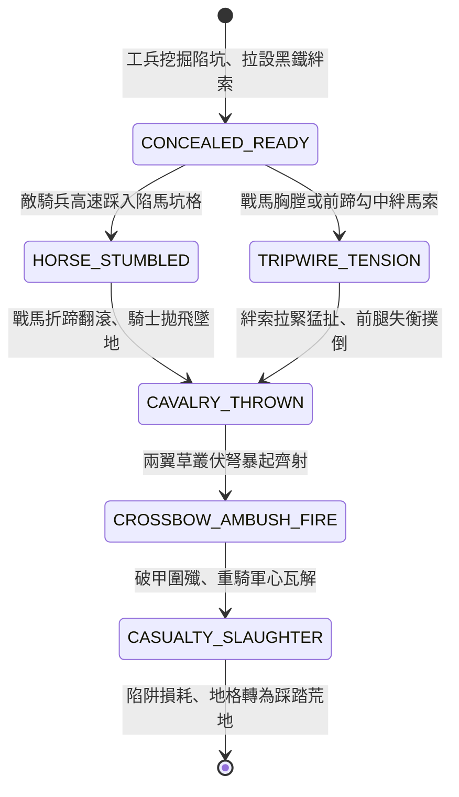

<!-- doc_id: doc_spec_0799 -->
# 3KLife 地穴暗坑落馬伏弩與連環絆馬索伏擊騎兵狀態機規格書

## 模組基本資訊
- **模組代號**：`CAVALRY-PIT-TRIPWIRE01`
- **系統定位**：三國反騎兵戰術陷阱與多層伏擊系統，負責陷馬坑掘設、連環生鐵絆馬索隱蔽、戰馬踏空折蹄骨折與兩側伏弩圍殲之完整狀態轉移。
- **架構依賴**：`BattleGridSystem`、`TroopTypeMovement`、`AmbushCombatController`、`VFXBlockRegistry`。

---

## 核心設計概念
三國時期步兵對陣北方精銳重騎（如虎豹騎、西涼鐵騎），單純正面肉搏極度劣勢。名將常於草叢荒野預先佈設雙重反騎陷阱：地面挖掘碗口粗細、深約尺餘之「梅花陷馬坑」，坑底插削尖竹籤；坑前低矮處橫拉浸黑生鐵「連環絆馬索」。當騎兵高速奔馳衝陣時，馬蹄踏空或被絆索猛烈拉扯，戰馬瞬間前滾折蹄，將重甲騎士甩飛拋落。兩翼預先埋伏之強弩手隨即引弦齊射，全殲陷陣騎兵。



---

## 狀態機定義與轉換條件

### 1. `CONCEALED_READY`（偽裝隱蔽警戒狀態）
- **進入條件**：己方工兵或斥候於平原、草地或林地地格設置「反騎陷坑矩陣」。
- **行為表現**：
  - 覆蓋枯草與浮土，隱蔽值為 85%（步兵緩步前進有 40% 機率識破）。
  - 對步兵部隊僅造成輕微絆腳（扣 1 點移動力），專門針對移速 >= 4 的騎兵兵種。
- **轉換**：敵方騎兵單位以衝鋒狀態踩入地格 -> 轉移至 `HORSE_STUMBLED` 或 `TRIPWIRE_TENSION`。

### 2. `HORSE_STUMBLED` / `TRIPWIRE_TENSION`（踏空被絆狀態）
- **行為表現**：
  - **陷馬坑**：馬前蹄踏入坑穴，強大慣性瞬間折斷馬骨；戰馬悲鳴側翻。
  - **絆馬索**：生鐵黑索受力拉緊至極限，猛扯雙前腿，形成向前空翻。
- **轉換**：動能失衡完成（延遲 0.3 秒） -> 轉移至 `CAVALRY_THROWN`。

### 3. `CAVALRY_THROWN`（落馬震昏破甲狀態）
- **行為表現**：
  - 騎兵隊伍直接強制中斷衝鋒，全隊移動力歸零並陷入「倒地失衡」（持續 1 回合無法反擊）。
  - 重甲騎士墜地受鈍擊傷害 300~500 點，防禦力驟降 50%。
- **轉換**：相鄰兩翼 2 格內存在隱蔽己方弓弩部隊 -> 轉移至 `CROSSBOW_AMBUSH_FIRE`。

### 4. `CROSSBOW_AMBUSH_FIRE`（伏弩暴起圍射狀態）
- **行為表現**：
  - 兩側埋伏之弩手現身，獲得「伏擊暴擊」加成（暴擊率 +60%，穿透防禦 +40%）。
  - 對倒地無防禦騎兵發動 2 輪近距離急射，造成大量傷亡。
- **轉換**：射擊結算完畢 -> 轉移至 `CASUALTY_SLAUGHTER`。

### 5. `CASUALTY_SLAUGHTER`（殲滅潰散狀態）
- **行為表現**：
  - 敵騎兵部隊兵力損失 60% 以上，士氣強制扣除 40 點，高機率陷入「潰散逃亡」。
  - 陷阱繩索斷裂、地穴被踩平，地格轉為常態平地。
- **轉換**：戰場狀態結算完成 -> 結束退出。

---

## 數值公式與配置契約

```typescript
export interface CavalryTrapConfig {
  trapId: string;
  trapType: 'HORSE_PIT' | 'TRIPWIRE' | 'PIT_AND_WIRE_COMBO';
  stealthConcealmentRate: number; // 隱蔽係數 (0.0 ~ 1.0)
  cavalryDismountChance: number;  // 導致騎兵墜馬倒地機率 (0.0 ~ 1.0)
  fallImpactDamage: number;       // 墜地鈍擊基礎傷害
  defenseDebuffPercent: number;   // 倒地後防禦削弱百分比 (0.0 ~ 1.0)
  ambushCritRateBonus: number;    // 兩翼伏兵暴擊加成
  infantryTriggerChance: number;  // 步兵誤踩觸發率 (步兵不受重傷)
}

export const CAVALRY_TRAP_PRESETS: Record<string, CavalryTrapConfig> = {
  MEIHUA_PIT_FIELD: {
    trapId: 'TRAP_PIT_01',
    trapType: 'HORSE_PIT',
    stealthConcealmentRate: 0.88,
    cavalryDismountChance: 0.95,
    fallImpactDamage: 450,
    defenseDebuffPercent: 0.50,
    ambushCritRateBonus: 0.60,
    infantryTriggerChance: 0.15,
  },
  IRON_TRIPWIRE_CHAIN: {
    trapId: 'TRAP_WIRE_01',
    trapType: 'TRIPWIRE',
    stealthConcealmentRate: 0.80,
    cavalryDismountChance: 0.85,
    fallImpactDamage: 320,
    defenseDebuffPercent: 0.40,
    ambushCritRateBonus: 0.45,
    infantryTriggerChance: 0.05,
  }
};
```

---

## 單元測試與驗收標準
1. **兵種觸發差異化**：一般輕步兵行經陷坑地格，有 85% 機率安全通過，僅微幅扣除 1 點行動力；騎兵兵種以速度 >= 4 衝鋒經過必定觸發墜馬。
2. **倒地防禦削弱**：被絆倒之騎兵單位在接下來 1 個回合內，物理防禦強制扣減 50%，受遠程箭矢傷害顯著暴增。
3. **伏擊連動齊射**：當相鄰存在待命伏弩單位時，狀態機自動由 `CAVALRY_THROWN` 驅動 `CROSSBOW_AMBUSH_FIRE` 產生連續兩輪高暴擊射擊。
