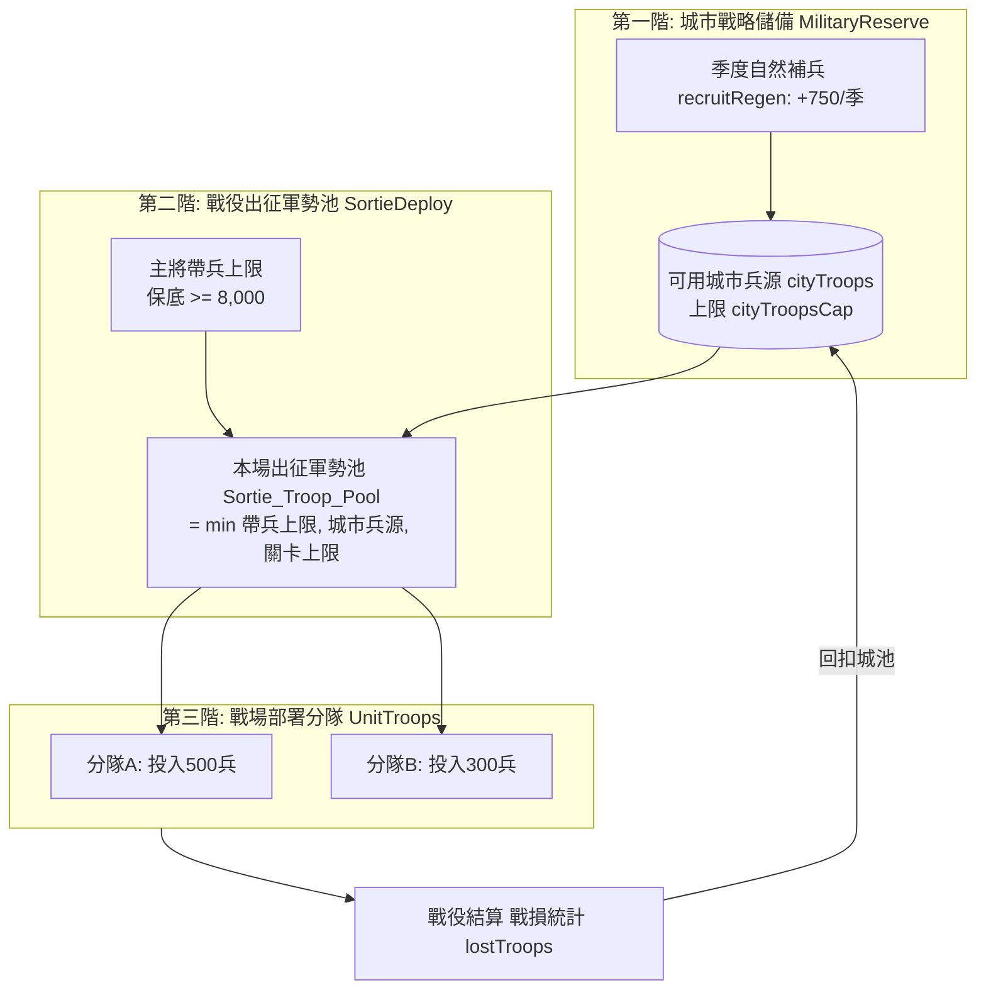

<!-- doc_id: doc_spec_0502 -->
<!-- spec_id: GOV-03 -->
# 城市兵源儲備上限與季度自然補兵速度規格書

> 標籤：`系統規格` `領地治理` `軍事儲備` `城市兵源` `GOV-03`
> 狀態：`正式生效` · 責任模組：`MilitaryReserve` · 參照：`GOV-03` / `PROG-2-1010` / `doc_spec_0040`

---

## 1. 模組定位與設計理念

在三國全動態戰役與領地生態中，「兵力」並非抽象數字，而是具有物理消耗、休養生息與編制約束的完整資源鏈條。
本規格書定義玩家主城之「城市兵源儲備與補兵再生系統」（`MilitaryReserve.ts` 與 `SortieDeploy.ts`），確立以下原則：
1. **三階兵源鏈條（Three-Tier Troop Pipeline）**：確立「城市兵源 $\to$ 出征軍勢池 $\to$ 戰場分隊」的層級管束，杜絕憑空暴兵。
2. **新手體驗雙重保底**：開局城市兵源與初期關卡帶兵上限皆設有最低保底（8,000 ~ 10,000），防止新手戰略猝死。
3. **季度自然休養回補（Regen Model）**：城市兵源每季依固定速度自然徵集回補，不依賴逐場點擊徵兵，減輕重複操作負擔。
4. **戰損實時回扣與上限統一管理**：戰役實際死傷精準回扣至城池儲備，總上限受領地太守府規模（`ResourceCap`）集中管束。

---

## 2. 三階兵源鏈條運作體系

---

## 3. 核心數值與初期保底配置

依據數值架構 E-15 與覆寫裁定，核心基準參數規範如下：

| 參數代碼 | 參數中文名稱 | 基準配置值 | 設計原則與功能說明 |
|---|---|:---:|---|
| `DEFAULT_CITY_TROOPS` | 新手初始城市兵源 | **10,000** | 新建存檔初始兵力，取數值模型上緣 |
| `COMMAND_CAPACITY_FLOOR` | 出征軍勢池最低保底 | **8,000** | 無論主將將階多低，出征上限保底不低於 8,000（覆寫裁定 #7） |
| `DEFAULT_RECRUIT_REGEN` | 季度基礎補兵速度 | **750 / 季** | 每季（每回合）領地自然休養補充之生力軍 |
| `FOOD_PER_SEASON` | 季度基礎軍糧補給 | **150 / 季** | 每季固定撥補之軍糧儲備，可乘季節氣候倍率 |
| `DEFAULT_STAGE_SORTIE_CAP`| 關卡預設軍勢上限 | **8,000** | 一般常規戰鬥關卡的出征兵力規模限制 |

---

## 4. 戰損回扣與自然補兵狀態推進

### 4.1 戰後實時回扣 (`applySortieResult`)
戰役結束時，戰場指揮系統匯總本場兵力折損與軍糧消耗，原子寫回城池儲備：
$$\text{cityTroops}_{new} = \max(0, \text{cityTroops}_{old} - \lfloor \text{summary.lostTroops} \rfloor)$$
$$\text{food}_{new} = \max(0, \text{food}_{old} - \lfloor \text{summary.foodSpent} \rfloor)$$
未陣亡的生還部隊自動隨軍班師回朝，不重複扣減城市總兵力。

### 4.2 季度自然休養推進 (`regenMilitaryOneSeason`)
當大世界時間推進 $N$ 季時，城池兵馬糧餉自然回補，上限受 `cityTroopsCap` 截斷：
$$\text{cityTroops}_{after} = \min(\text{cityTroopsCap}, \text{cityTroops} + \text{recruitRegen} \times N)$$
$$\text{food}_{after} = \min(\text{foodCap}, \text{food} + \lfloor \text{FOOD\_PER\_SEASON} \times N \times \text{foodMultiplier} \rfloor)$$

---

## 5. 存檔規格化與容錯防禦 (normalizeMilitaryReserve)

1. **上限規則解耦**：
   存檔中即便殘留歷史舊上限數值，讀檔時一律強制以 `ResourceCap`（全域城池上限）為準（`cityTroopsCap = DEFAULT_CITY_TROOPS_CAP`）。
2. **防禦性截斷**：
   目前兵力與糧草不得大於最新上限值，負數或非法浮點數強制退回預設起始值。
3. **戰鬥出征池計算約束**：
   $$\text{computeSortiePoolMax} = \min(\text{commandCapacity}, \text{cityTroops}, \text{stageSortieCap})$$
   任何一項資源見底皆自動限制本場可出動的最大部隊總數。
