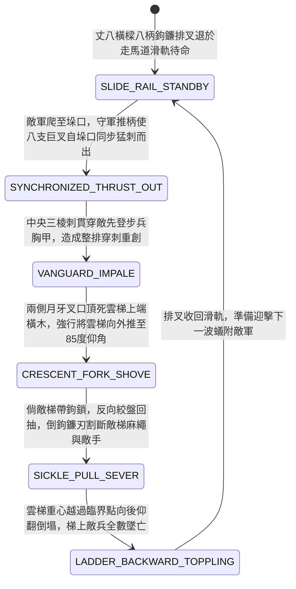

<!-- doc_id: doc_spec_0957 -->
# 城防城牆內側絞盤牽引生鐵鉤鐮排叉橫推刺穿敵軍攻城雲梯先鋒狀態機規格書

> **文件編號**：`doc_spec_0957`
> **模組代碼**：`WALL-HOOK-SICKLE-FORK-ARRAY-PUSH01`
> **對應 WBS**：`FORM-176`（M7 戰場進階機關、城防排叉推刺與精銳步兵丈八蛇矛）
> **單一真相來源（SSOT）**：本文件直接定義城牆內側絞盤牽引生鐵鉤鐮排叉橫推刺穿敵軍雲梯先鋒之完整物理與戰鬥狀態機，嚴禁於檔尾附加補丁。

---

## 一、 戰術定位與歷史工程原型

在守城戰中，當敵軍同時間在一段城牆架起數架竹木雲梯、數十名先登步兵魚貫蟻附而上時，單根推竿（叉竿）往往因力量分散而被敵軍死士合力抓住奪走。**城牆內側絞盤牽引生鐵鉤鐮排叉（Wall-Mounted Winch-Driven Hook-Sickle Fork Array）** 為守城方將多根長叉連動化的「排式機械刺推防禦武器」：
1. **丈八橫樑連排生鐵雙刃叉**：於走馬道內側滑軌架設一根長一丈八尺的粗柞木橫樑，橫樑正面每隔二尺垂直鑲嵌一柄長一丈二尺的「生鐵三叉鉤鐮槍（中間為透甲三棱刺，兩側為向外張開的月牙推叉與向內彎曲的倒鉤鐮刃）」，整排共計八柄巨叉同步連動。
2. **前推貫穿與架空雲梯**：當敵軍先登隊伍爬至女牆垛口時，四名守軍推動滑軌橫樑（或搖動前推絞盤），八柄生鐵三叉槍同時從八個垛口孔洞猛烈向前平刺而出，瞬間將扒在牆頭的整排敵兵串刺貫穿，並以月牙叉口死死頂住雲梯橫檔，將雲梯向牆外強行推離五尺懸空。
3. **絞盤回拉鉤割梯索**：若敵軍雲梯裝有抓牆鐵鉤，守軍隨即反向搖動後拉絞盤，叉頭內側的鋒利倒鉤鐮刃會在回抽瞬間割斷敵軍固定雲梯的麻繩與敵兵雙手，使失去支撐的雲梯向後仰翻倒塌。

---

## 二、 觸發條件與城防建造參數

| 參數項目 | 規格數值與限制條件 | 備註說明 |
| :--- | :--- | :--- |
| **部署位置限制** | 城牆「標準女牆段（直線連續 `2 格` 寬城牆）」 | 需架設於平整走馬道滑軌上，可防禦正前方 `2 格` 寬牆面 |
| **建造資源消耗** | 生鐵 110、硬木 90、滑軌絞盤 50、城防工事點 30 | 可無限次前後推拉使用（無彈藥限制） |
| **作用對象** | 正對該段城牆架設之「雲梯 / 竹梯 / 攀牆步兵」 | 對遠處地面部隊與大型蒙衝呂公車本體無效 |
| **排叉耐久（HP）** | `1,200` 點（生鐵叉頭免疫刀劍劈砍，僅受重錘或投石損耗） | 屬於半掩體內操作機關，守軍承受遠程傷害 `-65%` |

---

## 三、 核心狀態機（State Machine）

---

## 四、 數值結算與戰鬥公式

### 1. 排叉同步平刺與貫穿傷害（Synchronized Array Impale）
當敵方部隊透過雲梯攀爬至裝有鉤鐮排叉的城牆段時，守軍觸發 `SYNCHRONIZED_THRUST_OUT`：
- **整排必中穿刺**：八柄巨叉同時封死所有垛口，敵方攀爬步兵無法閃避（命中率 `100%`），承受高破甲穿刺傷害：
  $$\text{Damage}_{\text{fork}} = \text{BaseATK}_{\text{garrison}} \times 2.10 \times \left(1 - \text{TargetDEF} \times 0.50\right)$$
- **禁登阻絕（Climbing Denial）**：被排叉刺中的敵軍無法踏上城頭格，強制退回「雲梯半途懸掛態（`MID_LADDER_STALLED`）」。

### 2. 推翻雲梯與回抽割繩（Ladder Topple & Sickle Sever）
- **雙階段破梯判定**：
  1. 若敵軍使用「普通木竹雲梯」，月牙排叉向外猛推直接以 `100%` 機率將雲梯推過重心臨界角（$>85^\circ$），觸發 `LADDER_BACKWARD_TOPPLING`（雲梯向後仰翻砸地粉碎，梯上敵軍追加 `120%` 墜地摔傷）。
  2. 若敵軍使用「帶抓牆鐵鉤之重型雲梯」，排叉自動接續第二動 `SICKLE_PULL_SEVER`（回抽割斷鐵鉤綁繩並割傷敵兵雙手，附加每回合 `6%` 流血，並使重型雲梯耐久直接扣除 `65%`）。

---

## 五、 反制手段與戰術克制

1. **雙手長柄鏈子錘 / 抓子棒絞鎖排叉**：若敵軍先登死士手持長柄抓子棒（`doc_spec_0937`）或鏈子錘（`doc_spec_0946`），可在排叉刺出瞬間纏住鐵叉橫樑，使守軍絞盤卡死 `1 回合` 無法收回。
2. **雙馬絞盤火龍彈車拋射城頭**：若攻城方先以火龍彈車（`doc_spec_0935`）將松脂火球拋入走馬道，木製滑軌橫樑燒毀後排叉將解體散落。

---

## 六、 驗收測試案例（Acceptance Tests）

| 測試案例 ID | 測試情境與輸入條件 | 預期狀態轉移與數值輸出 |
| :--- | :--- | :--- |
| **TC-FORK-01** | 敵方 2 隊步兵架設普通木雲梯同時攀至該段 2 格寬城牆頂端 | 八柄排叉同步刺出，100% 命中無視 50% 防禦造成 210% 穿刺傷，並 100% 推翻普通木梯 |
| **TC-FORK-02** | 敵方架設「鐵鉤重型雲梯」防推，排叉觸發回抽割繩 | 轉入 `SICKLE_PULL_SEVER`，割傷敵兵附加每回合 6% 流血，重型雲梯扣除 65% 耐久且敵兵無法登城 |
| **TC-FORK-03** | 敵方火龍彈車將松脂火球拋上城頭燒毀滑軌橫樑 | 排叉橫樑耐久歸零解體，八柄巨叉失去連動推力 |
