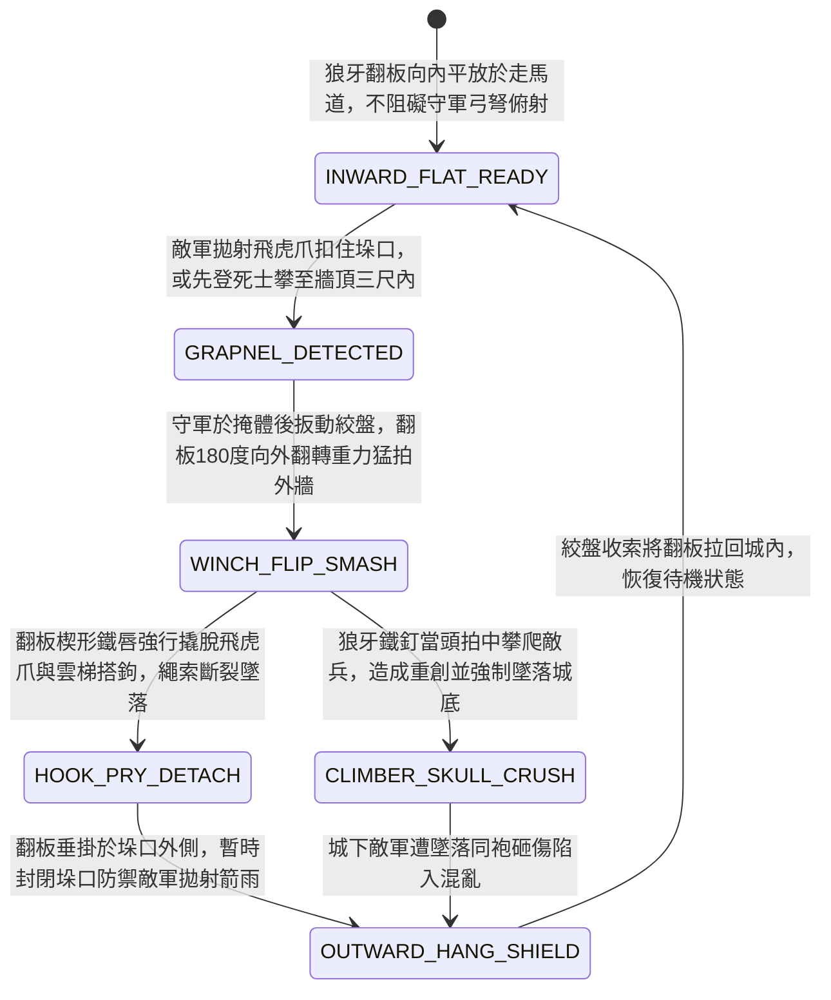

<!-- doc_id: doc_spec_0951 -->
# 城防城牆垛口內側絞盤牽引生鐵狼牙翻板拍落敵軍飛爪與攀城死士狀態機規格書

> **文件編號**：`doc_spec_0951`
> **模組代碼**：`CRENEL-WOLF-TOOTH-FLAP-GRAPNEL-CLEAR01`
> **對應 WBS**：`FORM-170`（M7 戰場進階機關、城防垛口狼牙翻板與精銳步兵開山大鉞）
> **單一真相來源（SSOT）**：本文件直接定義城牆垛口生鐵狼牙翻板拍落飛爪與攀城死士之完整物理與戰鬥狀態機，嚴禁於檔尾附加補丁。

---

## 一、 戰術定位與歷史工程原型

在山地攻城或夜間奇襲戰中，敵軍常派「飛虎爪死士（`doc_spec_0870`）」或架設竹梯，將四爪飛鉤拋扣於城牆垛口（雉堞）順繩攀登。若守軍探頭砍繩極易遭城下神射手狙殺。**城牆垛口內側絞盤牽引生鐵狼牙翻板（Crenel Wolf-Tooth Hinged Flap）** 為專克「飛爪攀牆與雲梯搭扣」的機械反制裝甲：
1. **垛口底檻轉軸與生鐵狼牙板**：於女牆垛口下緣預埋熟鐵轉軸，連接厚三寸、包鐵皮並密布三寸倒刺狼牙釘的柞木重翻板（平時向內平放於走馬道，不擋守軍射界）。
2. **絞盤猛拉一百八十度外翻下拍**：當飛虎爪扣住垛口或死士將爬至牆頂時，守軍於掩體後扳動棘輪絞盤，狼牙翻板瞬間向上呈 $180^\circ$ 向牆外重力猛拍而下。
3. **震脫飛爪與貫穿拍落**：翻板扣擊外牆瞬間，前端楔形鐵唇強行撬脫垛口飛虎爪與雲梯鐵鉤，同時板面生鐵狼牙釘當頭拍碎攀爬至牆頂的敵兵頭顱使其墜城。

---

## 二、 觸發條件與城防建造參數

| 參數項目 | 規格數值與限制條件 | 備註說明 |
| :--- | :--- | :--- |
| **部署位置限制** | 城牆全線「女牆垛口格（Crenel Tiles）」皆可加裝 | 屬於被動待發與主動清障雙用城防組件 |
| **建造資源消耗** | 硬木 75、生鐵狼牙釘 85、熟鐵轉軸 40、城防工事點 25 | 絞盤拉回即可重複使用，每回合最多觸發 1 次 |
| **作用範圍** | 正對該段城牆外牆面的「攀爬中單位 / 飛虎爪繩索 / 雲梯頂端」 | 守軍操作時處於全掩體保護，免疫城下遠程狙擊 |
| **翻板耐久（HP）** | `1,150` 點（外翻垂掛於牆外時，可兼作外牆護甲抵擋投石） | 對普通刀劍與飛爪完全免疫損耗 |

---

## 三、 核心狀態機（State Machine）

---

## 四、 數值結算與戰鬥公式

### 1. 飛爪撬脫與攀爬強制中斷（Grapnel Pry & Climb Abort）
當敵方單位對裝有狼牙翻板的城牆格施放「飛虎爪攀登（`GRAPPLING_HOOK_CLIMB`）」或架設「普通竹雲梯」時，立即觸發 `WINCH_FLIP_SMASH`：
- **100% 撬脫飛爪**：翻板外翻的楔形鐵唇直接切斷或撬開飛爪，使敵方 `GRAPPLING_HOOK_CLIMB` 狀態 `100%` 強制失敗，該技能直接進入冷卻且不返還戰技點（EP）。
- **守軍零暴露操作**：觸發此機關時，城頭守軍視為處於 `FULL_COVER`（全掩護）狀態，不會觸發城下敵方弓弩手的「掩護射擊（Overwatch）」。

### 2. 狼牙當頭拍擊與墜落疊壓傷害（Wolf-Tooth Smash & Fall Damage）
正在牆面攀爬的敵軍遭狼牙翻板外翻拍中時，承受「狼牙穿刺」與「高空墜落」雙重傷害：
$$\text{Damage}_{\text{total}} = \text{BaseATK}_{\text{garrison}} \times 1.90 + \text{WallHeightMeters} \times 28$$
- **顱骨重創與流血**：生鐵狼牙釘無視敵軍頭盔 `40%` 護甲，附加 `WOLF_TOOTH_CONCUSSION`（眩暈 `1 回合` 並每回合流失 `6%` 兵力，持續 2 回合）。
- **城底墜落砸傷**：墜落城下的敵兵會砸中牆根正下方的後續排隊敵軍，對牆根格敵軍造成 `85% ATK` 的連帶鈍擊傷害並使其移動力下降 `50%`。

---

## 五、 反制手段與戰術克制

1. **臨衝呂公車（攻城高樓）跨牆壓制**：臨衝高樓（`doc_spec_0843`）高度高於女牆垛口，其頂層搭板由上往下砸落，會直接將狼牙翻板死死壓在垛口上使其無法外翻。
2. **重型投石機粉碎垛口**：若攻城方先以重型投石機轟塌女牆雉堞，固定於垛口底檻的翻板轉軸將隨磚石一同崩毀失效。

---

## 六、 驗收測試案例（Acceptance Tests）

| 測試案例 ID | 測試情境與輸入條件 | 預期狀態轉移與數值輸出 |
| :--- | :--- | :--- |
| **TC-FLAP-01** | 敵方山地先登死士拋出飛虎爪扣住裝有狼牙翻板之城牆格並開始攀爬 | 觸發 `HOOK_PRY_DETACH`，100% 撬脫飛爪中斷攀爬，守軍全程不承受城下弓弩掩護射擊 |
| **TC-FLAP-02** | 攀爬至 10 米高牆頂的敵兵遭狼牙翻板當頭拍中墜落 | 承受 $1.90 \times \text{ATK} + 280$ 點複合傷害，附加眩暈 1 回合與流血，並砸傷牆根後續敵軍 |
| **TC-FLAP-03** | 敵方推來五層「臨衝高樓」貼近城牆並放下頂層重吊橋 | 高樓吊橋由上往下壓死垛口，狼牙翻板被鎖定無法轉入 `WINCH_FLIP_SMASH` |
