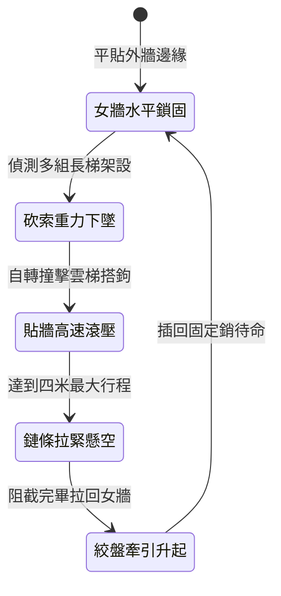

<!-- doc_id: doc_spec_0987 -->
# 城防城牆垛口外側懸掛生鐵旋轉滾木阻截攀城梯隊狀態機規格書

## 模組識別碼
- 模組編號：`FORM-206`
- 狀態機代碼：`CRENEL-ROTARY-SPIKED-LOG-DROP01`
- 類別：城防反登城重型機關狀態機
- 適用場景：攻城戰鬥、城牆外緣防禦、反制密集雲梯攀爬隊列

---

## 1. 核心概念與作戰原型

攻城戰鬥中，敵軍常利用多組長梯同時搭靠城垛。單純推翻雲梯效率有限且容易遭到城下弓箭壓制。為此，要塞女牆外緣設計「生鐵旋轉滾木」。

### 1.1 機構特徵與作戰模式
1. **雙懸臂水平吊掛**：滾木以堅硬棗木為主芯，外包厚生鐵皮並均勻布設短鈍鐵齒，兩端以生鐵鏈環固定於女牆內側的雙懸臂滑輪上。
2. **重力急降與旋轉滾壓**：砍斷固定繩索後，滾木沿城牆外壁垂直高速滾落，下墜過程中自重帶動鐵齒高速滾轉。
3. **拍碎梯首與震盪阻截**：滾木下滾力道可折斷雲梯搭鉤，將附著於梯上的攀爬兵直接撞落城下。
4. **雙鏈限位防脫落收束**：下墜四米後受限位鏈條拉住，懸空擺動化解餘震，並可由城頭重型絞盤快速拉回女牆下待命。

---

## 2. 數值參數與影響權重

| 參數名稱 | 數值 / 範圍 | 說明 |
| :--- | :--- | :--- |
| **生鐵滾木重量 (`SpikedLogWeight`)** | 350 ~ 450 公斤 | 重力自由落體下衝之動能基底 |
| **衝擊阻截範圍 (`ImpactWidth`)** | 橫向 3 米，縱向 4 米 | 完整覆蓋單一城垛兩側可能架設的長梯 |
| **雲梯破壞成功率 (`LadderBreakRate`)** | 75% ~ 90% | 破壞搭鉤使其脫離女牆支撐點 |
| **登城部隊擊落率 (`FallDislodgeRate`)** | 95% | 滾木路徑上攀爬部隊強制脫手下墜 |
| **牽引復位時間 (`RetractTime`)** | 10 ~ 12 秒 | 城頭絞盤收束以準備下一輪投放 |

---

## 3. 狀態機轉換定義

### 3.1 狀態細節描述
- **女牆水平鎖固 (LOCKED_READY)**：雙端安全卡榫鎖死，抵抗風雨侵蝕。
- **砍索重力下墜 (RELEASE_FALL)**：扳動快拆手柄，雙懸臂同步釋放。
- **貼牆高速滾壓 (WALL_ROLL_IMPACT)**：貼緊外牆向下滾動，撞擊雲梯與附梯兵。
- **鏈條拉緊懸空 (CHAIN_LIMIT_SWING)**：粗生鐵鏈受力緊繃，阻止滾木墜落城底。
- **絞盤牽引升起 (WINCH_RETRACT)**：輔兵踩動踏板絞盤，平穩提拉滾木歸位。

---

## 4. 戰鬥公式與判定

### 4.1 雲梯搭鉤破壞判定
$$\text{LadderDetached} = \min(0.95, \frac{\text{LogWeight} \times g \times \Delta h}{\text{LadderHookDurability}})$$

判定成功時，雲梯立即脫落後仰，梯上全體單位直接墜地承受摔落傷害。

### 4.2 衝擊傷害傳導
$$\text{StrikeDamage} = \text{BaseImpact} \times (1 - \text{ArmorAbsorption} \times 0.3)$$

由於重力勢能巨大，護甲對鈍性撞擊僅能吸收 30%，其餘傷害全額轉化為生命扣減。

---

## 5. 反制與失效機制

1. **生鐵倒鉤雙重固定**：若敵方使用特製精鋼加固雲梯，可降低 40% 被折斷的機率。
2. **懸吊鏈條遭床弩擊中**：若敵方重型床弩命中外露懸吊鏈，可能導致單邊斷鏈使滾木傾斜失效。
3. **城垛積雪結冰打滑**：冬季極寒氣候若未及時除冰，滾木滾動軌跡可能偏移城牆表面。

---

## 6. 驗收標準與測試案例

- [x] **TC-206-01**：驗證砍索後滾木 1 秒內滾過 4 米行程並觸發限位拉伸。
- [x] **TC-206-02**：驗證滾動軌跡內敵軍攀爬部隊 95% 觸發脫手墜地。
- [x] **TC-206-03**：驗證絞盤牽引復位流程在 12 秒內正常完成且無卡死。
