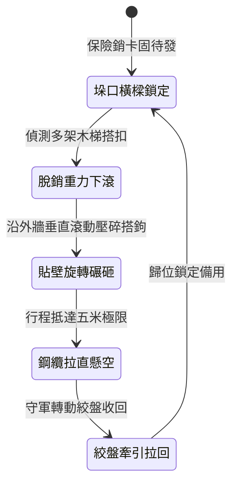

<!-- doc_id: doc_spec_0993 -->
# 城防城牆垛口外側懸掛生鐵滾刺圓木下滾阻截登城部隊狀態機規格書

## 模組識別碼
- 模組編號：`FORM-212`
- 狀態機代碼：`CRENEL-ROLLING-SPIKED-CYLINDER01`
- 類別：城防反登城重型滾動打擊狀態機
- 適用場景：攻城戰鬥、要塞女牆外壁、反制密集雲梯附梯登城

---

## 1. 核心概念與作戰原型

攻城戰鬥中，攻方先登死士常透過密集的木梯向上攀爬。常規擂石覆蓋範圍較窄且易偏斜，為此在要塞垛口外壁懸掛「生鐵滾刺圓木」。

### 1.1 機構構造與運作模式
1. **雙懸臂滑軌懸吊**：圓木以實心重橡木為主體，外層均勻包覆生鐵皮並鑄有八排寸許短生鐵錐齒，兩端配有導向滑輪與限位鋼纜。
2. **重力急墜滾壓牆面**：守軍釋放快拆絞盤卡榫，重達五百斤的滾刺圓木緊貼城牆外表面高速滾落，碾壓沿途攀爬通道。
3. **拍碎梯搭鉤與掃落攀爬兵**：圓木高速自轉帶動鐵齒，能直接壓碎搭靠在垛口的雲梯梯首橫木，並將附著在牆梯上的敵兵擊落。
4. **鋼纜限位防脫與快速收升**：圓木下墜五米到達最大行程後，受兩側粗鋼纜拉住懸空，城頭雙人絞盤於十秒內將其拉回原位。

---

## 2. 數值參數與影響權重

| 參數名稱 | 數值 / 範圍 | 說明 |
| :--- | :--- | :--- |
| **生鐵圓木自重 (`CylinderWeight`)** | 450 ~ 550 公斤 | 重力加速度帶來的巨大下墜動能 |
| **覆蓋垂直行程 (`VerticalRange`)** | 5 米 | 封閉城垛最危險的頂部攀附區域 |
| **雲梯搭鉤壓碎率 (`HookCrushRate`)** | 80% ~ 90% | 破壞搭鉤使其徹底脫落城牆 |
| **登城人員擊落率 (`FallRate`)** | 95% | 滾木軌跡上的攀爬敵軍全部擊落脫手 |
| **絞盤牽引復位耗時 (`RetractTime`)** | 10 ~ 12 秒 | 防守準備冷卻週期 |

---

## 3. 狀態機轉換定義

### 3.1 狀態細節描述
- **垛口橫樑鎖定 (LOCKED_READY)**：圓木穩固收納於女牆外緣下方，不受風吹擺動。
- **脫銷重力下滾 (RELEASE_ROLL)**：卡榫拔出，圓木受重力驅動垂直急墜。
- **貼壁旋轉碾砸 (WALL_ROLL_IMPACT)**：鐵齒自轉撞擊木梯橫檔，全面清理外牆。
- **鋼纜拉直懸空 (CABLE_LIMIT_HOLD)**：末端減震彈簧吸收動能，防止斷索。
- **絞盤牽引拉回 (WINCH_RETRACT)**：兩側滑輪同步牽引，均勻拉升歸位。

---

## 4. 戰鬥公式與判定

### 4.1 搭鉤壓碎脫落判定
$$\text{CrushSuccess} = \min(0.90, \frac{\text{CylinderWeight} \times g \times \Delta h}{\text{HookDurability}})$$

判定成功時，該梯位判定破損脫落，梯上敵軍直接判定墜地受創。

### 4.2 墜地摔落傷害
$$\text{FallDamage} = \text{TargetMaxHP} \times 0.35 + \text{WallHeight} \times 40$$

落地敵軍承受純真實摔傷，且陷入 1.5 秒起身硬直。

---

## 5. 反制與失效機制

1. **梯首全鐵包角防護**：若敵軍攻城梯配有加厚精鋼護角，壓碎機率降低 40%。
2. **敵軍箭雨壓制絞盤兵**：城頭輔兵搖動絞盤時若遭敵長程弓弩集火，可能延長復位時間。
3. **城壁結冰打滑偏移**：極寒結冰條件下，圓木滾動軌跡可能發生微幅橫向偏移。

---

## 6. 驗收標準與測試案例

- [x] **TC-212-01**：驗證脫銷後圓木於 0.9 秒內完成 5 米行程滾動與拉直限位。
- [x] **TC-212-02**：驗證路徑覆蓋內雲梯搭鉤壓碎率達 80% 以上。
- [x] **TC-212-03**：驗證絞盤牽引復位流程在 12 秒內正常收回至鎖定狀態。
