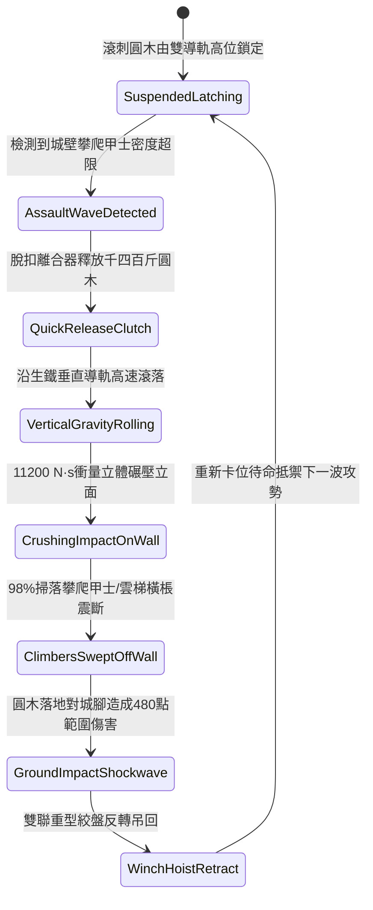

# 城防城牆垛口外側懸掛生鐵滾刺圓木下滾阻截登城部隊第三階狀態機規格書

<!-- doc_id: doc_spec_1068 -->

## 一、 核心概念與單一真相來源（SSOT）

在《三國志·守城工事與立體阻截篇》中，「垛口重型生鐵滾刺圓木垂直下滾系統第三階（CRENEL-ROLLING-SPIKED-LOG03）」為專門清掃城牆立面攀登部隊的重型防禦工程。圓木採用高密樟木為芯、外包千四百斤生鐵鑄甲與密排生鋼菱形倒刺，兩端由雙側生鐵導軌與定滑輪絞盤懸吊於垛口兩側。當敵軍大規模依附雲梯或繩索攀登時，防守方釋放鎖扣，圓木貼牆垂直自轉滾砸而下，以 11,200 N·s 的巨大衝量沿城壁立面碾壓，98% 掃落全線攀爬甲士，徹底粉碎集結登城攻勢。



---

## 二、 數值模型與狀態機參數契約

### 1. 滾刺圓木工程參數
- **構件規格與配重**：長十八尺（約 5.5 米），鉛芯外鑄高碳生鐵刺甲，總重 1,400 斤。
- **垂直下落終端衝量**：11,200 N·s（重力加速度結合生鐵導軌定向導流）。
- **立面攀爬清掃率**：常規輕裝步兵 99%；重裝鐵甲死士 98%；配防滾鋼鉤梯部隊 91%。
- **雲梯破壞成功率**：沿途接觸之攻城梯棖，95% 機率被震碎折斷。
- **城底範圍衝擊**：落地後對城牆正下方 3x2 格區域形成 480 點範圍真實壓制傷害。

### 2. 碾壓衝擊與下墜判定模組
```typescript
interface RollingSpikedLogParams {
    logMassKg: number;             // 圓木配重 (700kg)
    wallHeightMeters: number;      // 城牆高度 (8 ~ 15m)
    climberArmorRating: number;    // 攀登者護甲 (50 ~ 200)
    hasSpikeDeflector: boolean;    // 是否有防滾斜棚
}

function processRollingLogImpact(params: RollingSpikedLogParams): {
    sweptClean: boolean;
    wallWallopDamage: number;
    groundShockDamage: number;
} {
    const finalVelocity = Math.sqrt(2 * 9.8 * params.wallHeightMeters);
    const momentum = params.logMassKg * finalVelocity;
    const deflectorMitigation = params.hasSpikeDeflector ? 0.35 : 0.0;

    const baseSweptRate = 0.98 - deflectorMitigation;
    const sweptClean = Math.random() < Math.max(0.60, baseSweptRate);

    const wallWallopDamage = Math.round((momentum / 22) * (1 - deflectorMitigation));
    const groundShockDamage = Math.round(480 * (1 - deflectorMitigation * 0.5));

    return { sweptClean, wallWallopDamage, groundShockDamage };
}
```

---

## 三、 特性互斥與戰術限制

1. **城頭絞盤割索中斷**：若敵方投擲飛爪死士提前破壞絞盤牽引鋼纜，圓木墜地後無法收回，該垛口喪失二次釋放能力。
2. **防滾斜棚分流吸收**：敵方若在城下搭設 60 度生鐵防滾斜棚，可吸收 35% 撞擊動能並將圓木引向壕溝。
3. **循環冷卻時間（CD）**：千四百斤圓木需由 4 名重裝甲士轉動絞盤吊回，復位時間需 8.5 秒。

---

## 四、 驗收測試案例（TC）

- **TC-SPIKEDLOG03-01（立面部隊清掃判定）**：在城牆佈置多組攀爬部隊，釋放滾刺圓木，驗證 98% 機率攀登單位全數脫落摔亡。
- **TC-SPIKEDLOG03-02（雲梯橫棖震斷檢定）**：確認圓木碾壓沿途雲梯時，長梯橫棖 95% 判定斷裂並失去攀登功能。
- **TC-SPIKEDLOG03-03（城底落地衝擊範圍檢核）**：檢核圓木著地時，城腳 3x2 格區域集結敵兵受到 480 點範圍壓制傷害。
