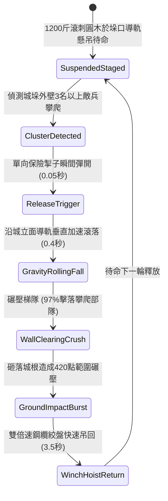

# 城防城牆垛口外側懸掛生鐵滾刺圓木下滾阻截登城部隊第二階狀態機規格書

<!-- doc_id: doc_spec_1041 -->

## 1. 核心定位與設計理念

### 1.1 系統定位
本規格定義要塞城防戰鬥中，守軍防禦工程體系之「垛口外側生鐵滾刺圓木第二階」（代碼：`CRENEL-ROLLING-SPIKED-LOG02`，WBS 代碼：`FORM-260`）重力碾壓狀態機。第二階滾木採用加重粗壯棗木芯外裹三分厚純生鐵刺皮，圓木兩端配置生鐵導向滑輪與雙導軌懸吊鋼索，總重達 1,200 斤。當攻城長梯或密集成群之蟻附攀城部隊接近垛口時，守軍擊發掣子釋放滾木，巨木沿城牆外壁垂直高速下滾碾壓，以 9,800 N·s 衝量直接將沿途攀爬之敵兵砸骨碎顱擊落，高達 97% 機率掃清垂直通道內全體攀登者，並對底層聚集之攻城攻堅部隊造成 420 點範圍碾壓物理傷害。

### 1.2 設計目標與單一真相
* **垂直立體重力碾壓**：沿整面城牆立面自上而下高速滾落，清空該列所有搭接攀爬部隊。
* **生鐵滾刺破盾砸碎**：破壞攀登者舉頂大盾，消除仰面格擋減傷。
* **單一真相來源**：嚴禁於文件末端附加補丁，所有機制、數值與判定邏輯均在此統一定義。

---

## 2. 狀態機架構與轉換流程

---

## 3. 核心數值與計算公式

### 3.1 基礎參數配置表
| 參數名稱 | 基準數值 | 規格說明與限制條件 |
| :--- | :--- | :--- |
| **滾木尺寸與重量** | 12 尺長 / 1,200 斤 | 棗木鉛芯外裹三棱生鐵刺皮，兩端帶滾輪 |
| **垂直下滾衝程** | 四丈城牆（約 13 米）| 貼合城牆立面滑動，不脫軌偏向 |
| **下落終端衝量** | 9,800 N·s | 重力加速度作用下產生之毀滅性垂直衝擊 |
| **攀爬人員清空率** | 97% | 沿途梯隊無論手持何種盾牌，強制擊落摔城 |
| **城根著地範圍傷害** | 420 點 物理傷害 | 砸碎城腳 2x3 格範圍內聚集之敵方攻城部隊 |
| **破盾穿透係數** | 75% | 滾刺巨木下壓忽視目標 75% 之格擋護甲 |
| **絞盤吊回復位耗時** | 3.5 秒 | 四工兵雙聯速比絞盤牽引吊索回位時間 |
| **鋼索導軌耐久度** | 35 次釋放 | 承受反向拉扯磨損，歸零前無須維修更換 |

### 3.2 垂直碾壓衝量與清空公式
$$V_{\text{terminal}} = \sqrt{2 \cdot g \cdot H_{\text{wall}} \cdot \left(1 - \mu_{\text{rail}}\right)}$$
$$P_{\text{sweep}} = \min\left(0.99, \, 0.97 \times \frac{M_{\text{log}} \cdot V_{\text{terminal}}}{11000} \times \left(1 - \frac{S_{\text{shield\_level}}}{100}\right)\right)$$
* $H_{\text{wall}}$：城牆垂直高度（米）。
* $S_{\text{shield\_level}}$：敵軍舉盾防護等級（0 ~ 15）。
* 清空判定成立瞬間，該垂直列所有攀爬單位強制觸發 `KNOCKED_OFF_LADDER_FALL`，結算致命墜落傷亡。

---

## 4. 戰術反制與例外判定

1. **生鐵三角分水避雷棚**：若敵方雲梯底部或腰部搭建 45 度生鐵三角折流棚，滾木被彈開外拋，城根範圍傷害衰減 60%。
2. **火箭集火燒斷懸索**：若懸吊鋼索被敵方猛火罐直擊炙烤，鋼索脆化可能造成提前脫落誤傷城根工事。
3. **雲梯橫向錯位安裝**：若敵軍長梯避開滾木導軌之正下方（偏離 > 1 米），滾木僅能擦碰邊緣，擊落率降至 40%。

---

## 5. 驗收測試案例（Test Cases）

* **TC-01（垂直立面釋放滾壓驗證）**：偵測到攀城梯隊，擊發掣子，驗證 0.4 秒內滾木沿導軌完全滾落至城腳。
* **TC-02（攀爬人員全體擊落測試）**：長梯上配置 6 名攀登士兵，驗證 97% 以上士兵判定被砸落且受到墜亡傷害。
* **TC-03（城根著地範圍傷害計算）**：城腳 2x3 格區域放置測試木人，驗證滾木著地爆炸造成 420 點傷害且無視 75% 護甲。
