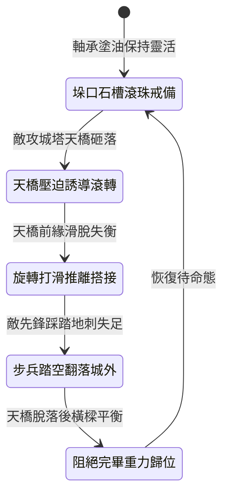

<!-- doc_id: doc_spec_1002 -->
# 城防城牆垛口外側懸掛生鐵滾動地刺橫樑阻截突入平台狀態機規格書

## 模組識別碼
- 模組編號：`FORM-221`
- 狀態機代碼：`CRENEL-ROTARY-SPIKED-BEAM01`
- 類別：城防要塞登城平台邊緣防禦狀態機
- 適用場景：要塞城防、女牆垛口邊緣、反制敵方攻城塔登城天橋搭接

---

## 1. 核心概念與作戰原型

攻城戰鬥中，敵軍巨型攻城塔靠近城牆後，常放下木質天橋搭接於垛口上方，供先鋒大隊直接突入。為破壞天橋搭接與阻截踩踏，垛口頂部特設「生鐵滾動地刺橫樑」。

### 1.1 機構構造與運作特點
1. **垛口頂槽轉軸佈局**：橫樑以整根沉重生鐵柱鑄造，長約八尺，表面密布四寸長尖銳生鐵倒刺，兩端嵌套於垛口兩側深石槽的滑動滾珠軸承內。
2. **重力與推力誘導自轉**：當敵軍攻城天橋砸上城垛時，天橋前緣搭在滾刺橫樑上；天橋前衝的摩擦力會誘發橫樑自由滾轉。
3. **打滑脫落破壞搭接**：高速滾動的橫樑使得天橋前緣無法咬死固定點，極易向外側滑脫落空，使突入通道直接崩解。
4. **地刺踏空破足防禦**：若敵軍步兵企圖踩踏橫樑強渡，滾轉地刺會使其瞬間踏空失衡，並刺破戰靴造成嚴重硬直。

---

## 2. 數值參數與影響權重

| 參數名稱 | 數值 / 範圍 | 說明 |
| :--- | :--- | :--- |
| **生鐵橫樑自重 (`BeamWeight`)** | 600 ~ 800 公斤 | 厚實生鐵柱具備承受重型天橋衝擊之強度 |
| **天橋搭接打滑率 (`BridgeSlipRate`)** | 75% ~ 88% | 破壞木質天橋在城垛上的受力支點 |
| **強制踏空失衡率 (`TumbleRate`)** | 90% | 企圖踩踏橫樑跨越之敵軍強制倒地 |
| **地刺穿透傷害 (`SpikePiercingDamage`)** | 450 ~ 650 點穿刺 | 刺破皮靴並造成移動速度降低 40% |
| **軸承維護耐久度 (`BearingDurability`)** | 可承受 5 次天橋猛砸 | 達到極限前保持完全平滑自轉 |

---

## 3. 狀態機轉換定義

### 3.1 狀態細節描述
- **垛口石槽滾珠戒備 (STOWED_BEARING)**：橫樑水平架於兩垛之間，滾珠靈活無阻。
- **天橋壓迫誘導滾轉 (PRESSURE_SPIN)**：受天橋下砸壓迫，生鐵橫樑受剪切力高速滾轉。
- **旋轉打滑推離搭接 (SLIP_DETACH)**：摩擦力歸零，天橋前緣向下滑脫脫離城頭。
- **步兵踏空翻落城外 (TUMBLE_FALL)**：先鋒死士失足踩入滾刺，被旋轉力道拋落城牆。
- **阻絕完畢重力歸位 (RESET_BALANCE)**：外力解除，偏心重錘使倒刺朝上復位。

---

## 4. 戰鬥公式與判定

### 4.1 天橋滑脫判定
$$\text{BridgeSlipSuccess} = \min(0.88, \frac{\text{ImpactForce}}{\text{BridgeFriction}} \times \text{RotarySmoothness})$$

判定成功時，攻城天橋前緣脫落墜下，攻城塔在 20 秒內無法重新架設天橋。

### 4.2 踩踏穿透傷害結算
$$\text{FootDamage} = \text{SpikePiercingDamage} \times (1 - \text{BootArmorRatio})$$

受創敵軍附加「斷筋破足」狀態，移動速度降低 40%，持續 8 秒。

---

## 5. 反制與失效機制

1. **生鐵凹槽防滑抱箍**：攻城方若在天橋前緣特製對扣鐵抱箍，可死死扣死橫樑阻止自轉。
2. **砂石大量傾倒卡軸**：若攻城塔預先向橫樑傾瀉大量黏土碎石，滾珠軸承可能被卡死。
3. **巨石直擊折斷石槽**：投石機若盲射命中垛口兩側深石槽，槽壁崩解將使橫樑脫軌。

---

## 6. 驗收標準與測試案例

- [x] **TC-221-01**：驗證承受天橋壓迫時，橫樑在 0.1 秒內流暢啟動自由滾轉。
- [x] **TC-221-02**：驗證天橋搭接滑脫率達到 75%~88% 預設區間。
- [x] **TC-221-03**：驗證強渡踩踏敵軍 90% 觸發踏空失衡與減速判定。
