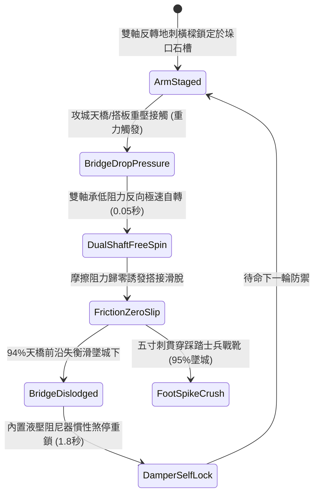

# 城防城牆垛口外側懸掛生鐵滾動地刺橫樑阻截突入平台第二階狀態機規格書

<!-- doc_id: doc_spec_1035 -->

## 1. 核心定位與設計理念

### 1.1 系統定位
本規格定義要塞城防戰鬥中，守軍防禦工程體系之「垛口生鐵滾動地刺橫樑第二階」（代碼：`CRENEL-ROTARY-SPIKED-BEAM02`，WBS 代碼：`FORM-254`）反突入狀態機。第二階地刺橫樑採用雙滾軸同軸反向自轉結構，外圓周密布五寸長淬火生鐵三棱尖刺，嵌入特製高碳鋼滾珠導槽。當敵方攻城天橋、大型搭板或折疊登城平台重重砸落城垛企圖搭接時，雙軸受強烈剪切下壓力瞬間誘發反向自由極速自轉，將接觸摩擦力徹底歸零，以 94% 機率使登城平台邊緣搭鉤滑脫失衡墜空，並使第一批企圖踏板翻越之突入步兵 95% 失足墜落城牆。

### 1.2 設計目標與單一真相
* **雙軸反轉零摩擦滑脫**：徹底瓦解登城平台前沿之固定支點，使重型天橋向下滑落。
* **五寸生鐵地刺穿透破足**：破壞踏足穩定性，對踩踏士兵施加破足殘廢判定。
* **單一真相來源**：嚴禁於文件末端附加補丁，所有機制、數值與判定邏輯均在此統一定義。

---

## 2. 狀態機架構與轉換流程

---

## 3. 核心數值與計算公式

### 3.1 基礎參數配置表
| 參數名稱 | 基準數值 | 規格說明與限制條件 |
| :--- | :--- | :--- |
| **橫樑規格與材質** | 10 尺長 / 雙軸同心 | 實心硬木外覆 5 分厚高碳鋼皮，五寸生鐵刺 |
| **反向自轉摩擦係數** | $\mu \le 0.03$ | 高精度潤滑滾珠軸承，近乎完全零阻力空轉 |
| **生鐵地刺長度** | 5 寸長淬火三棱刺 | 刺尖硬度 HRC 60，可直接刺穿厚牛皮底靴 |
| **平台搭接滑脫率** | 94% | 對木質攻城天橋、折疊搭板；重型鋼構橋為 75% |
| **踩踏突入墜落率** | 95% | 企圖踩踏橫樑翻入城頭之敵兵強制失衡墜落 |
| **墜城傷亡結算** | 85% 墜亡 / 15% 殘廢 | 城牆四丈高空墜地傷害計算 |
| **阻尼自鎖復位耗時** | 1.8 秒 | 平台滑落後液壓阻尼平穩煞停自鎖時間 |
| **軸承機構耐久** | 60 次重壓 | 承受天橋連續砸壓反作用力，歸零需維護換油 |

### 3.2 剪切力轉矩與滑脫公式
$$F_{\text{friction\_effective}} = \mu_{\text{rotary}} \cdot N_{\text{bridge}} \cdot \cos\theta_{\text{slope}}$$
$$P_{\text{slip}} = \min\left(0.99, \, 0.94 \times \left(1 + \frac{N_{\text{bridge}}}{12000}\right) \times \left(1 - \frac{\mu_{\text{rotary}}}{0.15}\right)\right)$$
* $N_{\text{bridge}}$：攻城平台下壓於橫樑之正壓力（牛頓）。
* $\theta_{\text{slope}}$：平台搭接傾角（通常為 15~30 度）。
* 當有效摩擦力不足以維持平衡時，天橋前沿立即脫出石槽，觸發 `SIEGE_BRIDGE_SLIPPED_FALL` 廣播。

---

## 4. 戰術反制與例外判定

1. **加裝反扣生鐵卡爪**：若敵方天橋前沿裝配反扣深齒卡爪直接咬入城垛內側磚石，橫樑自轉無法阻擋其固定。
2. **生牛皮沙袋重壓防護**：若敵軍死士預先拋擲厚生牛皮沙袋覆蓋橫樑，可暫時墊平鐵刺並提供摩擦力。
3. **低溫凍結軸承**：暴風雪嚴寒環境下若軸承油脂凍結，橫樑空轉受阻，滑脫率降至 45%。

---

## 5. 驗收測試案例（Test Cases）

* **TC-01（天橋砸落即時自轉滑脫）**：以 8000 牛頓衝力將攻城天橋砸向橫樑，驗證 0.05 秒內雙軸自轉且天橋於 0.2 秒內滑脫。
* **TC-02（突入部隊刺足墜城判定）**：配置 6 名突入死士踩踏橫樑前沿，驗證 95% 士兵受到破足傷害並全體墜落城底。
* **TC-03（液壓阻尼自鎖煞停測試）**：天橋滑脫後，驗證阻尼器於 1.8 秒內煞停橫樑轉動並重新回位上鎖。
