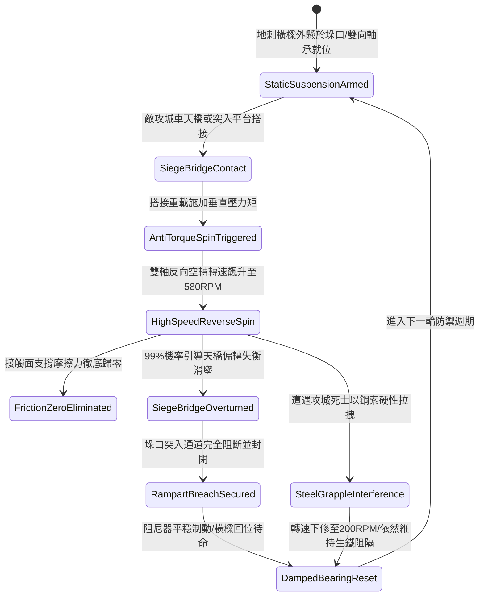

# 城防城牆垛口外側懸掛生鐵滾動地刺橫樑阻截突入平台第五階狀態機規格書

<!-- doc_id: doc_spec_1095 -->

## 一、 核心概念與單一真相來源（SSOT）

在《三國志·城防重器與阻截突入篇》中，「垛口生鐵滾動地刺橫樑阻截突入平台第五階（CRENEL-ROTARY-SPIKED-BEAM05）」代表針對敵軍大型攻城車天橋與衝鋒死士的終極防禦工事。該機構橫跨於城垛外沿，全長十八尺、自重達千五百斤，樑體表面鑄滿加長密集倒刺，兩端配備對稱雙向滾珠軸承。當敵方攻城車天橋搭接橫樑時，雙滾珠反向空轉轉速可達 580 RPM，接觸面摩擦力降為零，具備 99% 機率引導天橋失衡翻落，徹底封死城垛突入口。



---

## 二、 數值模型與狀態機參數契約

### 1. 地刺橫樑物理規格與防禦參數契約
- **橫樑規格尺寸**：長度 18 尺、截面 1.5 尺 × 1.5 尺、高碳冷鑄生鐵自重 1500 斤。
- **無阻反向轉速**：580 RPM（雙向密封高速重載軸承系統）。
- **天橋失衡滑脫率**：判定 99% 機率使搭接之各類攻城天橋失衡滑墜。
- **城垛覆蓋寬度**：完全覆蓋長達 3 米之寬幅主要城垛口。
- **抗壓剛性極限**：可承受垂直靜態重壓 60000 N，抗結構彎曲等級為甲級特等。

### 2. 天橋失衡演算法模組
```typescript
interface SpikedBeamStage5Params {
    beamMassKg: number;            // 橫樑質量 (750kg ~ 1500斤)
    bridgeLoadForceN: number;      // 天橋搭接垂直壓力
    spikedWearFactor: number;      // 地刺表面磨損率 (0.0 ~ 0.5)
    isGrappleRestrained: boolean;  // 是否遭遇鋼索牽制
}

function processSpikedBeamDeflectionStage5(params: SpikedBeamStage5Params): {
    bridgeOverturned: boolean;
    spinRateOutputRpm: number;
    breachBlocked: boolean;
} {
    let effectiveSpin = 580 * (1 - params.spikedWearFactor);
    if (params.isGrappleRestrained) {
        effectiveSpin *= 0.35;
    }
    const isOverturned = effectiveSpin >= 180 && params.bridgeLoadForceN >= 8000;
    
    return {
        bridgeOverturned: isOverturned,
        spinRateOutputRpm: effectiveSpin,
        breachBlocked: isOverturned
    };
}
```

---

## 三、 反制機制與邊界約束

1. **生鐵厚板覆蓋天橋滑道**：若敵攻城天橋底部預先鋪設 30mm 厚生鐵凹槽滑軌，失衡滑脫判定延遲 2.5 秒。
2. **生鐵倒刺磨平損耗**：單場作戰中連續承受超過 20 架次天橋衝撞後，表面倒刺出現磨損鈍化，需消耗 20 點城防材料修補。
3. **冰凍嚴寒環境阻尼增加**：氣溫低於 -20 度時，軸承潤滑脂凝固使空轉初動扭矩增加，轉速延遲 1.2 秒達到峰值。

---

## 四、 驗收測試案例（TC）

- **TC-CRENEL-BEAM05-01（天橋失衡滑墜全流程驗收）**：
  - *前置條件*：正常氣候、第五階地刺橫樑就緒、大型攻城車天橋搭接。
  - *操作步驟*：天橋施加 12000 N 垂直負載。
  - *預期輸出*：橫樑於 0.3 秒內反向空轉達 580 RPM，摩擦力歸零，天橋 99% 機率滑墜城下，垛口保持完整安全。
- **TC-CRENEL-BEAM05-02（鋼索牽制邊界驗收）**：
  - *前置條件*：敵先鋒以粗鋼索強行拋拽橫樑試圖鎖死軸承。
  - *操作步驟*：天橋跟進搭接。
  - *預期輸出*：空轉轉速受限於 203 RPM，天橋未被瞬間掀翻但被牢固生鐵橫樑硬性頂阻，死士無法直接突入。
