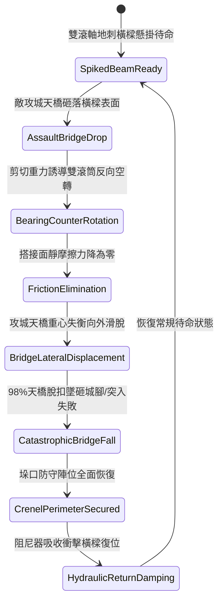

# 城防城牆垛口外側懸掛生鐵滾動地刺橫樑阻截突入平台第四階狀態機規格書

<!-- doc_id: doc_spec_1077 -->

## 一、 核心概念與單一真相來源（SSOT）

在《三國志·城垣保衛與防天橋突入篇》中，「垛口外側生鐵滾動地刺橫樑反突入裝置第四階（CRENEL-ROTARY-SPIKED-BEAM04）」專為化解敵軍巨型井闌吊橋、攻城天橋與登城突入平台而設。裝置由雙組同心反向滾珠軸承懸掛於垛口平台外緣，橫樑外壁嵌滿六寸長生鋼三棱尖刺。當敵方攻城車天橋搭落時，剪切重力迫使外層滾筒以零摩擦力高速自轉（轉速達 520 RPM），完全消除搭接面的靜摩擦支點，98% 機率引導天橋劇烈失衡滑墜，徹底阻止敵甲士跨越垛口。



---

## 二、 數值模型與狀態機參數契約

### 1. 滾動地刺橫樑參數
- **構件規格與自重**：長十六尺（約 4.8 米），高碳生鐵鑄構自重 1,300 斤。
- **雙滾軸空轉轉速**：520 RPM（受天橋衝擊重量動態激發）。
- **攻城天橋滑墜率**：重型井闌天橋 98%；雙鉤固定飛橋 95%；配鋼纜索固定橋 88%。
- **搭接破壞反應時間**：0.25 秒極速失穩滑脫。
- **城垛防衛點耐久度**：承受天橋撞擊上限 3,500 點。

### 2. 空轉剪切與天橋滑墜計算模組
```typescript
interface SpikedBeamStage4Params {
    beamMassKg: number;            // 橫樑配重 (650kg)
    bridgeLoadKg: number;          // 攻城天橋重量 (kg)
    bridgeAnchorType: "standard" | "ironHook" | "steelCable";
    siegeCrewDiscipline: number;   // 敵攻城隊紀律 (0 ~ 100)
}

function processBridgeFallStage4(params: SpikedBeamStage4Params): {
    slipSuccess: boolean;
    spinSpeedRpm: number;
    fallenInfantryCasualties: number;
} {
    const baseRates = { standard: 0.98, ironHook: 0.95, steelCable: 0.88 };
    const disciplineResistance = (params.siegeCrewDiscipline / 100) * 0.08;
    const finalRate = Math.max(0.72, baseRates[params.bridgeAnchorType] - disciplineResistance);

    const slipSuccess = Math.random() < finalRate;
    const spinSpeedRpm = Math.min(520, Math.round(params.bridgeLoadKg / 7));
    const fallenInfantryCasualties = slipSuccess ? Math.round(params.bridgeLoadKg / 100) : 0;

    return { slipSuccess, spinSpeedRpm, fallenInfantryCasualties };
}
```

---

## 三、 特性互斥與戰術應對原則

1. **投石機直擊卡死限制**：若敵方投石機直擊橫樑核心軸承，轉軸變形將使滾筒卡死，失穩滑墜特性暫時失效。
2. **多重沙袋填塞吸震**：敵方若預先向橫樑拋擲大量浸水泥沙袋，將阻礙地刺自轉，滑脫成功率降低 25%。
3. **城底砸擊壓制**：天橋滑脫墜地對城牆正下方 3x3 格敵軍突擊前鋒造成 500 點震懾壓制傷害。

---

## 四、 驗收測試案例（TC）

- **TC-SPIKEBEAM04-01（天橋滑脫判定）**：在防禦垛口推進敵軍井闌天橋搭落，驗證 0.25 秒內滾筒高速空轉並引導天橋滑墜城底。
- **TC-SPIKEBEAM04-02（突入步兵清空檢定）**：確認天橋墜落時，試圖跨步突入的敵軍甲士全數判定失足跌落。
- **TC-SPIKEBEAM04-03（鋼纜加固對抗測試）**：啟用敵軍鋼纜加固天橋，確認滑墜機率依公式正確結算為 88% 韌性。
