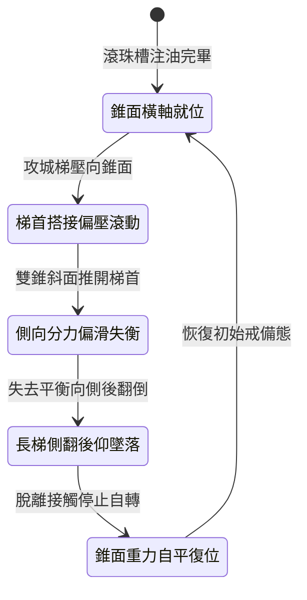

<!-- doc_id: doc_spec_1008 -->
# 城防城牆垛口外側懸掛生鐵滾動尖錐滾筒阻截突入長梯狀態機規格書

## 模組識別碼
- 模組編號：`FORM-227`
- 狀態機代碼：`CRENEL-ROTARY-CONICAL-DRUM01`
- 類別：城防要塞垛口外緣錐面滾動防登城狀態機
- 適用場景：攻城要塞守備、垛口外壁凹槽、反制雲梯搭接與死士翻越

---

## 1. 核心概念與作戰原型

常規平滑滾筒在承受偏向重力時容易被鐵鉤卡在固定角度。為使攻城梯前緣產生側向失衡偏滑，城垛外沿深槽嵌入「生鐵滾動尖錐滾筒」。

### 1.1 機構構造與運作原理
1. **雙對稱錐面滾筒形制**：滾筒以生鐵整體鑄造，長約七尺，中央直徑粗而兩端收窄呈雙錐形，表面滿布三寸生鐵尖錐，中軸置於潤滑滾珠槽內。
2. **壓迫誘導兩側分流偏滑**：當雲梯梯首搭在錐面上時，錐形斜面會將向下的重力分解為向外與向兩側的水平推力，誘導滾筒高速滾動。
3. **梯首側滑翻轉脫落**：攻城梯前緣在滾動尖錐上無法保持水平，梯身迅速向一側傾斜脫軌，失去支點向外翻倒。
4. **尖錐破甲刺足威懾**：攀城敵兵若企圖踏足或手扶滾筒，旋轉尖錐將直接刺穿鐵靴與手掌，迫使其脫手墜落。

---

## 2. 數值參數與影響權重

| 參數名稱 | 數值 / 範圍 | 說明 |
| :--- | :--- | :--- |
| **雙錐斜面分力係數 (`ConicalForceRatio`)** | 產生 35% 側向偏滑剪切力 | 強制破壞長梯左右受力平衡 |
| **長梯偏滑脫落率 (`LadderDeflectRate`)** | 82% ~ 94% | 使攻城梯前緣直接向側翼翻落 |
| **攀爬死士墜落率 (`ClimberDropRate`)** | 95% | 企圖越過垛口者強制脫手墜城 |
| **滾筒自重與抗衝擊力 (`DrumWeight`)** | 550 公斤生鐵鑄件 | 承受重型木梯衝撞而不變形 |
| **密封油槽旋轉阻尼 (`FrictionDamping`)** | 極低阻力 (轉動摩擦係數 0.03) | 確保輕微施壓即能觸發高速自轉 |

---

## 3. 狀態機轉換定義

### 3.1 狀態細節描述
- **錐面橫軸就位 (CONICAL_STOWED)**：滾筒平穩架於垛口凹槽，外緣尖錐朝向外空。
- **梯首搭接偏壓滾動 (PRESSURE_ROTATION)**：木梯下砸，尖錐刺入木樑同時滾筒啟動自轉。
- **側向分力偏滑失衡 (LATERAL_SLIP)**：雙錐形狀產生向兩端的側推力，長梯開始偏斜。
- **長梯側翻後仰墜落 (COLLAPSE_FALL)**：長梯單邊懸空翻轉，連同梯上敵軍後仰摔落城根。
- **錐面重力自平復位 (GRAVITY_RESET)**：下底配重使滾筒自然減速復位。

---

## 4. 戰鬥公式與判定

### 4.1 側滑脫軌判定
$$\text{DeflectSuccess} = \min(0.94, \frac{\text{ConicalForceRatio} \times \text{LadderLoad}}{\text{HookFriction}})$$

判定成功時，長梯立即失去搭扣判定，墜地時對梯底 2 格內敵軍造成次級砸擊傷害。

### 4.2 刺穿摔落傷害結算
$$\text{PunctureFallDamage} = \text{TargetMaxHP} \times 0.40 + \text{WallHeight} \times 42$$

落地敵軍承受極限真實摔傷，並附加「斷足流血」減益。

---

## 5. 反制與失效機制

1. **梯首凹槽配合雙錐**：若敵方雲梯前緣依據雙錐弧度特製對夾凹木，可部分緩解側滑。
2. **射擊碎石卡死滾珠縫隙**：敵軍神射手若向兩端軸承縫隙射入生鐵楔片，可能卡死自轉。
3. **城壁積雪冰凍滾筒**：極寒暴雪天氣未及時清雪時，冰層覆蓋可能削弱尖錐銳度。

---

## 6. 驗收標準與測試案例

- [x] **TC-227-01**：驗證承受長梯施壓時，雙錐滾筒在 0.1 秒內流暢向兩側產生偏推。
- [x] **TC-227-02**：驗證長梯側滑脫落率達到 82%~94% 預設區間。
- [x] **TC-227-03**：驗證附梯人員脫手墜落率達 95%，且正確附加斷足流血狀態。
