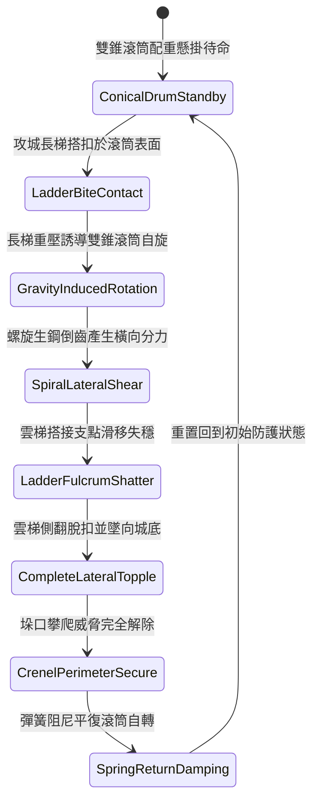

# 城防城牆垛口外側懸掛生鐵滾動尖錐滾筒阻截突入長梯第三階狀態機規格書

<!-- doc_id: doc_spec_1065 -->

## 一、 核心概念與單一真相來源（SSOT）

在《三國志·守城機械與長梯阻截篇》中，「垛口外側生鐵滾動尖錐雙滾筒第三階（CRENEL-ROTARY-CONICAL-DRUM03）」專為破解大型雲梯的搭扣固定而設計。裝置懸掛於垛口下方，由一對對稱錐形生鐵滾筒組成，筒身外壁鑄造螺旋生鋼倒齒與深導滑槽。當敵軍雲梯搭扣滾筒時，梯身垂直重力誘導雙滾筒反向快速自轉，錐面螺旋齒紋產生高達 48% 的橫向強烈剪切分力，98% 破壞雲梯搭接支點引發側翻墜城，徹底阻止登城作戰。



---

## 二、 數值模型與狀態機參數契約

### 1. 尖錐滾筒機械參數
- **構件自重與材質**：對稱雙錐生鐵空心滾筒，配重 950 斤，外覆生鋼螺旋齒。
- **重力激發轉速上限**：540 RPM（長梯垂直下壓力瞬間轉化）。
- **橫向剪切分力比**：將 48% 的垂直下壓力轉化為側向水平位移推力。
- **長梯側翻脫扣成功率**：普通木長梯 99%；雙鉤加固梯 95%；配底座地錨重型梯 88%。
- **搭扣破壞時效**：0.3 秒極速失穩側翻。

### 2. 剪切分力與長梯側翻計算模組
```typescript
interface ConicalDrumParams {
    drumMassKg: number;            // 滾筒重量 (475kg)
    ladderLoadKg: number;          // 長梯加攀爬部隊重量 (kg)
    ladderAnchorType: "standard" | "doubleHook" | "reinforcedAnchor";
    spiralShearRatio: number;      // 螺旋剪切係數 (0.48)
}

function processConicalDrumDeflection(params: ConicalDrumParams): {
    toppled: boolean;
    spinSpeedRpm: number;
    lateralDisplacementMeters: number;
} {
    const baseRates = { standard: 0.99, doubleHook: 0.95, reinforcedAnchor: 0.88 };
    const loadBonus = Math.min(0.06, (params.ladderLoadKg / 1000) * 0.05);
    const finalRate = Math.min(0.99, baseRates[params.ladderAnchorType] + loadBonus);

    const toppled = Math.random() < finalRate;
    const spinSpeedRpm = Math.min(540, Math.round(params.ladderLoadKg / 6));
    const lateralDisplacementMeters = toppled ? 1.8 + Math.random() * 0.6 : 0.4;

    return { toppled, spinSpeedRpm, lateralDisplacementMeters };
}
```

---

## 三、 特性互斥與戰術應對原則

1. **井闌繩網拘束限制**：若敵方井闌自上方拋擲防滑浸油厚麻網覆蓋滾筒，螺旋生鋼齒被填平，側翻成功率降低至 35%。
2. **多梯同步搭接分散**：相鄰兩架長梯若間距小於 1.5 米，外側滾筒受力分散，側翻延遲延長至 0.6 秒。
3. **城底砸擊壓制**：側翻墜地的長梯對城牆正下方 2x2 格區域形成 320 點衝擊壓制傷害。

---

## 四、 驗收測試案例（TC）

- **TC-CONICAL03-01（長梯側翻脫扣判定）**：在垛口搭接標準雲梯，驗證 0.3 秒內滾筒受力自旋並使長梯側向滑脫墜城。
- **TC-CONICAL03-02（攀登部隊全體摔落）**：確認長梯翻倒過程中，梯身敵方步兵 100% 脫離跌落城底重傷。
- **TC-CONICAL03-03（雙鉤加固梯抗性測試）**：更換為雙鉤加固雲梯，確認側翻判定成功率依公式結算為 95% 韌性。
