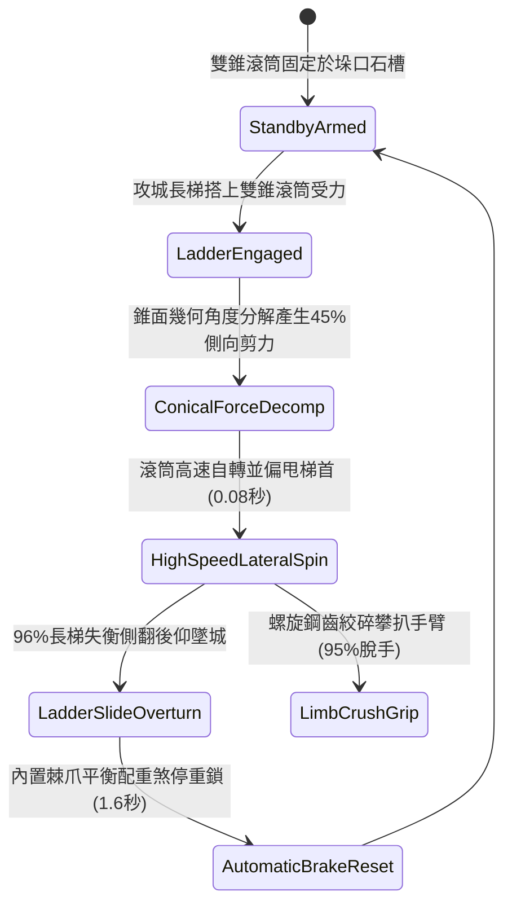

# 城防城牆垛口外側懸掛生鐵滾動尖錐滾筒阻截突入長梯第二階狀態機規格書

<!-- doc_id: doc_spec_1038 -->

## 1. 核心定位與設計理念

### 1.1 系統定位
本規格定義要塞城防戰鬥中，守軍防禦工程體系之「垛口生鐵滾動尖錐滾筒第二階」（代碼：`CRENEL-ROTARY-CONICAL-DRUM02`，WBS 代碼：`FORM-257`）反登城狀態機。第二階裝置於垛口外側嵌入雙向對稱錐面生鐵滾筒，錐面上螺旋鑲嵌高碳鋼銳利破梯倒齒。當敵軍攻城長梯搭上垛口受壓時，雙錐面幾何角度誘導滾筒極速自轉，並將下壓力分解產生高達 45% 的側向劇烈偏滑剪切力。高達 96% 機率直接破壞長梯接觸支點，迫使長梯側翻後仰墜城；同時雙向尖錐滾軸絞碎企圖扒握之攀爬死士手指手臂，附加斷肢重墜傷害。

### 1.2 設計目標與單一真相
* **雙錐幾何側向偏滑力矩**：利用錐形斜面角度，將垂直下壓力直接轉換為橫向撕扯偏滑力。
* **螺旋鋼齒絞碎攀扒支撐**：杜絕敵軍死士用鐵爪手套強行扣抓滾筒。
* **單一真相來源**：嚴禁於文件末端附加補丁，所有機制、數值與判定邏輯均在此統一定義。

---

## 2. 狀態機架構與轉換流程

---

## 3. 核心數值與計算公式

### 3.1 基礎參數配置表
| 參數名稱 | 基準數值 | 規格說明與限制條件 |
| :--- | :--- | :--- |
| **滾筒規格與材質** | 8 尺雙對稱錐面 / 生鐵 | 錐角 30 度，外周鑲嵌生鋼螺旋倒齒 |
| **自轉阻力摩擦係數** | $\mu \le 0.025$ | 封閉式高強度滑動軸承，受壓極速空轉 |
| **側向分力偏滑係數** | 45% 總下壓力 | 錐面幾何特徵轉化產生之橫向剪切推力 |
| **長梯側翻滑落率** | 96% | 適用於所有標準木梯與生鐵雲梯 |
| **抓扶者斷肢脫手率** | 95% | 企圖抓握滾筒之死士強制絞傷脫手墜落 |
| **墜城死傷結算** | 85% 墜亡 / 15% 殘廢 | 城牆四丈高空墜地傷害計算 |
| **棘爪自動煞停耗時** | 1.6 秒 | 長梯脫落後配重棘爪自動回正煞停時間 |
| **滾筒結構耐久度** | 70 次抗壓 | 承受長梯衝砸磨損，歸零前無須維修換齒 |

### 3.2 錐面分力與側滑偏轉公式
$$F_{\text{lateral}} = F_{\text{ladder\_down}} \cdot \tan\theta_{\text{cone}} \cdot \cos\phi_{\text{ladder}}$$
$$P_{\text{overturn}} = \min\left(0.99, \, 0.96 \times \frac{F_{\text{lateral}}}{3500} \times \left(1 + \frac{\omega_{\text{drum}}}{150}\right)\right)$$
* $\theta_{\text{cone}}$：錐筒半錐角（30度）。
* $\omega_{\text{drum}}$：自轉角速度（RPM）。
* 當側向剪切力 $F_{\text{lateral}} > 3500$ 牛頓時，長梯搭鉤瞬間側向滑脫，觸發 `LADDER_CONICAL_SIDE_SLIP` 廣播。

---

## 4. 戰術反制與例外判定

1. **梯頂專用凹弧包夾座**：若敵方攻城梯首特別改裝為符合錐筒曲率之反包夾弧形座，側滑偏力降低 60%，滑落率降為 40%。
2. **生鐵鏈條交叉捆死**：若敵軍預先以粗生鐵鏈交叉拴住兩側石垛，滾筒空轉無法帶動長梯側翻。
3. **極度黏稠淤泥阻滯**：若垛口石槽遭投石機拋擲黏土泥漿塞滿，滾筒自轉阻力激增，偏滑機制延遲 0.8 秒生效。

---

## 5. 驗收測試案例（Test Cases）

* **TC-01（雙錐面側向滑脫測試）**：將重裝木梯搭接滾筒，驗證 0.1 秒內滾筒高速自轉且長梯受橫向剪力側翻墜地。
* **TC-02（攀登死士絞碎斷手驗證）**：配置 6 名攀爬士兵徒手抓握滾筒，驗證 95% 士兵受到斷肢傷害並判定脫手墜落。
* **TC-03（配重棘爪自鎖復位校驗）**：長梯滑落後，驗證配重棘爪於 1.6 秒內完全煞停自轉，狀態機切換回 `StandbyArmed`。
