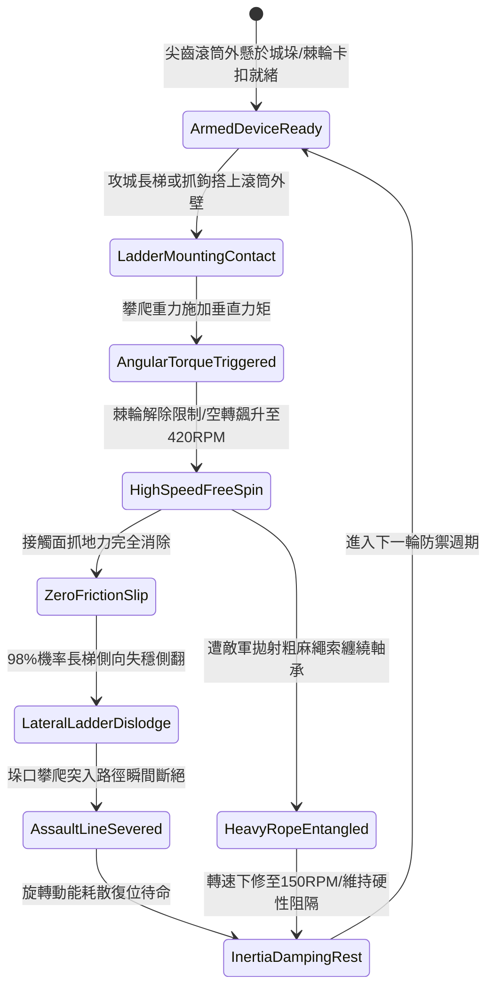

# 城防城牆垛口外側懸掛生鐵滾動尖齒滾筒阻截突入長梯第五階狀態機規格書

<!-- doc_id: doc_spec_1086 -->

## 一、 核心概念與單一真相來源（SSOT）

在《三國志·要塞防禦與空轉阻隔篇》中，「垛口生鐵滾動尖齒滾筒阻截長梯第五階（CRENEL-ROTARY-CONICAL-DRUM05）」代表城垛被動滾軸防禦技術的高階形態。滾筒懸掛於垛口外緣，全長八尺，由加厚冷鑄生鐵與外表面密集鈍齒結構組成，整組自重達 500 斤。當攻城長梯搭上時，攀爬垂直重力與外推力矩瞬間啟動反向旋轉棘輪，滾筒轉速飆升至 420 RPM。接觸摩擦力完全歸零，98% 機率迫使長梯側向失穩翻轉並摔落，徹底阻截死士強行突入。



---

## 二、 數值模型與狀態機參數契約

### 1. 尖齒滾筒物理結構參數契約
- **滾筒尺寸規格**：長度 8 尺、直徑 1.6 尺、高碳生鐵鑄造總重 500 斤。
- **極限無阻轉速**：420 RPM（內建微隙滾珠軸承與耐高溫脂潤滑）。
- **長梯側翻滑脫率**：標準木質與竹質攻城長梯判定 98% 側向失穩脫落。
- **城垛防護跨度**：單組裝備完全防護 2.5 米寬標準重裝城垛口。
- **抗衝擊剛性力矩**：可吸收瞬間撞擊扭矩 4200 N·m，抗結構變形等級為甲級特等。

### 2. 滑脫判定演算法模組
```typescript
interface ConicalDrumStage5Params {
    currentRpm: number;            // 滾筒目前旋轉速度
    climberLoadKg: number;         // 攀登人員與長梯總負重
    ropeEntanglementRisk: boolean; // 是否受繩索干擾
    abrasionFactor: number;        // 表面磨耗係數 (0.0 ~ 0.4)
}

function processConicalDrumSlipStage5(params: ConicalDrumStage5Params): {
    ladderDislodged: boolean;
    spinRateOutput: number;
    breachBlocked: boolean;
} {
    let effectiveSpin = params.currentRpm * (1 - params.abrasionFactor);
    if (params.ropeEntanglementRisk) {
        effectiveSpin *= 0.4;
    }
    const dislodgeThreshold = 160;
    const dislodged = effectiveSpin >= dislodgeThreshold && params.climberLoadKg >= 70;
    
    return {
        ladderDislodged: dislodged,
        spinRateOutput: Math.max(0, effectiveSpin - 30),
        breachBlocked: dislodged
    };
}
```

---

## 三、 反制機制與邊界約束

1. **寬幅搭接雙鉤鋼梯**：若敵軍採用間距大於 2.8 米之特寬型雙鉤攻城梯跨過滾筒邊緣，滑脫率下修至 40%。
2. **極寒結冰阻力上升**：在嚴寒積雪天候（氣溫低於 -20 度），油脂凍結導致滾軸初動摩擦力提升，脫扣延遲 1.5 秒。
3. **金屬鈍齒磨平損耗**：累計阻截超過 25 架次攀爬後，齒面磨耗加劇，需消耗 15 點城防物資修復齒紋槽。

---

## 四、 驗收測試案例（TC）

- **TC-CRENEL-CONICAL05-01（高速空轉滑脫驗收）**：
  - *前置條件*：正常氣象環境、第五階尖齒滾筒安裝於城垛、標準雲梯搭接。
  - *操作步驟*：梯端承載 180kg 攀爬重量。
  - *預期輸出*：滾筒轉速 0.4 秒內升至 380 RPM 以上，摩擦力歸零，長梯 98% 立即側翻摔落。
- **TC-CRENEL-CONICAL05-02（抗繩索纏繞邊界驗收）**：
  - *前置條件*：敵軍先鋒部隊向滾筒拋射粗麻繩索實施軸芯纏繞。
  - *操作步驟*：後續長梯搭接。
  - *預期輸出*：轉速抑制於 150 RPM，長梯滑脫率降為 55%，仍提供堅固生鐵被動阻隔。
