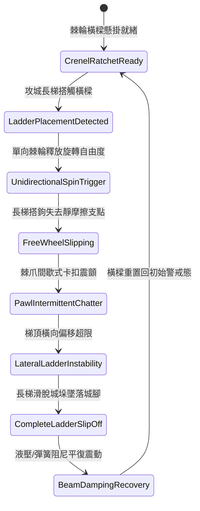

# 城防城牆垛口外側懸掛生鐵滾動棘輪橫樑引導長梯失穩滑脫第三階狀態機規格書

<!-- doc_id: doc_spec_1047 -->

## 一、 核心概念與單一真相來源（SSOT）

在《三國志·守城機械篇》中，「垛口生鐵滾動棘輪橫樑防護裝置第三階（CRENEL-ROTARY-RATCHET-BEAM03）」專門應對大型梯隊的強行搭接。橫樑本體採用實心生鐵鑄造，長十二尺，內部裝配單向棘輪結構與自潤滑銅滾軸。當敵軍雲梯搭扣橫樑時，棘輪允許橫樑在向下壓力下單向飛旋，阻斷長梯搭鉤建立剛性固定點；反向時則透過棘爪自鎖卡槽，產生微幅劇烈顫振，使長梯側向失穩滑脫城垛，阻止登城梯隊突入。



---

## 二、 數值模型與狀態機參數契約

### 1. 棘輪橫樑防護參數
- **橫樑規格與重量**：長 3.6 米（十二尺），鑄鐵配重 900 斤。
- **單向棘輪轉速上限**：520 RPM（受下壓重力動態激發）。
- **梯首搭鉤滑脫率**：標準木梯 97%；加寬鐵鉤梯 93%；連環掛扣梯 88%。
- **搭扣失效反應時間**：0.35 秒（長梯接觸至徹底滑脫）。
- **城垛防衛點耐久度**：承受攻城衝撞上限 2,600 點。

### 2. 滑脫率與側向震顫計算模組
```typescript
interface CrenelRatchetBeamParams {
    beamMassKg: number;            // 橫樑配重 (450kg)
    ladderLoadKg: number;          // 長梯與攀爬部隊總重 (kg)
    ladderHookType: "standard" | "ironClaw" | "interlocking";
    chatterFrequencyHz: number;    // 棘爪震顫頻率 (20 ~ 60 Hz)
}

function processLadderSlipOff(params: CrenelRatchetBeamParams): {
    slipSuccess: boolean;
    reactionTimeSec: number;
    lateralDisplacementCm: number;
} {
    const baseRates = { standard: 0.97, ironClaw: 0.93, interlocking: 0.88 };
    const loadBonus = Math.min(0.05, (params.ladderLoadKg / 1000) * 0.04);
    const slipRate = Math.min(0.99, baseRates[params.ladderHookType] + loadBonus);

    const slipSuccess = Math.random() < slipRate;
    const reactionTimeSec = 0.35 * (params.chatterFrequencyHz / 40);
    const lateralDisplacementCm = slipSuccess ? 45 + Math.random() * 20 : 12;

    return { slipSuccess, reactionTimeSec, lateralDisplacementCm };
}
```

---

## 三、 特性互斥與戰術應對原則

1. **多重倒鉤扣死限制**：若敵方採用帶自鎖齒咬死內垛的專用破城鐵錨，橫樑自轉無法完全擺脫，滑脫率降低至 35%。
2. **防凍防泥維護**：在嚴寒積雪天候下，需消耗軍資桐油維護軸承，否則棘輪凍結將轉為固定橫樑，滑脫特性失效。
3. **墜落部隊干擾**：滑落的長梯與兵員跌落城腳，對下方 2x2 格區域的攻城輔助單位造成 250 點混亂阻滯。

---

## 四、 驗收測試案例（TC）

- **TC-RATCHET03-01（長梯自轉滑脫判定）**：派遣標準雲梯搭接防禦垛口，驗證 0.35 秒內橫樑受重自旋並使長梯滑脫墜城。
- **TC-RATCHET03-02（棘輪單向自鎖測試）**：模擬攀城士兵試圖反向拉扯橫樑借力，確認棘爪即刻咬合自鎖並產生高頻震顫阻絕借力。
- **TC-RATCHET03-03（極寒結冰狀態機切換）**：在極低溫氣候下切換環境，確認未抹油時橫樑切入 `FrostLocked` 凍結異常態。
