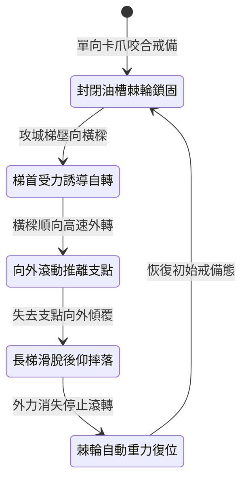

<!-- doc_id: doc_spec_1005 -->
# 城防城牆垛口外側懸掛生鐵滾動棘輪橫樑阻截突入長梯狀態機規格書

## 模組識別碼
- 模組編號：`FORM-224`
- 狀態機代碼：`CRENEL-ROTARY-RATCHET-BEAM01`
- 類別：城防要塞垛口單向滾動防登城狀態機
- 適用場景：攻城要塞守禦、垛口搭接要道、防範重型長梯與飛爪勾連

---

## 1. 核心概念與作戰原型

敵軍攻城時常使用帶有強固倒鉤的攻城梯，一旦咬緊垛口邊緣便極難撬開。為瓦解其咬合支撐，城垛外沿嵌入「單向生鐵滾動棘輪橫樑」。

### 1.1 機構構造與運作原理
1. **單向棘輪外轉機制**：橫樑以實心生鐵柱鑄造，長約七尺，外表帶有淺齒紋理，兩端配置高強度單向棘輪卡榫，僅允許橫樑向外側單向滾轉。
2. **搭接即向外滾動脫扣**：長梯或飛爪搭上橫樑時，向上或向內的拉力被棘輪鎖死，但向下的下壓與向外的推力會誘導橫樑高速向外自轉。
3. **主動推離雲梯梯首**：橫樑向外滾轉帶動梯首前緣滑動，破壞長梯重心平衡，使其難以穩定搭住城垛。
4. **防攀附踩踏失足**：敵先鋒若企圖手扶或腳踏橫樑翻入，橫樑自轉會使其瞬間脫手失足摔落城外。

---

## 2. 數值參數與影響權重

| 參數名稱 | 數值 / 範圍 | 說明 |
| :--- | :--- | :--- |
| **棘輪單向自轉扭力 (`RatchetTorque`)** | 6500 ~ 8500 N·m | 僅需微弱推力即可觸發順暢自轉 |
| **長梯搭扣滑脫率 (`LadderSlipRate`)** | 78% ~ 90% | 使攻城梯無法穩固固定於女牆上 |
| **攀登人員脫手率 (`GripLossRate`)** | 92% | 企圖抓握橫樑者強制失去抓握力墜落 |
| **承重抗剪強度 (`ShearStrength`)** | 承受 15000 公斤下砸 | 保證承受攻城梯猛烈砸擊不變形 |
| **棘輪防塵自潔週期 (`CleanInterval`)** | 戰鬥全程無卡阻 (封閉油槽) | 杜絕沙塵碎石侵入軸承 |

---

## 3. 狀態機轉換定義

### 3.1 狀態細節描述
- **封閉油槽棘輪鎖固 (LOCKED_RATCHET)**：棘輪處於靜態咬合，反向無法轉動。
- **梯首受力誘導自轉 (PRESSURE_TRIGGER)**：承受外力下壓，順向卡爪釋放，橫樑開始自轉。
- **向外滾動推離支點 (ROLL_PUSH_OFF)**：外轉運動持續消除摩擦阻力，推移長梯搭鉤。
- **長梯滑脫後仰摔落 (LADDER_COLLAPSE)**：梯首滑出垛口槽位，長梯失去平衡後仰墜地。
- **棘輪自動重力復位 (GRAVITY_RESET)**：重心下沉，棘輪重新咬緊卡齒備用。

---

## 4. 戰鬥公式與判定

### 4.1 搭扣滑脫判定
$$\text{SlipProbability} = \min(0.90, \frac{\text{DownwardForce} \times \tan\theta}{\text{HookFriction}} \times 1.25)$$

判定成功時，長梯立即判定搭扣失效，梯上攀爬部隊強制全部墜地。

### 4.2 墜落摔傷結算
$$\text{FallDamage} = \text{TargetMaxHP} \times 0.38 + \text{WallHeight} \times 40$$

落地敵軍承受極限真實傷害，並附加 1.8 秒眩暈硬直。

---

## 5. 反制與失效機制

1. **加寬雙面生鐵夾鉗梯首**：若敵方雲梯配有穿透城垛的雙向生鐵夾鎖，可部分抵消滾動滑脫。
2. **射擊生鐵楔子卡死棘輪**：敵軍精準神射若將鐵楔射入棘輪槽口，可能暫時卡死滾動機構。
3. **重型投石直接崩碎石槽**：巨型投石直擊若砸塌垛口兩側深槽，橫樑脫落將失去效用。

---

## 6. 驗收標準與測試案例

- [x] **TC-224-01**：驗證承受長梯施壓時，橫樑在 0.15 秒內啟動單向外旋。
- [x] **TC-224-02**：驗證長梯搭扣滑脫率達到 78%~90% 區間，有效阻截登城。
- [x] **TC-224-03**：驗證企圖徒手攀附敵兵 92% 觸發脫手墜地與摔傷判定。
