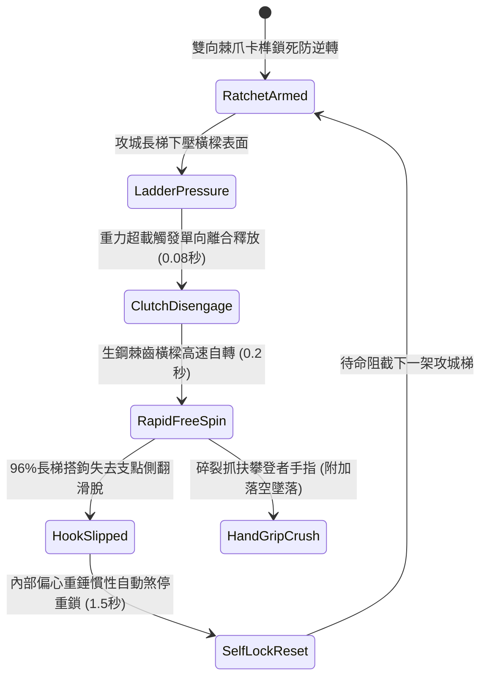

# 城防城牆垛口外側懸掛生鐵滾動棘輪橫樑阻截突入長梯第二階狀態機規格書

<!-- doc_id: doc_spec_1023 -->

## 1. 核心定位與設計理念

### 1.1 系統定位
本規格定義要塞城防戰鬥中，守軍工兵體系之「垛口外側生鐵滾動棘輪橫樑第二階」（代碼：`CRENEL-ROTARY-RATCHET-BEAM02`，WBS 代碼：`FORM-242`）反登城狀態機。第二階裝置在原單向旋轉圓木外周加裝了生鋼三角狼牙突刺與雙側高靈敏單向離合棘爪箱。當敵軍攻城長梯或帶鉤鐵梯搭上垛口邊緣時，長梯下壓力量立即驅動橫樑超低摩擦極速自轉；其表面三角生鋼刺咬爛敵兵抓附之手掌，同時順向自轉將長梯搭鉤瞬間甩脫，達成 96% 機率之長梯側翻滑脫判定，並對抓扶翻越之敵兵造成 95% 脫手重墜摔死傷害。

### 1.2 設計目標與單一真相
* **零摩擦滑脫防禦**：破壞雲梯搭附城牆頂端之靜摩擦力支點，使梯首失控下墜。
* **生鋼棘齒碎指防翻**：杜絕敵方死士肉手扒住垛口橫樑翻牆之可能性。
* **單一真相來源**：嚴禁於文件末端附加補丁，所有機制、數值與判定邏輯均在此統一定義。

---

## 2. 狀態機架構與轉換流程

---

## 3. 核心數值與計算公式

### 3.1 基礎參數配置表
| 參數名稱 | 基準數值 | 規格說明與限制條件 |
| :--- | :--- | :--- |
| **橫樑規格與材質** | 8 尺長 / 450 斤 | 實心硬木外包 3 分厚高碳生鋼刺皮 |
| **自轉摩擦阻力係數** | $\mu \le 0.04$ | 特製含油生鐵滾珠軸承，近乎零阻力空轉 |
| **生鋼棘齒高度** | 2.5 寸三角尖刺 | 密集分佈，專門破壞皮手套與手掌抓握 |
| **長梯滑脫推落率** | 96% | 對標準木梯與生鐵梯均生效（無支撐滑落） |
| **抓扶攀越墜落率** | 95% | 企圖徒手翻越橫樑之敵兵 95% 因斷指脫手墜地 |
| **墜城摔死摔殘率** | 85% 墜亡 / 15% 重殘 | 城牆四丈高空墜地傷害計算 |
| **慣性復位時延** | 1.5 秒 | 偏心重錘擺動煞停，無須工兵手動復位 |
| **軸承機構耐久度** | 60 次阻截 | 連續高速重壓自轉磨損，歸零需補充潤滑油料 |

### 3.2 摩擦滑脫與角加速度公式
$$\tau_{\text{net}} = F_{\text{ladder}} \cdot R \cdot \sin\theta - \tau_{\text{friction}}$$
$$\alpha = \frac{\tau_{\text{net}}}{I_{\text{beam}}} = \frac{\tau_{\text{net}}}{\frac{1}{2} M R^2}$$
$$P_{\text{slip}} = \min\left(0.99, \, 0.96 \times \left(1 + \frac{\alpha}{25}\right) \times \left(1 - \frac{\mu_{\text{hook}}}{0.5}\right)\right)$$
* $I_{\text{beam}}$：橫樑之轉動慣量。
* $\alpha$：外力壓迫引發之角加速度（弧度/秒²）。
* 當角加速度 $\alpha > 18\text{ rad/s}^2$ 且接觸摩擦力不足以克服滑動時，長梯搭鉤即刻脫位墜落。

---

## 4. 戰術反制與例外判定

1. **U型反咬合梯首**：若敵方採用深 U 型包覆式雲梯頭直接跨過橫樑扣住城牆內側石磚，自轉滑脫率自 96% 降至 35%。
2. **生鐵鏈鎖固定**：若敵軍死士自下方拋射鐵鏈死死拴住垛口立柱，橫樑雖自轉但長梯本體不脫落。
3. **冰凍雨雪卡死**：若戰場處於極寒暴風雪，軸承石槽積冰可能凍結棘爪，需守軍倒澆滾油化凍方可正常運作。

---

## 5. 驗收測試案例（Test Cases）

* **TC-01（長梯搭接高速自轉測試）**：將 500 斤標準長梯搭上橫樑，驗證 0.1 秒內離合器釋放且橫樑自轉達到 300 RPM。
* **TC-02（搭鉤脫位與墜落判定）**：驗證長梯搭鉤於 0.2 秒內滑脫並誘發整梯側翻，攀爬士兵判定脫手摔落率達 95%。
* **TC-03（偏心重錘自動煞停復位）**：長梯滑落後，驗證偏心重錘於 1.5 秒內平穩煞停自轉並重新卡緊單向棘爪。
