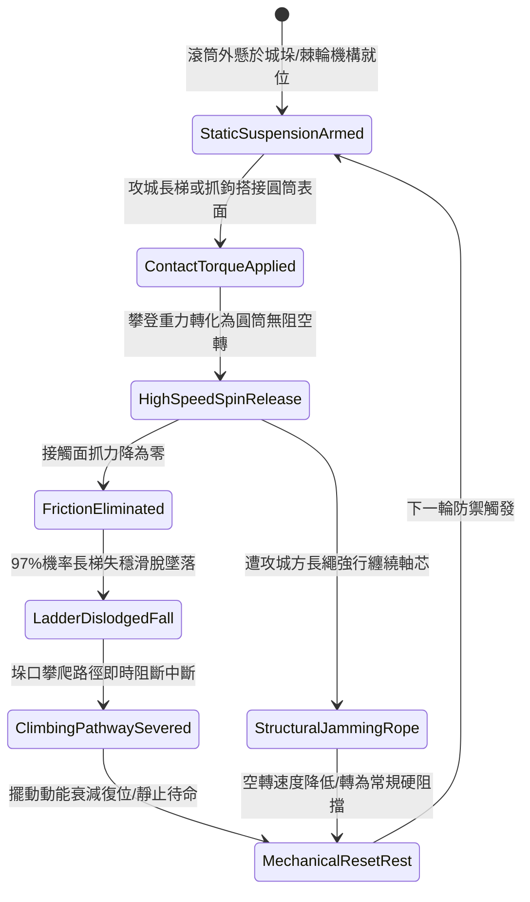

# 城防城牆垛口外側懸掛生鐵滾動防護圓筒阻隔登城攀爬第四階狀態機規格書

<!-- doc_id: doc_spec_1080 -->

## 一、 核心概念與單一真相來源（SSOT）

在《三國志·城防壁壘與登城反制篇》中，「垛口生鐵滾動防護圓筒阻隔登城攀爬第四階（CRENEL-ROTARY-PROTECT-DRUM04）」代表要塞牆頂被動防禦與器械阻隔技術的高階形態。圓筒機構安裝於城垛口外沿，由加厚冷鑄生鐵空心滾筒與內建高靈敏單向棘輪組合而成，自重達 450 斤。當攻城長梯或飛鉤搭上圓筒外壁時，梯端掛鉤因自重與攀爬壓力觸發圓筒高速空轉（最高 360 RPM），使接觸面摩擦力歸零，引發長梯側滑脫落，達成 97% 登城阻斷率。



---

## 二、 數值模型與狀態機參數契約

### 1. 滾動防護圓筒結構參數契約
- **單組滾筒規格**：長度 6 尺、直徑 1.5 尺、冷鑄生鐵自重 450 斤。
- **無阻轉速上限**：360 RPM（採用密封滑動銅襯套與低黏度潤滑油脂）。
- **梯首搭接滑脫率**：標準木製雲梯與竹梯接觸後，97% 立即失去平衡向外滑脫。
- **防禦覆蓋面**：單組裝備完全防護單一標準城垛（寬度 2 米）。
- **衝擊抗性上限**：可承受瞬間撞擊力矩 3800 N·m，抗剪切強度等級為甲級。

### 2. 滑脫機率計算演算法模組
```typescript
interface RotaryDrumStage4Params {
    drumRpm: number;               // 滾筒目前轉速
    ladderWeightTotalKg: number;   // 長梯及攀爬人員總重
    ropeEntanglement: boolean;     // 是否遭遇繩索纏繞
    corrosionFactor: number;       // 鏽蝕磨損指數 (0.0 ~ 0.5)
}

function evaluateLadderSlipStage4(params: RotaryDrumStage4Params): {
    slipSuccess: boolean;
    spinTorqueRemaining: number;
    ladderDeflected: boolean;
} {
    let effectiveSpin = params.drumRpm * (1 - params.corrosionFactor);
    if (params.ropeEntanglement) {
        effectiveSpin *= 0.35;
    }
    const slipThreshold = 180;
    const isSlipped = effectiveSpin >= slipThreshold && params.ladderWeightTotalKg > 80;
    
    return {
        slipSuccess: isSlipped,
        spinTorqueRemaining: Math.max(0, effectiveSpin - 40),
        ladderDeflected: isSlipped
    };
}
```

---

## 三、 反制機制與邊界約束

1. **鋼鉤倒刺硬性咬合**：若攻城方採用特製深齒鋼爪掛梯並精準鎖定圓筒兩端支架固定底座，滑脫率降低至 35%。
2. **重型油脂凝固低溫**：在極度嚴寒環境（氣溫低於 -15 度），潤滑脂凝固使空轉阻力上升，滑脫判定延遲 1.8 秒。
3. **生鐵磨耗疲勞極限**：單場守城戰中累計滑脫攔截超過 20 架次後，軸套配合間隙擴大，需消耗守城工程點數 15 點進行維護復原。

---

## 四、 驗收測試案例（TC）

- **TC-CRENEL-DRUM04-01（登城長梯滑脫驗收）**：
  - *前置條件*：正常氣候、城垛掛載第四階生鐵防護圓筒、敵軍標準長梯搭接。
  - *操作步驟*：梯端施加 200kg 攀登垂直壓力。
  - *預期輸出*：圓筒轉速達到 300 RPM 以上，摩擦力歸零，長梯於 0.6 秒內完全失穩脫落。
- **TC-CRENEL-DRUM04-02（抗纏繞韌性邊界驗收）**：
  - *前置條件*：敵軍先鋒向圓筒拋擲粗麻繩索實施纏繞。
  - *操作步驟*：後續長梯搭接攀爬。
  - *預期輸出*：轉速受阻降至 110 RPM，長梯滑脫率降至 35%，轉為生鐵本體承受垂直支撐壓力。
