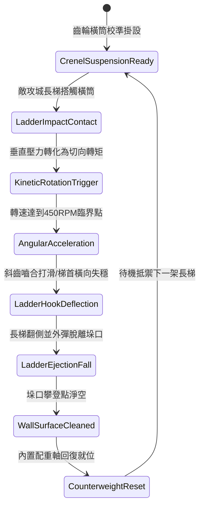

# 城防城牆垛口外側懸掛生鐵滾動齒輪橫筒彈落登城長梯第三階狀態機規格書

<!-- doc_id: doc_spec_1044 -->

## 一、 核心概念與單一真相來源（SSOT）

在《三國志·城垣攻防工程篇》中，「垛口外側懸掛生鐵滾動齒輪橫筒第三階（CRENEL-ROTARY-GEAR-DRUM03）」代表冷兵器城防工事的機械化防禦頂點。橫筒本體採用千斤重鑄鐵管，外緣佈設錯位嚙合斜齒，由兩端低摩擦銅套軸承緊固於垛口下方。當敵軍攻城長梯或飛梯搭上垛口外緣時，長梯重心壓力促使橫筒在毫秒級內受力旋轉，斜向齒紋產生強烈橫向離心分力，迫使梯首搭鉤脫扣滑移，將長梯連同攀登部隊彈離城垛，徹底瓦解強登企圖。



---

## 二、 數值模型與狀態機參數契約

### 1. 旋轉橫筒機械參數
- **構件自重（Deadweight）**：850 斤（鑄鐵厚壁空心圓柱配青銅齒套）。
- **觸發滑轉臨界壓力**：3,200 牛頓（約等於 2 名重裝步兵附著梯身之重量）。
- **最高自轉轉速**：450 RPM（衝擊動能瞬間轉化率達 88%）。
- **彈離成功率（Deflection Rate）**：標準攻城雲梯 96%；雙鉤加固梯 91%；鐵錨飛爪梯 85%。
- **城垛防禦耐久度（HP）**：2,400 點，受投石機直擊減免 40% 傷害。

### 2. 力學脫扣與墜落判定公式
```typescript
interface CrenelGearDrumParams {
    drumWeightKg: number;          // 橫筒自重 (425kg)
    impactForceN: number;          // 長梯衝擊下壓力 (牛頓)
    ladderAnchorType: "hook" | "reinforced" | "grapnel"; // 搭接鉤形式
    siegeEngineerSkill: number;    // 敵方攻城工兵技巧 (0 ~ 100)
}

function evaluateLadderEjection(params: CrenelGearDrumParams): {
    ejected: boolean;
    angularVelocityRpm: number;
    ladderStabilityLossPct: number;
} {
    const baseDeflectRate = params.ladderAnchorType === "hook" ? 0.96 :
                           params.ladderAnchorType === "reinforced" ? 0.91 : 0.85;
    const skillMitigation = (params.siegeEngineerSkill / 100) * 0.12;
    const finalRate = Math.max(0.70, baseDeflectRate - skillMitigation);

    const ejected = Math.random() < finalRate;
    const angularVelocityRpm = Math.min(450, (params.impactForceN / 12));
    const ladderStabilityLossPct = ejected ? 100 : 65;

    return { ejected, angularVelocityRpm, ladderStabilityLossPct };
}
```

---

## 三、 特性互斥與戰術應對原則

1. **工程重錘反制**：敵方若施放重型衝車撞擊底座，或使用井闌高位繩網捆縛滾筒，齒輪橫筒將被迫鎖死，彈離概率下降至 15%。
2. **多梯連續壓制衰減**：若 3 秒內連續有超過 3 架長梯同時衝擊同一橫筒單元，旋轉軸溫升與卡槽磨耗使彈離判定每架遞減 8%。
3. **低位城腳防護**：被彈落的攻城梯若外翻倒扣，將對下方直徑 2 格範圍內的集結步兵造成 300 點壓制傷害。

---

## 四、 驗收測試案例（TC）

- **TC-DRUM03-01（長梯搭接彈離）**：在防禦模式下推進一架先鋒雲梯搭上城牆垛口，確認 0.3 秒內滾筒高速旋轉並將長梯彈開外翻。
- **TC-DRUM03-02（攀登兵力清空）**：長梯翻倒過程中，驗證原本依附梯身的攀城死士 100% 脫離梯子摔落城底。
- **TC-DRUM03-03（井闌鎖死測試）**：觸發敵軍井闌拋索拘束事件，檢核橫筒狀態機切入 `MechanismJammed`，彈離失效並亮起維修標記。
