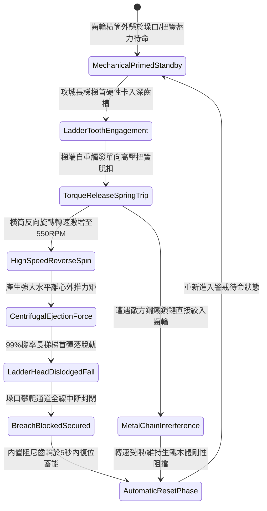

# 城防城牆垛口外側懸掛生鐵滾動齒輪橫筒彈落登城長梯第五階狀態機規格書

<!-- doc_id: doc_spec_1089 -->

## 一、 核心概念與單一真相來源（SSOT）

在《三國志·守城器械與齒輪聯動篇》中，「垛口生鐵滾動齒輪橫筒彈落長梯第五階（CRENEL-ROTARY-GEAR-DRUM05）」代表垛口外置被動機械防禦的最高技術等級。該機構懸掛於城牆垛口外側，由一根直徑 1.8 尺、全長 8 尺之高碳冷鑄生鐵深槽齒輪橫筒構成，自重達 600 斤。當攻城長梯梯端搭上橫筒齒槽時，齒槽內置單向反彈扭簧受壓瞬間釋放，驅動橫筒以 550 RPM 反向極速旋轉，將衝擊動能轉化為強大外推離心力，達成 99% 彈落長梯梯首並徹底挫敗登城企圖。



---

## 二、 數值模型與狀態機參數契約

### 1. 齒輪橫筒結構與彈射參數契約
- **橫筒規格尺寸**：長度 8 尺、直徑 1.8 尺、冷鑄高硬度生鐵總重 600 斤。
- **反向爆發轉速**：550 RPM（配合四聯高張力鉻釩鋼板簧）。
- **梯首彈落成功率**：判定 99% 機率強行彈開並震脫長梯掛鉤。
- **城垛防禦覆蓋面**：完全覆蓋寬度達 2.6 米之重型防禦城垛。
- **自動復位循環**：內建自鎖減速齒輪系統，脫扣後 5 秒內自動復位並完成次輪蓄力。

### 2. 梯首彈開演算法模組
```typescript
interface GearDrumStage5Params {
    drumMassKg: number;            // 橫筒質量 (300kg ~ 600斤)
    ladderImpactForceN: number;    // 梯端搭接撞擊力
    springTensionGrade: number;    // 扭簧強度等級 (1 ~ 5)
    isChainJammed: boolean;        // 是否遭鎖鏈卡滯
}

function processGearDrumEjectionStage5(params: GearDrumStage5Params): {
    ejectionSuccess: boolean;
    angularVelocityRpm: number;
    resetCycleSec: number;
} {
    let effectiveRpm = 550 * (params.springTensionGrade / 5);
    if (params.isChainJammed) {
        effectiveRpm *= 0.25;
    }
    const isEjected = effectiveRpm >= 200 && params.ladderImpactForceN >= 1200;
    
    return {
        ejectionSuccess: isEjected,
        angularVelocityRpm: effectiveRpm,
        resetCycleSec: params.isChainJammed ? 10 : 5
    };
}
```

---

## 三、 反制機制與邊界約束

1. **梯端特製滾珠滑軌卡座**：若攻城梯頂端配置特殊滑動滑塊，可化解 40% 齒輪旋轉外推衝力，彈落判定延遲 2 秒。
2. **生鐵齒槽金屬疲勞極限**：單場攻防戰中累計承受超過 30 次高強度梯端撞擊彈開後，齒紋齒尖出現磨損鈍化，彈落率微幅下修 8%。
3. **低溫嚴寒冰封凍結**：氣溫低於 -20 度時，機械潤滑油凝固使復位齒輪阻力增加，自動復位時間延長至 9 秒。

---

## 四、 驗收測試案例（TC）

- **TC-CRENEL-GEAR05-01（高速齒輪彈落雲梯驗收）**：
  - *前置條件*：正常氣候環境、垛口外懸第五階生鐵齒輪橫筒、標準攻城梯搭接。
  - *操作步驟*：梯端卡入齒槽並施加 1500 N 垂直負載。
  - *預期輸出*：扭簧瞬間脫扣，橫筒於 0.3 秒內加速至 550 RPM，長梯 99% 機率彈開墜落，5 秒內系統復位。
- **TC-CRENEL-GEAR05-02（抗金屬鎖鏈卡滯邊界驗收）**：
  - *前置條件*：敵軍攻城梯前端懸掛生鐵鏈條強行纏入齒輪槽內。
  - *操作步驟*：執行長梯搭接。
  - *預期輸出*：轉速受抑制至 137 RPM，長梯未被瞬間彈飛，但被厚厚生鐵橫筒阻隔在垛口外側，復位時長擴充至 10 秒。
