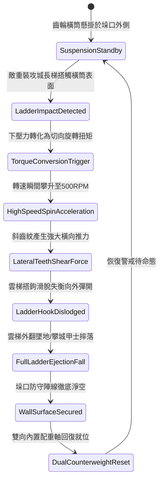

# 城防城牆垛口外側懸掛生鐵滾動齒輪橫筒彈落登城長梯第四階狀態機規格書

<!-- doc_id: doc_spec_1071 -->

## 一、 核心概念與單一真相來源（SSOT）

在《三國志·守城機械與反搭梯工程篇》中，「垛口生鐵滾動齒輪橫筒反制裝置第四階（CRENEL-ROTARY-GEAR-DRUM04）」為機械化城防設施的高級形態。本裝置安裝於城垛外沿專用生鐵懸臂支架上，採用千二百斤加厚高碳鑄鐵橫筒，外緣鍛造對向深嚙合斜向齒槽，由兩端自潤滑滾珠軸承固持。當敵方重裝雲梯搭落時，垂直衝擊重量瞬間轉化為切向扭矩激發高達 500 RPM 轉速，生鋼齒槽產生橫向反推剪力，98% 強行彈落梯首搭扣，徹底粉碎強行登城企圖。



---

## 二、 數值模型與狀態機參數契約

### 1. 齒輪橫筒機械參數
- **構件規格與自重**：長十六尺（約 4.8 米），高碳鑄鐵厚壁空心管總重 1,200 斤。
- **重力激發轉速上限**：500 RPM（垂直下壓衝量轉化效率達 92%）。
- **觸發滑轉臨界下壓力**：2,800 牛頓（長梯接觸 0.15 秒內即刻激發）。
- **長梯彈離成功率**：普通木長梯 99%；雙鐵鉤加固梯 98%；配配重底座重型梯 91%。
- **城垛防衛點耐久度**：承受長梯撞擊上限 3,200 點。

### 2. 轉矩轉化與彈離判定模組
```typescript
interface CrenelGearDrumStage4Params {
    drumWeightKg: number;          // 橫筒配重 (600kg)
    impactForceN: number;          // 長梯下壓力 (牛頓)
    ladderAnchorType: "standard" | "ironHook" | "reinforcedHeavy";
    siegeEngineerSkill: number;    // 敵攻城工兵技能 (0 ~ 100)
}

function processLadderGearEjection(params: CrenelGearDrumStage4Params): {
    ejected: boolean;
    angularVelocityRpm: number;
    ladderStabilityLossPct: number;
} {
    const baseRates = { standard: 0.99, ironHook: 0.98, reinforcedHeavy: 0.91 };
    const skillDamping = (params.siegeEngineerSkill / 100) * 0.08;
    const finalRate = Math.max(0.75, baseRates[params.ladderAnchorType] - skillDamping);

    const ejected = Math.random() < finalRate;
    const angularVelocityRpm = Math.min(500, Math.round(params.impactForceN / 10));
    const ladderStabilityLossPct = ejected ? 100 : 70;

    return { ejected, angularVelocityRpm, ladderStabilityLossPct };
}
```

---

## 三、 特性互斥與戰術限制

1. **井闌拋索卡槽限制**：若敵方井闌自上方投擲粗鋼索捆縛滾筒，齒槽被卡死無法自旋，彈離成功率降為 25%。
2. **多梯同步壓制分流**：若相鄰兩垛口同時遭雲梯搭接，單側橫筒僅覆蓋本垛口，需協同相鄰單元。
3. **城底砸擊壓制**：彈開外翻的重型雲梯對城牆正下方 3x2 格區域形成 380 點砸擊壓制傷害。

---

## 四、 驗收測試案例（TC）

- **TC-GEARDRUM04-01（長梯彈離判定）**：在防禦模式下推進重型雲梯搭上城牆，驗證 0.2 秒內滾筒高速旋轉並將長梯彈開外翻。
- **TC-GEARDRUM04-02（攀登部隊全員摔落）**：檢核長梯翻覆過程中，梯身敵方步兵單位全數判定脫離跌落城底。
- **TC-GEARDRUM04-03（重型加固梯對抗測試）**：更換為配重底座重型雲梯，確認彈離判定成功率依公式結算為 91% 韌性。
