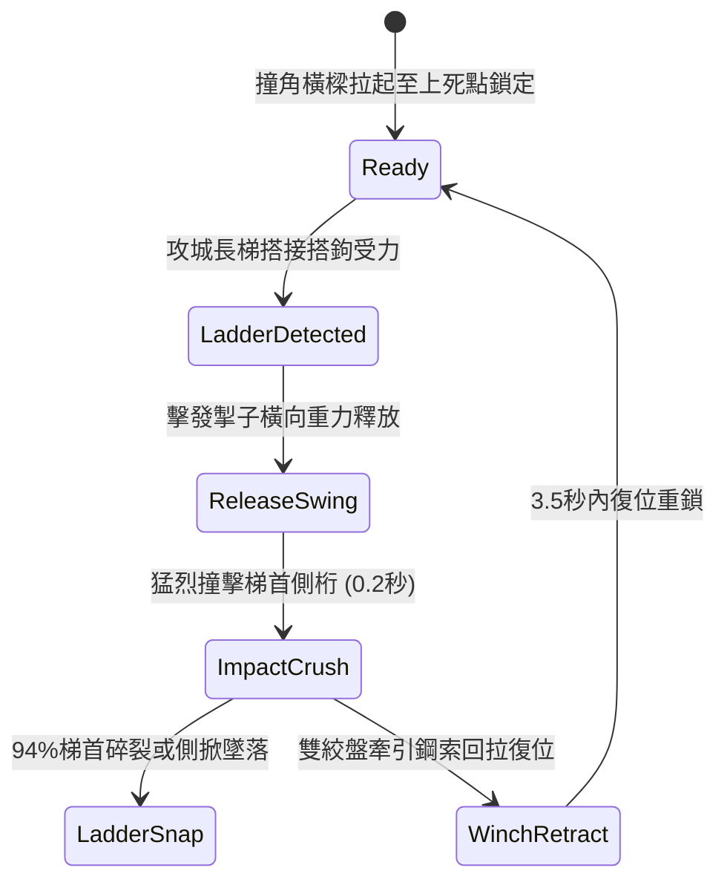

# 城防城牆垛口外側懸掛生鐵重型撞角橫樑橫向擺動撞碎攻城梯首狀態機規格書

<!-- doc_id: doc_spec_1017 -->

## 1. 核心定位與設計理念

### 1.1 系統定位
本規格定義要塞城防戰鬥中，守軍防禦工程體系之「垛口生鐵重型撞角橫樑」（代碼：`CRENEL-SWINGING-RAM-BEAM01`，WBS 代碼：`FORM-236`）運作狀態機。本裝置安裝於城牆垛口外緣懸吊石槽，由長度十二尺之加厚硬木橫樑外包生鐵重型撞角組成，透過雙側絞盤滑輪懸吊與單向重力釋放機制，在攻城長梯搭上城垛瞬間進行水平橫向鐘擺式強力擺動，藉由數百斤之重力加速度橫向猛烈撞擊攻城梯頂端木榫與側桁，高達 94% 機率直接將梯首徹底撞裂摧毀，並產生強大橫向慣性將整架雲梯連同攀爬部隊向側向掀翻墜落。

### 1.2 設計目標與單一真相
* **橫向剪切破壞**：針對攻城梯縱向抗壓、橫向抗剪力極弱之物理特點，施以橫向重擊。
* **連鎖清空梯隊**：梯首斷裂或滑脫引發整隊骨牌效應，阻絕蟻附攀爬。
* **單一真相來源**：嚴禁於文件末端附加補丁，所有機制、數值與判定邏輯均在此統一定義。

---

## 2. 狀態機架構與轉換流程

---

## 3. 核心數值與計算公式

### 3.1 基礎參數配置表
| 參數名稱 | 基準數值 | 規格說明與限制條件 |
| :--- | :--- | :--- |
| **橫樑長度與重量** | 12 尺 / 650 斤 | 實心硬木外包生鐵重型尖刺撞角 |
| **擺動弧度與衝程** | 120 度 / 2.8 米 | 水平弧形橫擺，覆蓋相鄰 2 個垛口區間 |
| **撞擊衝量（Impulse）**| 5,200 N·s | 瞬間撞擊產生強烈橫向剪切破壞力 |
| **梯首碎裂率（Break）**| 94% | 對普通木製長梯為 94%；加固型鐵裹梯為 72% |
| **攀爬部隊墜落率** | 96% | 梯子傾覆時正在攀登之敵軍部隊全數失足墜落 |
| **墜落致死/重傷率** | 80% 致死 / 20% 殘廢 | 依據四丈城牆高度換算之物理重力墜落傷害 |
| **回拉復位時間** | 3.5 秒 | 雙工兵操控雙聯速比齒輪絞盤回拉重設掣子 |
| **耐久度（Durability）**| 35 次擺擊 | 生鐵撞角與吊索承受衝擊損耗，歸零需工兵維修 |

### 3.2 橫向破壞與傾覆公式
$$P_{\text{destroy}} = \min\left(0.98, \, 0.94 \times \frac{M_{\text{beam}}}{650} \times \left(1 - \frac{D_{\text{ladder\_reinforce}}}{100}\right)\right)$$
* $M_{\text{beam}}$：撞角橫樑當前總重量（斤）。
* $D_{\text{ladder\_reinforce}}$：攻城長梯額外鐵件加固防護係數（0 ~ 30）。
* 當梯首側桁承受橫向衝擊動能超過 4,500 焦耳時，木結構產生塑性斷裂，立即觸發 `LADDER_STRUCTURAL_COLLAPSE` 事件。

---

## 4. 戰術反制與例外判定

1. **重裝鐵角雲梯**：敵方若投入重型生鐵防撞雲梯（鐵骨骨架），梯首斷裂率降至 38%，但仍有 65% 機率因橫向巨大扭矩脫鉤側滑。
2. **火箭燒灼吊索**：若敵軍神射手以猛火油火箭射擊懸吊麻繩/鋼絲絞索，吊索若斷裂則撞角下墜卡死於牆根，橫擺機制失效。
3. **推梯死角規避**：若攻城梯搭於兩橫樑擺動衝程交界之微小死角（約 0.3 米寬度），撞擊能量衰減 50%。

---

## 5. 驗收測試案例（Test Cases）

* **TC-01（長梯搭接即時觸發橫擺）**：敵軍長梯搭上城垛 0.1 秒內檢測受力，驗證掣子釋放並於 0.3 秒內完成橫向擺動撞擊。
* **TC-02（梯首破壞與墜落驗證）**：配置 6 名攀城死士之長梯受撞擊，驗證 94% 梯首碎裂判定及全員墜落判定成功。
* **TC-03（絞盤回拉復位時序）**：撞擊完成後觸發 `WinchRetract`，驗證計時器精確在 3.5 秒內完成回拉並切換回 `Ready` 待命狀態。
