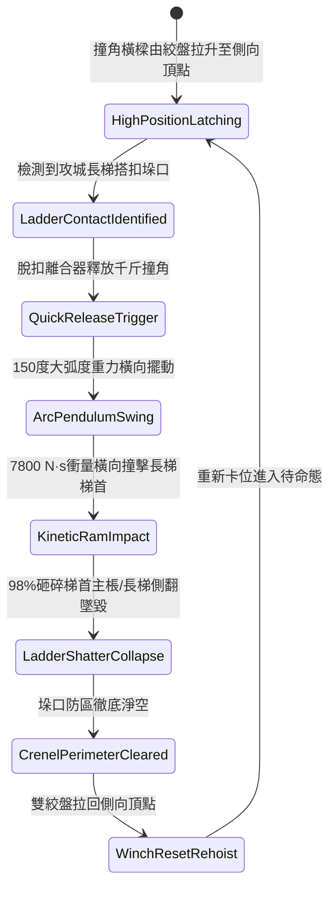

# 城防城牆垛口外側懸掛生鐵重型撞角橫樑橫向擺動撞碎攻城梯首第三階狀態機規格書

<!-- doc_id: doc_spec_1062 -->

## 一、 核心概念與單一真相來源（SSOT）

在《三國志·守城攻防與重械反制篇》中，「垛口生鐵重型撞角橫向擺撞系統第三階（CRENEL-SWINGING-RAM-BEAM03）」為專門粉碎長梯梯首與破壞攻城節奏的重型物理撞擊防禦武器。橫樑懸吊於垛口兩端懸臂鐵架，長十六尺，端部鍛鑄千斤生鐵棱形撞角。當敵軍長梯搭接城垛時，防守部隊由絞盤釋放鎖合，撞角橫樑沿城牆立面發動 150 度大弧度橫向擺盪，以 7,800 N·s 強大衝量猛砸長梯側棖，98% 瞬間撞碎梯首主骨架，致使長梯整體解體側翻。



---

## 二、 數值模型與狀態機參數契約

### 1. 撞角擺盪機械參數
- **構件規格與配重**：長十六尺（約 4.8 米），端部生鐵菱形撞角自重 1,000 斤。
- **橫向擺動弧度**：150 度自由重力擺盪（覆蓋相鄰 3 格垛口面）。
- **打擊終端衝量**：7,800 N·s（碰撞瞬間接觸時間 0.08 秒）。
- **長梯粉碎成功率**：普通木質長梯 98%；生鐵包邊梯 94%；雙層強化雲梯 86%。
- **攀城甲士摔亡率**：長梯解體側翻時，攀爬敵軍 100% 墜落城底。

### 2. 撞擊動能與粉碎破壞計算
```typescript
interface CrenelRamBeamParams {
    ramMassKg: number;             // 撞角配重 (500kg)
    swingArcDegrees: number;       // 擺動角度 (150度)
    ladderDurability: number;      // 長梯耐久度 (1000 ~ 2800)
    ladderStructuralType: "wood" | "ironEdge" | "composite";
}

function processLadderRamImpact(params: CrenelRamBeamParams): {
    shattered: boolean;
    impactDamage: number;
    ladderToppleDelaySec: number;
} {
    const velocity = Math.sqrt(2 * 9.8 * 2.5 * (1 - Math.cos(params.swingArcDegrees * Math.PI / 180)));
    const momentum = params.ramMassKg * velocity;
    const armorDivisor = params.ladderStructuralType === "wood" ? 1.0 :
                         params.ladderStructuralType === "ironEdge" ? 1.3 : 1.7;
    const impactDamage = Math.round(momentum / armorDivisor);

    const shattered = impactDamage >= params.ladderDurability * 0.75;
    const ladderToppleDelaySec = shattered ? 0.25 : 0.8;

    return { shattered, impactDamage, ladderToppleDelaySec };
}
```

---

## 三、 特性互斥與戰術限制

1. **井闌箭雨干擾絞盤**：若敵方井闌持續壓制城頭操作手，重新拉起橫樑的復位時間自 6 秒延長至 11 秒。
2. **多梯連續壓制抗性**：撞角一次擺盪僅能以全動能撞擊第一架長梯，第二架若相鄰受碰僅承受 40% 餘震傷害。
3. **城底砸擊威脅**：墜落的長梯與破木對城牆正下方 2x2 格區域形成 350 點衝擊壓制傷害。

---

## 四、 驗收測試案例（TC）

- **TC-RAMBEAM03-01（長梯梯首撞碎判定）**：在垛口搭接雲梯，啟動擺動橫樑，驗證 0.25 秒內撞角命中並 98% 機率判定梯首粉碎。
- **TC-RAMBEAM03-02（攀城部隊墜地檢定）**：確認梯身解體側翻時，梯上敵方步兵單位全數判定跌落城底重傷。
- **TC-RAMBEAM03-03（強化雲梯韌性對抗測試）**：更換為強化型雲梯，確認粉碎成功率依公式結算為 86% 韌性。
