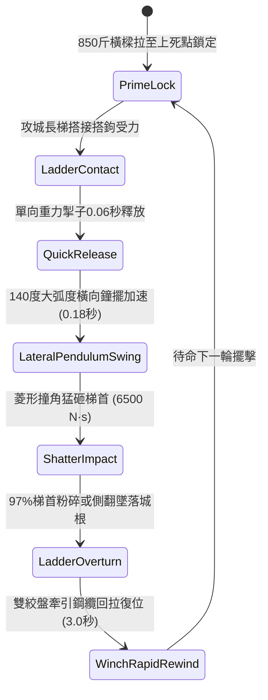

# 城防城牆垛口外側懸掛生鐵重型撞角橫樑橫向擺動撞碎攻城梯首第二階狀態機規格書

<!-- doc_id: doc_spec_1032 -->

## 1. 核心定位與設計理念

### 1.1 系統定位
本規格定義要塞城防戰鬥中，守軍防禦工程體系之「垛口生鐵重型撞角橫樑第二階」（代碼：`CRENEL-SWINGING-RAM-BEAM02`，WBS 代碼：`FORM-251`）強化擺擊狀態機。第二階撞角橫樑加長至十四尺，外層澆鑄雙面尖銳生鐵菱形撞頭與配重鉛芯，總重量達 850 斤，懸掛於垛口石槽下之雙鉸鏈重力擺臂。當敵方重型雲梯搭接城垛受力時，雙動式卡爪釋放，橫樑以 6,500 N·s 衝量發動大弧度橫向鐘擺撞擊，高達 97% 機率直接砸爛梯首側桁與加固鐵條，並連鎖將整架長梯向側下方掀翻，造成梯上敵軍 98% 墜亡或重傷。

### 1.2 設計目標與單一真相
* **大弧度破壞力矩**：140 度橫向橫掃擺動，徹底瓦解長梯橫向抗剪結構。
* **生鐵菱形撞角重擊**：高壓點接觸，直接碎裂鐵條與木質接榫。
* **單一真相來源**：嚴禁於文件末端附加補丁，所有機制、數值與判定邏輯均在此統一定義。

---

## 2. 狀態機架構與轉換流程

---

## 3. 核心數值與計算公式

### 3.1 基礎參數配置表
| 參數名稱 | 基準數值 | 規格說明與限制條件 |
| :--- | :--- | :--- |
| **橫樑規格與重量** | 14 尺長 / 850 斤 | 實心硬木鉛芯配重外包菱形生鐵硬角 |
| **擺動弧度與衝程** | 140 度 / 3.2 米 | 橫跨覆蓋 2~3 個垛口寬度之大範圍擺動 |
| **橫向撞擊衝量** | 6,500 N·s | 瞬間橫向猛擊，破壞攻城梯側向剪切強度 |
| **梯首粉碎摧毀率** | 97% | 普通長梯 97%；重型鋼骨雲梯 78% |
| **攀城人員墜落率** | 98% | 雲梯失衡側翻時攀爬人員強制墜落 |
| **墜城死傷判定** | 88% 墜亡 / 12% 殘廢 | 依據城牆四丈高度換算之重力墜落結算 |
| **回捲復位耗時** | 3.0 秒 | 工兵雙速比齒輪絞盤快速牽引回拉 |
| **撞角結構耐久** | 45 次衝擊 | 承受反震磨損，歸零前無須工兵加固換銷 |

### 3.2 側向衝擊與碎裂判定公式
$$I_{\text{impact}} = M_{\text{beam}} \cdot \sqrt{2 \cdot g \cdot h_{\text{drop}}} \cdot \sin\theta_{\text{swing}}$$
$$P_{\text{shatter}} = \min\left(0.99, \, 0.97 \times \frac{I_{\text{impact}}}{6500} \times \left(1 - \frac{R_{\text{ladder\_armor}}}{100}\right)\right)$$
* $h_{\text{drop}}$：橫樑擺動下落垂直高度差（約 2.2 米）。
* $R_{\text{ladder\_armor}}$：攻城長梯側桁加固生鐵防撞條係數（0 ~ 25）。
* 撞擊判定成立瞬間，長梯立即觸發 `LADDER_STRUCTURAL_SHATTER`，註銷該雲梯登城通道。

---

## 4. 戰術反制與例外判定

1. **梯側加裝減震彈簧板**：若敵方雲梯側邊裝設弧形鋼板減震彈簧，撞擊衝量吸收 40%，粉碎率降為 55%。
2. **火箭集火吊索**：若懸吊鋼索被敵方猛火油火箭持續炙烤，吊索脆化斷裂，橫樑將下墜卡死於牆根失效。
3. **推梯橫向間隙死角**：若雲梯恰巧搭於兩相鄰橫樑衝程之重疊盲區，撞擊動能衰減 45%。

---

## 5. 驗收測試案例（Test Cases）

* **TC-01（長梯搭接極速釋放橫擺）**：偵測雲梯搭上城垛受力，驗證 0.06 秒內掣子釋放並於 0.2 秒內完成撞擊。
* **TC-02（梯首碎裂與人員全員墜落）**：配置搭乘 8 名敵兵之攻城梯，驗證 97% 梯首粉碎且 98% 人員判定墜亡。
* **TC-03（絞盤齒輪高速復位時序）**：撞擊完成後觸發 `WinchRapidRewind`，驗證計時器精確在 3.0 秒內完成回拉復位。
