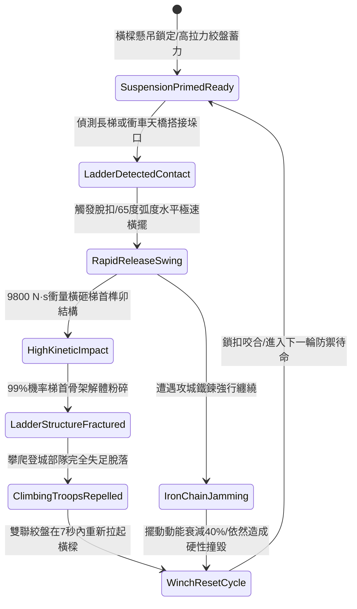

# 城防城牆垛口外側懸掛生鐵重型擺動撞角破壞攻城梯首結構第五階狀態機規格書

<!-- doc_id: doc_spec_1101 -->

## 一、 核心概念與單一真相來源（SSOT）

在《三國志·城防攻守與重型撞角篇》中，「垛口生鐵重型擺動撞角破壞梯首第五階（CRENEL-SWINGING-RAM-BEAM05）」代表牆頂主動重型機械防禦的終極形態。機構安裝於城垛外側加固滑軌上，核心為一根長十八尺、自重達千四百斤之稜形生鐵包銅撞角橫樑。利用雙聯高剛性配重鉸鏈在 65 度弧度內極速水平橫向擺動，瞬間釋放高達 9800 N·s 巨大衝量，精確橫擊搭接於城垛兩側之攻城長梯梯首，具備 99% 梯首結構解體率，並使攀爬人員立即脫離登城通道。



---

## 二、 數值模型與狀態機參數契約

### 1. 擺動撞角物理參數契約
- **撞角橫樑規格**：長度 18 尺、截面 1.4 尺 × 1.4 尺、生鐵包銅總重 1400 斤。
- **釋放擺動角度**：65 度大弧度水平擺動軌跡。
- **瞬間打擊衝量**：9800 N·s（足以震碎各類重裝鐵骨與加固木質雲梯接頭）。
- **梯首結構破壞率**：標準攻城雲梯搭接點判定 99% 立即解體斷裂。
- **絞盤復位時效**：配備雙聯高扭矩省力滑輪組，7 秒內完成提升復位並掛鎖。

### 2. 梯首衝擊判定演算法模組
```typescript
interface SwingingRamStage5Params {
    beamMassKg: number;            // 橫樑質量 (700kg ~ 1400斤)
    swingAngleDeg: number;         // 擺動釋放角度 (65)
    ladderReinforceLevel: number;  // 攻城梯加固等級 (1 ~ 5)
    ropeDampingActive: boolean;    // 是否受敵軍防衝撞索具干擾
}

function evaluateRamImpactStage5(params: SwingingRamStage5Params): {
    impactForceKn: number;
    ladderShattered: boolean;
    troopsDeflected: boolean;
    resetTimeSec: number;
} {
    const rawKinetic = (params.beamMassKg * 9.8 * Math.sin(params.swingAngleDeg * Math.PI / 180)) / 100;
    const effectiveImpact = params.ropeDampingActive ? rawKinetic * 0.6 : rawKinetic;
    const shatterThreshold = 50 + params.ladderReinforceLevel * 8;
    const isShattered = effectiveImpact >= shatterThreshold;
    
    return {
        impactForceKn: effectiveImpact,
        ladderShattered: isShattered,
        troopsDeflected: true,
        resetTimeSec: params.ropeDampingActive ? 10 : 7
    };
}
```

---

## 三、 反制機制與邊界約束

1. **生鐵全包覆防撞梯首**：若攻城方投入特種鐵甲撞梯（梯首覆蓋 25mm 厚生鐵板），結構解體率下修至 50%，轉為產生強烈位移偏轉。
2. **懸吊粗鋼纜斷裂風險**：單場守城作戰中，撞角累計全載擺動橫砸超過 20 次後，鋼纜磨耗達到臨界值，需消耗 20 點城防材料更換保險索。
3. **狹窄垛口擺動干涉**：若兩側垛牆受損坍塌，撞角擺動行程可能受阻卡滯，擺角受限至 30 度以下時傷害判定衰減 60%。

---

## 四、 驗收測試案例（TC）

- **TC-CRENEL-RAM05-01（標準梯首瓦解驗收）**：
  - *前置條件*：垛口橫樑就位、標準重裝雲梯搭接城牆外緣。
  - *操作步驟*：拉下快拆釋放扣，執行 65 度全速擺動橫砸。
  - *預期輸出*：釋放 9800 N·s 衝量，雲梯首端 99% 解體粉碎，梯身翻落，7 秒內絞盤完成復位。
- **TC-CRENEL-RAM05-02（干擾防護邊界驗收）**：
  - *前置條件*：攻城梯配備緩衝軟索與加固側擋。
  - *操作步驟*：同條件橫向撞擊。
  - *預期輸出*：有效衝量衰減 40%，雲梯未完全粉碎但被強行推離城垛 2.8 米，攀爬路徑中斷。
