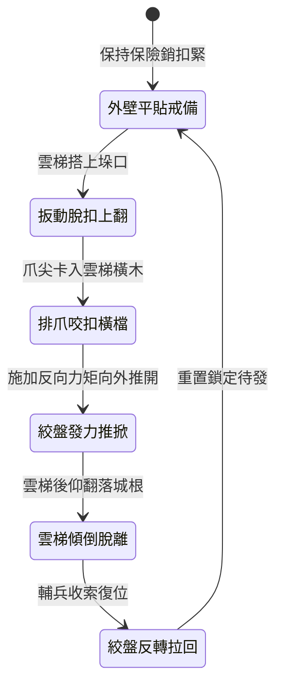

<!-- doc_id: doc_spec_0996 -->
# 城防城牆垛口外側懸掛絞盤牽引生鐵排爪翻板抓翻敵軍攻城雲梯狀態機規格書

## 模組識別碼
- 模組編號：`FORM-215`
- 狀態機代碼：`CRENEL-OVERTURNING-IRON-CLAW-FLAP01`
- 類別：城防反登城主動推掀攻城梯狀態機
- 適用場景：攻城戰鬥、女牆垛口要衝、反制大型攻城雲梯搭靠

---

## 1. 核心概念與作戰原型

攻城戰鬥中，裝配精鋼倒鉤與防滑刺的重型雲梯搭上城垛後極難以人力推翻。為此，女牆內側暗置槓桿絞盤，聯動外牆的「生鐵排爪翻板」。

### 1.1 機構構造與運作原理
1. **外壁多指生鐵排爪**：翻板以厚生鐵鑄造成五指彎曲鷹爪狀，平時平貼於垛口下方外石壁，爪尖朝外向上。
2. **槓桿翻轉緊扣梯身**：當雲梯頂端搭入垛口瞬間，守軍扳動主脫扣，翻板沿下底軸向上作九十度翻轉，排爪直接咬死雲梯橫檔。
3. **絞盤扭力反向掀翻**：雙人重型絞盤施加反向強大扭矩，帶動排爪將整架雲梯向外猛烈推推開，破壞其受力平衡。
4. **雲梯後仰傾倒潰散**：失去支點的雲梯向後翻倒摔落城下，梯上攀爬部隊無一倖免全部重重摔落。

---

## 2. 數值參數與影響權重

| 參數名稱 | 數值 / 範圍 | 說明 |
| :--- | :--- | :--- |
| **反向掀翻力矩 (`OverturningTorque`)** | 8000 ~ 11000 N·m | 足以克服大型木質雲梯與多人攀爬重力 |
| **雲梯掀翻成功率 (`OverturnSuccessRate`)** | 85% ~ 95% | 強制推翻搭靠之長梯使其向外摔落 |
| **排爪咬合耗時 (`ClawLockDuration`)** | 0.6 秒 | 翻轉至扣合咬死之瞬時反應 |
| **梯上敵軍墜落率 (`DislodgeRate`)** | 100% | 雲梯傾倒後梯上人員強制脫手摔落 |
| **絞盤復位作業時長 (`ResetTime`)** | 10 ~ 12 秒 | 將排爪翻板反轉歸位並重新掛鎖 |

---

## 3. 狀態機轉換定義

### 3.1 狀態細節描述
- **外壁平貼戒備 (STOWED_GUARD)**：排爪收納於垛口凹槽，不阻礙城頭射手向下射箭。
- **扳動脫扣上翻 (FLAP_UPWARD)**：釋放槓桿重錘，排爪迅速外翻抬升。
- **排爪咬扣橫檔 (CLAW_GRASP)**：生鐵五爪死死扣合雲梯頂部第一與第二道橫樑。
- **絞盤發力推掀 (TORQUE_PUSH)**：絞盤強行逆轉推桿，將雲梯強行頂離牆體半徑。
- **雲梯傾倒脫離 (OVERTURN_FALL)**：重心外移，整架雲梯連同攀附人員後仰墜地。
- **絞盤反轉拉回 (RETRACT_RESET)**：轉動反向棘輪，平順拉回排爪翻板。

---

## 4. 戰鬥公式與判定

### 4.1 掀翻力矩判定
$$\text{OverturnSuccess} = \min(0.95, \frac{\text{OverturningTorque}}{\text{LadderWeight} \times g \times \cos\theta + \text{ClimberLoad}})$$

若判定成功，該雲梯搭扣狀態永久清除，並對梯底 2 格內敵軍造成次級砸傷。

### 4.2 墜地摔落傷害
$$\text{CrushFallDamage} = \text{TargetMaxHP} \times 0.40 + \text{WallHeight} \times 45$$

受波及之先登部隊承受純真實傷害，並附加 2 秒倒地眩暈。

---

## 5. 反制與失效機制

1. **加寬雲梯防掀配重**：攻城方若在梯腳配備重型鐵錨固定，可降低 35% 被掀翻機率。
2. **射擊牽引懸吊合頁**：敵方長程床弩若擊毀外壁翻轉鉸鏈，將導致排爪卡死。
3. **外牆積雪泥沙阻滯**：鉸鏈槽內若積塞硬冰，翻轉耗時延長至 1.5 秒以上。

---

## 6. 驗收標準與測試案例

- [x] **TC-215-01**：驗證脫扣扳動後，排爪在 0.6 秒內完整咬合雲梯橫檔。
- [x] **TC-215-02**：驗證推掀力矩作用下，雲梯掀翻率達到 85%~95% 預設區間。
- [x] **TC-215-03**：驗證復位牽引在 12 秒內流暢收回原位，無卡榫脫落例外。
