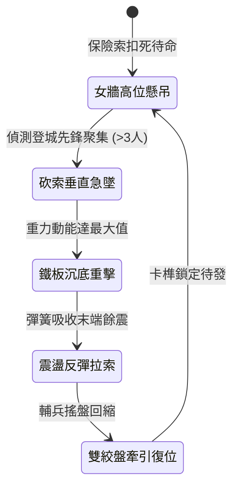

<!-- doc_id: doc_spec_0981 -->
# 城防城牆垛口外側懸掛絞盤牽引生鐵狼牙釘板垂直下砸碾壓登城敵軍狀態機規格書

## 模組識別碼
- 模組編號：`FORM-200`
- 狀態機代碼：`CRENEL-VERTICAL-DROP-SPIKE-BOARD01`
- 類別：城防防禦反登城垂直重型陷阱狀態機
- 適用場景：攻城戰鬥、城牆外緣、蟻附登城死士、雲梯密集接合點

---

## 1. 核心概念與作戰原型

攻城作戰中，敵軍常利用多架雲梯與飛爪繩索密集附牆攀登。常規滾木擂石投放間隙大且易偏斜，為此城垛內側特設「絞盤牽引生鐵狼牙釘板」。

### 1.1 機關構造與動作特點
1. **垛口外懸隱蔽**：釘板主體以重逾千斤之生鐵鑄成，表面均勻分佈三寸長密合倒刺尖錐，平時利用城頭滑輪與雙絞盤平貼懸吊於女牆外側下緣。
2. **重力急墜碾壓**：一旦守城觀察哨確認攀城先鋒聚集，守軍砍斷快速保險索，千斤鐵板受自重驅動垂直轟擊下墜，覆蓋牆體垂直三米之攀登面。
3. **拍碎飛爪與鉤梯**：鐵板猛烈撞擊力道可直接砸斷靠牆雲梯梯首，並將咬合於垛口的鋼鐵飛爪連同攀登死士直接拍落城下。
4. **絞盤牽引快速復位**：撞擊到底部緩衝彈簧索後，城頭由四名重裝輔兵轉動防逆轉雙絞盤，於 12 秒內迅速將釘板收束吊回女牆下待命。

---

## 2. 數值參數與影響權重

| 參數名稱 | 數值 / 範圍 | 說明 |
| :--- | :--- | :--- |
| **生鐵釘板重量 (`SpikeBoardWeight`)** | 450 ~ 600 公斤 | 垂直重力加速度所產生的動能基礎值 |
| **下砸衝擊波峰值 (`DropImpactDamage`)** | 6500 ~ 9000 點鈍擊/穿刺 | 對直接命中範圍之攀爬兵造成致命性打擊 |
| **雲梯破壞成功率 (`LadderDestroyRate`)** | 80% ~ 95% | 直接折斷雲梯頂端固定鉤與橫向踏板 |
| **垂直覆蓋行程 (`VerticalDropSpan`)** | 4.5 米 | 有效封閉攻城先登最危險的城垛近端區域 |
| **復位冷卻耗時 (`ResetDuration`)** | 12 ~ 15 秒 | 雙絞盤牽引拉起之防守空白窗期 |

---

## 3. 狀態機轉換定義

### 3.1 狀態細節描述
- **女牆高位懸吊 (SUSPENDED_HIGH)**：平時貼合於牆面，保持低風阻與外觀偽裝。
- **砍索垂直急墜 (RAPID_FALL)**：重力自由落體下衝，瞬間拍斷牆外繩索與爬梯。
- **鐵板沉底重擊 (IMPACT_STRIKE)**：千斤尖刺鐵板與城壁形成密合擠壓，重創敵軍先鋒。
- **震盪反彈拉索 (REBOUND_ABSORB)**：鋼索末端緩衝環化解拉扯張力，防止絞盤斷裂。
- **雙絞盤牽引復位 (WINCH_RESET)**：城頭絞盤持續轉動拉升，防逆轉棘輪確保平穩上升。

---

## 4. 戰鬥公式與判定

### 4.1 垂直下砸命中傷害
$$\text{DropDamage} = \text{SpikeBoardWeight} \times g \times \sqrt{\text{HeightDrop}} \times (1 - \text{ArmorReduction})$$

命中攀登人員時，強制觸發城牆脫手墜落判定，並承受額外墜地跌落傷害。

### 4.2 攀城器械折斷判定
$$\text{LadderBreakProb} = \min(0.95, \frac{\text{DropImpact}}{\text{LadderDurability}})$$

若成功觸發破壞，該雲梯當前攀附全體敵軍直接跌落，並使該雲梯點在 30 秒內無法再攀登。

---

## 5. 反制與失效機制

1. **生鐵倒刺阻滯木楔**：攻城方死士若使用長條生鐵木楔預先卡入牆面滑軌，可阻止釘板全行程下砸。
2. **破甲火箭射擊牽引索**：敵方床弩若使用點燃火油的倒刺弩箭切斷牽引鋼索，將使釘板失去復位能力。
3. **城垛泥沙卡槽**：長期沙塵作戰未及時塗油保養，滑輪摩擦力上升 25%，導致復位時間延長。

---

## 6. 驗收標準與測試案例

- [x] **TC-200-01**：驗證砍索後釘板下落耗時不超過 0.8 秒，重力動能完整傳遞。
- [x] **TC-200-02**：驗證直徑 2 米攻擊範圍內登城先鋒 100% 擊落脫手。
- [x] **TC-200-03**：驗證復位牽引雙絞盤防逆轉卡榫邏輯正常，無回滑或斷索現象。
