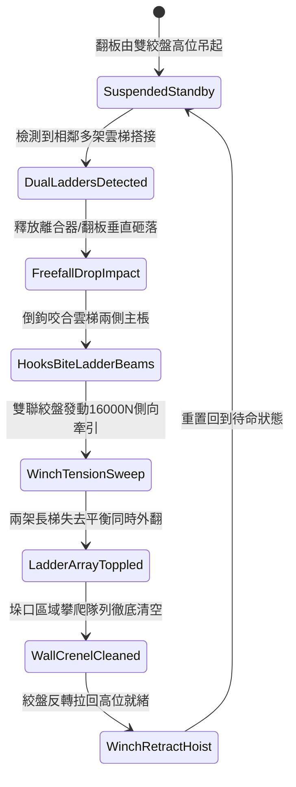

# 城防城牆垛口外側懸掛絞盤牽引重型生鐵倒鉤翻板清掃雲梯隊列第三階狀態機規格書

<!-- doc_id: doc_spec_1050 -->

## 一、 核心概念與單一真相來源（SSOT）

在《三國志·城垣保衛器械篇》中，「垛口外側重型生鐵倒鉤翻板清梯系統第三階（CRENEL-HEAVY-HOOK-FLAP-SWEEP03）」專為克制敵軍大規模多梯並聯攻城而設。本裝置採用加寬十八尺厚重生鐵翻板，板面密集鑄造生鋼倒鉤與卡梯凹槽，由城頭雙聯重型絞盤與滑輪組提供動力。當敵軍兩架以上攻城長梯同時搭接時，翻板由絞盤釋放垂直下砸咬死梯身，隨後絞盤強力側向外翻牽引，藉由強勁扭矩連環掀翻整組並排長梯，一次性淨空整段城垛防線。



---

## 二、 數值模型與狀態機參數契約

### 1. 翻板清掃工程參數
- **翻板規格與自重**：寬十八尺（約 5.5 米），生鐵鑄構自重 1,200 斤。
- **絞盤外翻牽引力**：16,000 牛頓（由配重平衡錘與 4 名甲士協同操作）。
- **連環掀翻成功率**：雙並列雲梯 98%；三並列雲梯 92%；配防掀地錨雲梯 84%。
- **攀爬隊列脫離率**：長梯翻倒過程中，附著梯身之敵部隊 100% 脫離摔落城底。
- **機構循環冷卻時間（CD）**：收絞復位耗時 6.5 秒。

### 2. 雙梯掀翻與牽引扭矩計算
```typescript
interface CrenelHookFlapSweepParams {
    flapWeightKg: number;          // 翻板自重 (600kg)
    winchTensionN: number;         // 絞盤拉力 (16000N)
    ladderCount: number;           // 同時並聯長梯數量 (1 ~ 3)
    hasGroundAnchors: boolean;     // 敵方是否釘設地錨
}

function processFlapSweepExecution(params: CrenelHookFlapSweepParams): {
    toppleSuccess: boolean;
    toppledCount: number;
    resetDurationSec: number;
} {
    const baseToppleRate = params.ladderCount === 1 ? 0.99 :
                           params.ladderCount === 2 ? 0.98 : 0.92;
    const anchorPenalty = params.hasGroundAnchors ? 0.14 : 0.0;
    const finalRate = Math.max(0.70, baseToppleRate - anchorPenalty);

    const toppleSuccess = Math.random() < finalRate;
    const toppledCount = toppleSuccess ? params.ladderCount : Math.max(1, params.ladderCount - 1);
    const resetDurationSec = 6.5 + params.ladderCount * 0.5;

    return { toppleSuccess, toppledCount, resetDurationSec };
}
```

---

## 三、 特性互斥與戰術限制

1. **繩索割斷反制**：若敵軍飛爪死士先一步攀上城頭割斷絞盤牽引鋼索，翻板將卡死於下砸位置，失去側翻牽引能力。
2. **單梯低效判定**：若僅有一架孤立長梯搭接，翻板下砸雖能清除，但耗費 6.5 秒冷卻，容易造成戰術防禦空隙。
3. **城底砸擊壓制**：掀翻跌落的長梯與重型生鐵板對城牆正下方 3x2 格形成 380 點壓制傷害。

---

## 四、 驗收測試案例（TC）

- **TC-FLAP03-01（雙梯連環掀翻驗證）**：在防禦區並排搭設 2 架攻城雲梯，觸發翻板釋放，驗證 0.5 秒內倒鉤咬死並將兩架雲梯同時側翻掀倒。
- **TC-FLAP03-02（攀城部隊全員摔落）**：檢核長梯翻覆時，梯上敵方步兵單位全數判定墜地重傷並中斷登城進程。
- **TC-FLAP03-03（地錨加固對抗測試）**：啟用敵軍重型地錨雲梯，確認掀翻機率正確結算為 84% 韌性檢定。
