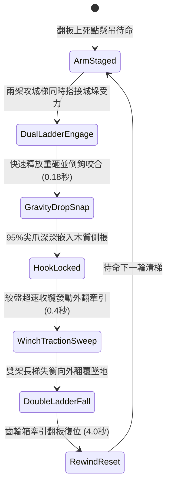

# 城防城牆垛口外側懸掛絞盤牽引重型生鐵倒鉤翻板清掃雲梯隊列第二階狀態機規格書

<!-- doc_id: doc_spec_1020 -->

## 1. 核心定位與設計理念

### 1.1 系統定位
本規格定義要塞城防體系中，守軍防禦工程之「垛口絞盤牽引重型生鐵倒鉤翻板第二階」（代碼：`CRENEL-HEAVY-HOOK-FLAP-SWEEP01`，WBS 代碼：`FORM-239`）進階清梯狀態機。相較於初階翻板，本裝置增設了雙組外伸加長生鐵尖爪倒鉤與多倍率滑輪減速齒輪箱。當敵軍攻城雲梯搭上垛口外牆時，翻板以重力砸落並利用倒鉤直接咬死雲梯梯棖，隨後雙絞盤以 4 倍速強大拉力強制向側後方牽引翻轉，95% 機率連帶推翻整排相鄰並列之兩架雲梯，並將梯上全部攻城部隊扯離城牆摔落城底。

### 1.2 設計目標與單一真相
* **雙梯連鎖牽引清掃**：透過加寬倒鉤橫樑一次鎖定相鄰兩架長梯，形成連鎖掀翻破壞。
* **強力外翻卸載**：不只垂直砸壓，更依賴斜向絞盤拉力將雲梯向外推出安全支點。
* **單一真相來源**：嚴禁於文件末端附加補丁，所有機制、數值與判定邏輯均在此統一定義。

---

## 2. 狀態機架構與轉換流程

---

## 3. 核心數值與計算公式

### 3.1 基礎參數配置表
| 參數名稱 | 基準數值 | 規格說明與限制條件 |
| :--- | :--- | :--- |
| **生鐵倒鉤翻板尺寸** | 16 尺寬 / 800 斤 | 加寬規格，可同時橫跨覆蓋兩座相鄰長梯 |
| **倒鉤數量與長度** | 16 枚 / 8 寸長 | 倒鉤尖端帶反勾榫，咬入木質後無法輕易滑脫 |
| **連環掀翻率（Sweep）**| 95% | 對相鄰兩架木製雲梯生效；若為鋼骨梯則為 76% |
| **牽引拉力（Traction）**| 8,500 牛頓 | 雙側雙工兵絞盤齒輪倍率放大之強大拉力 |
| **攀爬部隊摔落率** | 98% | 牽引翻覆瞬間，兩梯上全數攀登敵軍皆強制墜落 |
| **重墜死傷判定** | 85% 墜亡 / 15% 殘疾 | 四丈高空墜地之致命重力衝擊計算 |
| **復位冷卻時間** | 4.0 秒 | 絞盤反向高速纏繞鋼纜回位時間 |
| **翻板耐久度** | 40 次使用 | 承受持續撞擊拉扯，歸零需城防工兵修復卡榫 |

### 3.2 雙梯掀翻判定公式
$$P_{\text{sweep}} = \min\left(0.98, \, 0.95 \times \frac{F_{\text{winch}}}{8500} \times \left(1 - \frac{W_{\text{reinforce}}}{100}\right)\right)$$
* $F_{\text{winch}}$：絞盤當前輸出之有效牽引拉力（牛頓）。
* $W_{\text{reinforce}}$：攻城長梯底座之防外翻配重抗傾係數（0 ~ 25）。
* 牽引成功時，兩梯上所有敵軍立即清除「攀爬登城」狀態並附加 `FALL_FROM_HEIGHT_LETHAL` 判定。

---

## 4. 戰術反制與例外判定

1. **梯頂搭鉤外掛倒刺**：若敵方雲梯具備防拉脫反鎖鋼索，翻板倒鉤咬入後可能卡死，需延長 2.0 秒額外解鎖復位時間。
2. **單梯孤立搭接**：若僅有一架雲梯搭接，倒鉤仍能發揮作用，但掀翻效率自動降為單梯 92%，不會觸發第二架連鎖判定。
3. **猛火油焚燒翻板**：若翻板遭敵方猛火罐直擊燃燒，木質骨架耐久每秒流失 15 點，燃燒中翻板若耐久歸零將直接墜落斷裂。

---

## 5. 驗收測試案例（Test Cases）

* **TC-01（雙長梯連鎖咬合掀翻）**：城垛並列搭接 2 架攻城梯，啟動翻板，驗證 0.2 秒內倒鉤嵌入並於 0.4 秒內同步拉翻兩梯。
* **TC-02（攀城梯隊全員摔落）**：配置兩梯共 12 名敵兵同時攀登，驗證翻板牽引後全員判定摔落且死亡率達到 85%。
* **TC-03（絞盤齒輪高速復位時延）**：驗證牽引完成後自動進入 `RewindReset`，計時精確維持 4.0 秒後回到 `ArmStaged`。
