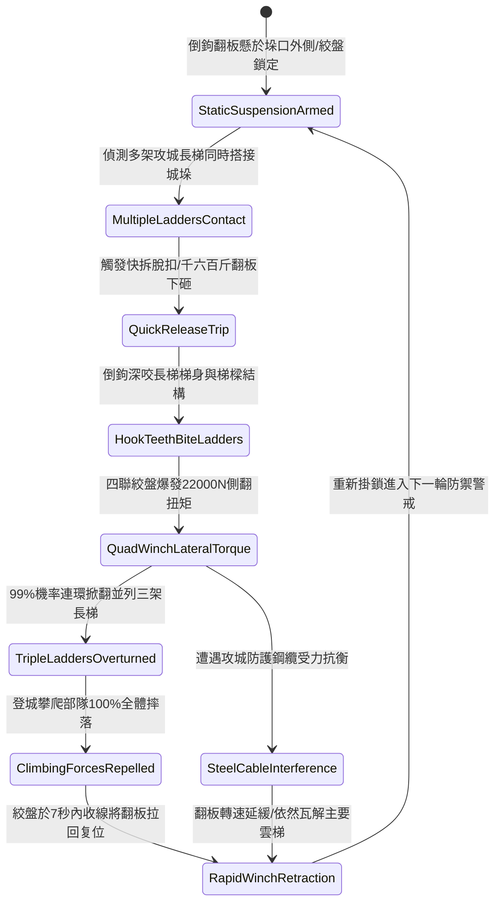

# 城防城牆垛口外側懸掛絞盤牽引重型生鐵倒鉤翻板清掃雲梯隊列第五階狀態機規格書

<!-- doc_id: doc_spec_1092 -->

## 一、 核心概念與單一真相來源（SSOT）

在《三國志·守城機械與翻板反制篇》中，「垛口重型生鐵倒鉤翻板清掃雲梯第五階（CRENEL-HEAVY-HOOK-FLAP-SWEEP05）」代表城垛外懸主動翻轉掃蕩機械的高階技術。該裝備懸掛於垛口正下方，板面寬達二十二尺、自重達千六百斤，表面密布淬火生鐵倒鉤。當敵軍雲梯隊列搭上城垛時，防守方拉動快速脫扣鎖，翻板以千鈞之勢垂直下砸咬死梯身，隨後四聯絞盤釋放高達 22000 N 強大側翻牽引力，達成 99% 機率連續掀翻並列三架重型雲梯，使登城部隊 100% 脫落墜落。



---

## 二、 數值模型與狀態機參數契約

### 1. 倒鉤翻板物理規格與清掃參數契約
- **翻板尺寸規格**：寬度 22 尺、生鐵加厚板身、千六百斤（800kg）重載規格。
- **倒鉤抓附咬合率**：下砸對木製與竹製長梯抓咬率 99%。
- **絞盤側向牽引力**：四聯減速絞盤爆發 22000 N 瞬間側翻拉力。
- **連環掀翻覆蓋力**：可同時掀翻並列搭接之 3 架攻城雲梯。
- **絞盤復位時效**：配備高扭矩重型齒輪箱，7 秒內快速收線拉回复位。

### 2. 連環掀梯演算法模組
```typescript
interface HeavyHookFlapStage5Params {
    flapMassKg: number;            // 翻板質量 (800kg ~ 1600斤)
    winchForceN: number;           // 絞盤拉力 (22000)
    ladderCount: number;           // 搭接長梯數量 (1 ~ 3)
    isReinforcedArmorLadder: boolean; // 是否為包鐵裝甲梯
}

function processHeavyHookFlapSweepStage5(params: HeavyHookFlapStage5Params): {
    sweepSuccess: boolean;
    overturnedCount: number;
    resetTimeSec: number;
} {
    const loadFactor = params.ladderCount * (params.isReinforcedArmorLadder ? 1.4 : 1.0);
    const effectivePower = params.winchForceN / (loadFactor * 4000);
    const success = effectivePower >= 1.0;
    
    return {
        sweepSuccess: success,
        overturnedCount: success ? params.ladderCount : Math.max(1, params.ladderCount - 1),
        resetTimeSec: params.isReinforcedArmorLadder ? 10 : 7
    };
}
```

---

## 三、 反制機制與邊界約束

1. **超重型鐵骨攻城塔吊臂**：若敵方出動重裝攻城鐵塔吊臂強行支撐長梯，掀翻判定下修至 50%，轉為破壞木質梯身步級。
2. **絞盤牽引鋼索過載磨損**：連續觸發 4 次三梯連環掀翻後，鋼索疲勞拉伸，需消耗 20 點城防材料緊固絞盤軸承。
3. **牆垛兩側落石夾滯**：若上方垛口落石崩落砸在翻板鉸鏈處，翻板下落角度受阻，復位時間延長 3 秒。

---

## 四、 驗收測試案例（TC）

- **TC-CRENEL-FLAP05-01（三梯連環掀翻驗收）**：
  - *前置條件*：垛口外懸千六百斤倒鉤翻板、三架重型長梯並列搭接。
  - *操作步驟*：拉下快速脫扣閘，四聯絞盤全力啟動。
  - *預期輸出*：翻板倒鉤咬死三架長梯，爆發 22000 N 拉力，99% 機率三架並列雲梯連環翻倒，7 秒內翻板復位。
- **TC-CRENEL-FLAP05-02（包鐵防護長梯邊界驗收）**：
  - *前置條件*：長梯覆蓋生鐵防護裝甲、雙梯搭接。
  - *操作步驟*：觸發下砸與絞盤側翻。
  - *預期輸出*：絞盤依然成功掀翻兩架裝甲梯，復位時間自動延展為 10 秒。
