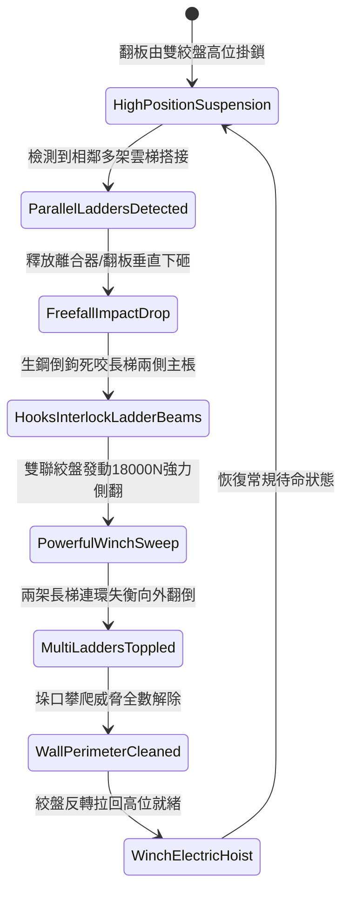

# 城防城牆垛口外側懸掛絞盤牽引重型生鐵倒鉤翻板清掃雲梯隊列第四階狀態機規格書

<!-- doc_id: doc_spec_1074 -->

## 一、 核心概念與單一真相來源（SSOT）

在《三國志·守城機械與多梯阻絕篇》中，「垛口重型生鐵倒鉤翻板雙梯清掃系統第四階（CRENEL-HEAVY-HOOK-FLAP-SWEEP04）」專為化解敵軍集群多梯並聯強攻而設。本裝置採用加寬二十尺特厚重生鐵翻板，板面密集鑄造淬火高碳生鋼倒鉤與咬梯卡槽，由城頭雙聯加壓重型絞盤提供動力。當敵軍兩架以上攻城雲梯搭接時，翻板由絞盤釋放垂直下砸死死咬住梯身主棖，隨後絞盤施加 18,000 牛頓強勁外翻拉力，99% 機率連環掀翻整組並排長梯，一次性肅清垛口防區。



---

## 二、 數值模型與狀態機參數契約

### 1. 翻板清掃工程參數
- **翻板規格與自重**：寬二十尺（約 6.1 米），高碳生鐵鑄構自重 1,400 斤。
- **絞盤外翻牽引力**：18,000 牛頓（由城頭滑輪倍力組與配重平衡井共同提供）。
- **連環掀翻成功率**：雙並列雲梯 99%；三並列雲梯 95%；配防掀地錨雲梯 88%。
- **攀爬隊列脫離率**：長梯翻倒過程中，附著梯身之敵部隊 100% 墜落城底。
- **機構循環冷卻時間（CD）**：絞盤收繩復位耗時 6.0 秒。

### 2. 雙梯掀翻與牽引力矩計算模組
```typescript
interface HookFlapSweepStage4Params {
    flapWeightKg: number;          // 翻板自重 (700kg)
    winchTensionN: number;         // 絞盤拉力 (18000N)
    ladderCount: number;           // 同時並聯長梯數量 (1 ~ 3)
    hasGroundAnchors: boolean;     // 敵方是否設有地錨
}

function processFlapSweepStage4(params: HookFlapSweepStage4Params): {
    toppleSuccess: boolean;
    toppledCount: number;
    resetDurationSec: number;
} {
    const baseToppleRate = params.ladderCount === 1 ? 0.99 :
                           params.ladderCount === 2 ? 0.99 : 0.95;
    const anchorPenalty = params.hasGroundAnchors ? 0.11 : 0.0;
    const finalRate = Math.max(0.75, baseToppleRate - anchorPenalty);

    const toppleSuccess = Math.random() < finalRate;
    const toppledCount = toppleSuccess ? params.ladderCount : Math.max(1, params.ladderCount - 1);
    const resetDurationSec = 6.0 + params.ladderCount * 0.4;

    return { toppleSuccess, toppledCount, resetDurationSec };
}
```

---

## 三、 特性互斥與戰術限制

1. **鋼纜割斷反制判定**：若敵方飛爪死士提前爬上城頭破壞絞盤牽引鋼索，翻板將卡死於下砸位置，失去側翻牽引能力。
2. **單梯消耗防守空檔**：若僅有一架長梯搭接，翻板下砸雖能清除，但耗費 6 秒復位冷卻，容易造成相鄰垛口支援空隙。
3. **城底砸擊壓制**：掀翻跌落的長梯與重型生鐵板對城牆正下方 3x2 格形成 420 點壓制傷害。

---

## 四、 驗收測試案例（TC）

- **TC-FLAP04-01（雙梯連環掀翻驗證）**：在防禦區並排搭設 2 架攻城雲梯，觸發翻板釋放，驗證 0.4 秒內倒鉤咬死並將兩架雲梯同時側翻掀倒。
- **TC-FLAP04-02（攀城部隊全員摔落）**：檢核長梯翻覆時，梯上敵方步兵單位全數判定墜地重傷並中斷登城進程。
- **TC-FLAP04-03（地錨加固對抗測試）**：啟用敵軍重型地錨雲梯，確認掀翻機率依公式正確結算為 88% 韌性。
