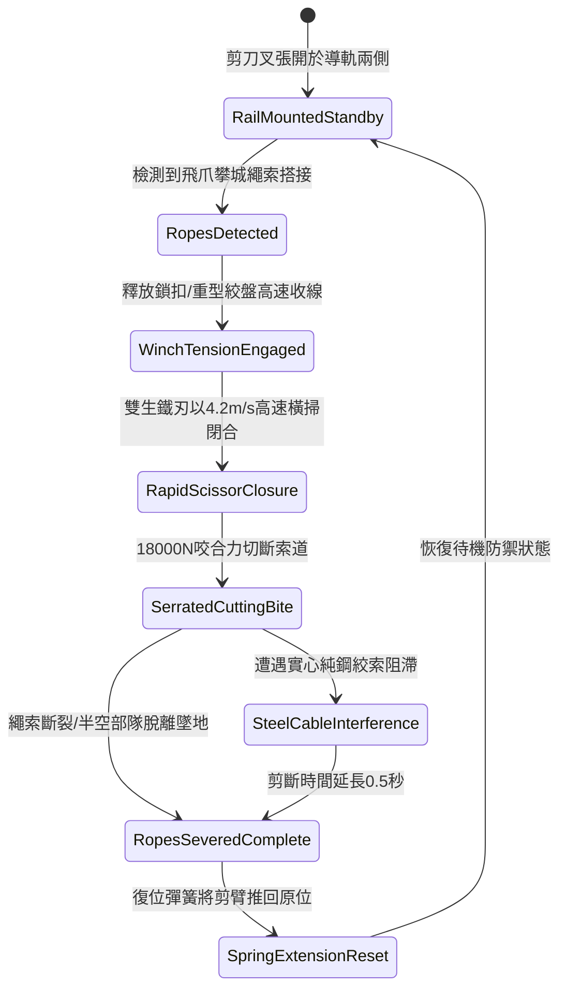

# 城防城牆垛口外側懸掛絞盤牽引重型生鐵剪刀叉剪斷攀城索道第三階狀態機規格書

<!-- doc_id: doc_spec_1053 -->

## 一、 核心概念與單一真相來源（SSOT）

在《三國志·守城機械與特種防禦篇》中，「垛口重型生鐵剪刀叉剪索裝置第三階（CRENEL-SCISSOR-ROPE-CUTTER03）」專為剪斷敵軍攀城繩索、飛爪索道與軟梯而設計。剪刀叉安裝於垛口底座水平導軌，雙臂採用十尺長高碳淬火生鐵巨刃，刃緣佈設密排反向鋸齒。當敵軍拋擲飛爪扣上垛口時，城頭絞盤牽引鋼索以 4.2 米/秒高速橫向收剪，雙刃產生 18,000 牛頓巨大剪切力，迅速切斷所有麻繩、牛皮索與夾鋼絲繩索，阻斷死士攀越。



---

## 二、 數值模型與狀態機參數契約

### 1. 剪刀叉機械參數
- **剪臂長度與材質**：十尺長（約 3 米），高碳生鐵鑄鍛配鋸齒刃。
- **絞盤閉合牽引力**：18,000 牛頓（由城垛重力配重井瞬間帶動）。
- **索道剪斷成功率**：普通麻繩/棕繩 100%；牛皮防割索 98%；夾細鋼絲複合索 92%。
- **動作閉合反應時效**：0.28 秒極速閉合橫掃。
- **死士攀登瓦解率**：繩索切斷時，攀爬在半空中的敵軍單位 100% 墜落城底。

### 2. 剪切力學與索道判定模組
```typescript
interface ScissorRopeCutterParams {
    cuttingForceN: number;         // 剪切咬合力 (18000N)
    cableType: "hemp" | "rawhide" | "steelCore";
    attachedSoldierCount: number;  // 索道上懸掛兵員數 (1 ~ 4)
}

function processRopeSevering(params: ScissorRopeCutterParams): {
    severed: boolean;
    cuttingDelaySec: number;
    fallenSoldiers: number;
} {
    const cableResistance = params.cableType === "hemp" ? 1.0 :
                            params.cableType === "rawhide" ? 1.4 : 2.2;
    const canSever = params.cuttingForceN >= cableResistance * 6000;

    const cuttingDelaySec = params.cableType === "steelCore" ? 0.45 : 0.28;
    const fallenSoldiers = canSever ? params.attachedSoldierCount : 0;

    return { severed: canSever, cuttingDelaySec, fallenSoldiers };
}
```

---

## 三、 特性互斥與戰術應對原則

1. **防護重盾阻擋卡刃**：敵方若先向導軌射入生鐵擋板或木盾，剪臂閉合受阻，剪斷動作需延遲 1.2 秒。
2. **多點同時攀爬分流**：若敵方在相距 5 格以外同時拋射超過 4 根索道，單一剪刀叉只能覆蓋 2 格寬度，需協同相鄰單元。
3. **墜落部隊阻滯**：墜落城底的敵死士對下方 1x2 格區域的登城集結部隊造成 280 點阻滯砸擊傷害。

---

## 四、 驗收測試案例（TC）

- **TC-SCISSOR03-01（麻繩索道秒切）**：在敵軍飛爪扣垛後啟動剪刀叉，驗證 0.28 秒內雙刃咬合並 100% 切斷繩索。
- **TC-SCISSOR03-02（攀登部隊全體墜落）**：確認掛載於索道上的攀城步兵即時切換為 `FallenOffWall` 狀態並墜城重傷。
- **TC-SCISSOR03-03（鋼絲複合索剪切測試）**：更換為夾鋼絲複合索，驗證剪切延遲時間增加至 0.45 秒且成功完成斷索判定。
