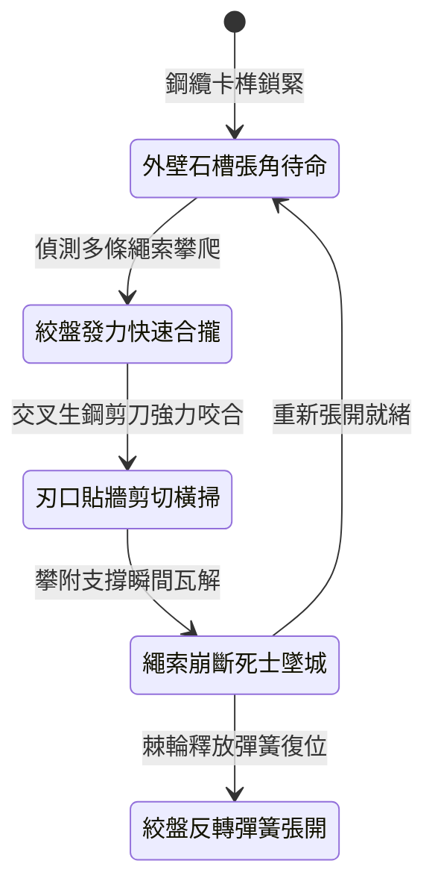

<!-- doc_id: doc_spec_1014 -->
# 城防城牆垛口外側懸掛絞盤牽引重型生鐵剪刀叉剪斷攀城繩索狀態機規格書

## 模組識別碼
- 模組編號：`FORM-233`
- 狀態機代碼：`CRENEL-SCISSOR-ROPE-CUTTER01`
- 類別：城防反登城繩索清理重型機關狀態機
- 適用場景：攻城要塞守備、垛口外沿、反制飛爪攀爬與繩梯突入

---

## 1. 核心概念與作戰原型

夜間攻城時，敵方死士常利用鉤錨與粗生麻繩密集攀登城牆。常規短刀割繩易遭城下箭雨壓制，為此垛口基石下暗置「絞盤牽引生鐵剪刀叉」。

### 1.1 機構構造與運作原理
1. **垛口外嵌剪叉刀刃**：兩柄長達六尺、以淬火生鋼鍛造的巨型交叉剪刀臂，平時收束於垛口外側石槽內，刃口鋒利帶微細倒鋸齒。
2. **絞盤牽引槓桿閉合**：城頭雙人重型絞盤透過雙鋼纜牽引剪刀臂末端，轉動絞盤可施加數千斤之強大槓桿剪切力。
3. **貼牆橫向滑動收剪**：剪叉沿外牆弧線水平張開並迅速合攏，緊貼城石外壁橫掃，將搭掛在城垛上的麻繩、鋼絲繩及皮條全部一刀兩斷。
4. **死士脫手墜落城下**：受剪切力作用，多根攀登繩索瞬間崩斷，正處於半空的先鋒死士全部失去支點墜落摔傷。

---

## 2. 數值參數與影響權重

| 參數名稱 | 數值 / 範圍 | 說明 |
| :--- | :--- | :--- |
| **生鐵剪叉咬合剪力 (`ScissorShearForce`)** | 8500 ~ 12000 N | 足以直接切斷內嵌鋼絲的特製攀城繩 |
| **攀城繩索切斷率 (`RopeSeverRate`)** | 90% ~ 98% | 覆蓋範圍內所有掛搭繩索直接切斷 |
| **剪切覆蓋橫向寬度 (`SweepSpanWidth`)** | 3 米 (涵蓋相鄰垛口) | 一次閉合即可肅清單一防禦節點 |
| **攀爬敵軍墜地傷害 (`ClimberFallDamage`)** | 依高度結算 400 ~ 700 點真實傷害 | 瞬間失重墜落造成嚴重致殘硬直 |
| **絞盤張開收束耗時 (`CycleDuration`)** | 4.5 秒 (包含閉合與張開) | 高頻作動，有效阻止後續繩索接續搭掛 |

---

## 3. 狀態機轉換定義

### 3.1 狀態細節描述
- **外壁石槽張角待命 (STOWED_OPEN)**：剪刀叉呈 75 度角張開嵌入外牆石槽，不阻礙垛口常規作戰。
- **絞盤發力快速合攏 (DRIVE_CLOSE)**：守軍轉動踏板絞盤，雙鋼纜同時發力拉攏剪臂。
- **刃口貼牆剪切橫掃 (WALL_SHEAR_SWEEP)**：生鋼刀刃緊貼石壁交錯劃過，橫掃沿途所有繩條。
- **繩索崩斷死士墜城 (SEVER_DROP)**：受力繩索寸斷，攀爬敵軍全部後仰墜落城根。
- **絞盤反轉彈簧張開 (SPRING_RESET)**：解開棘輪，高強彈簧迅速將雙剪臂向外彈開復位。

---

## 4. 戰鬥公式與判定

### 4.1 繩索切斷判定
$$\text{SeverChance} = \min(0.98, \frac{\text{ScissorShearForce}}{\text{RopeToughness}} \times 1.2)$$

若判定成功，相應繩索掛搭狀態立即銷毀，梯隊攀登進度徹底重置。

### 4.2 墜落摔傷結算
$$\text{FallDamage} = \text{TargetMaxHP} \times 0.35 + \text{ClimbHeight} \times 55$$

受波及之先鋒敵兵承受極限真實傷害，並附加 2 秒倒地眩暈。

---

## 5. 反制與失效機制

1. **生鐵全包覆粗鐵鏈**：若敵方使用純生鐵粗鏈攀城，剪刀叉難以單次切斷生鐵鏈環。
2. **射擊牽引鋼索合頁**：敵軍神射手若射毀外露牽引拉索，剪刀將失去閉合動力。
3. **牆縫碎石卡滯刀刃**：崩落碎石若卡入剪叉轉軸中央，閉合速度將延長 2 秒。

---

## 6. 驗收標準與測試案例

- [x] **TC-233-01**：驗證啟動牽引後，剪刀叉在 1.2 秒內完成橫向 3 米全行程閉合。
- [x] **TC-233-02**：驗證橫掃軌跡內普通麻繩與加固鋼絲繩切斷率達 90% 以上。
- [x] **TC-233-03**：驗證彈簧復位在 2 秒內順暢張開，可連續發動下一輪剪切。
