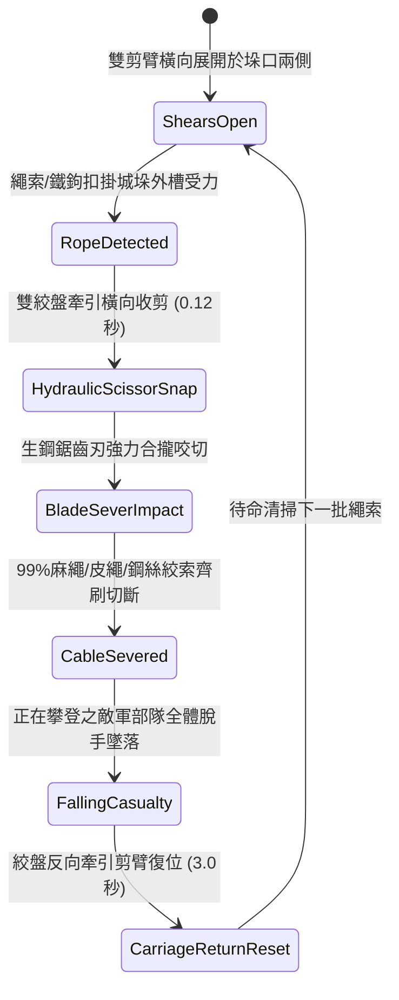

# 城防城牆垛口外側懸掛絞盤牽引重型生鐵剪刀叉剪斷攀城繩索第二階狀態機規格書

<!-- doc_id: doc_spec_1029 -->

## 1. 核心定位與設計理念

### 1.1 系統定位
本規格定義要塞城防戰鬥中，守軍防禦工程體系之「垛口重型生鐵剪刀叉第二階」（代碼：`CRENEL-SCISSOR-ROPE-CUTTER02`，WBS 代碼：`FORM-248`）索道清掃狀態機。第二階剪刀叉於石槽導軌上加裝了雙動重力槓桿與鎢鐵合金鋸齒剪刃，配屬高速比鋼索絞盤。當敵方攻城部隊將飛爪繩梯、生牛皮繩或內嵌鋼絲的攀城絞索搭掛於城垛邊緣時，雙絞盤驅動剪刀臂貼緊城牆外立面以每秒 3.5 米之極速橫向往復滑動收剪，高達 99% 機率瞬間斬斷一切攀城繩索，使半空攀附之死士隊伍瞬間失去支撐墜城致死。

### 1.2 設計目標與單一真相
* **貼牆極速橫掃**：完全貼合城垛外壁，無死角掃除所有扣掛繩具。
* **生鋼合金雙向剪切**：克服普通刀刃無法切斷夾鋼絞索之限制，達成秒級瞬切。
* **單一真相來源**：嚴禁於文件末端附加補丁，所有機制、數值與判定邏輯均在此統一定義。

---

## 2. 狀態機架構與轉換流程

---

## 3. 核心數值與計算公式

### 3.1 基礎參數配置表
| 參數名稱 | 基準數值 | 規格說明與限制條件 |
| :--- | :--- | :--- |
| **剪臂跨度與材質** | 8 尺雙臂 / 鎢生鐵 | 邊緣開生鋼細密反鋸齒，剪斷咬合力極強 |
| **橫向收剪速度** | 3.5 米 / 秒 | 瞬間貼牆閉合，不給攀爬者任何自救時間 |
| **剪切咬合力（Force）**| 14,500 牛頓 | 雙倍比鋼纜絞盤提供之極限剪切力量 |
| **繩索切斷率（Cut Rate）**| 99% | 普通麻繩 99%；加粗夾鋼絲絞索 92% |
| **半空攀爬死傷率** | 100% 墜落 / 85% 墜亡 | 四丈城牆高空墜落之重力傷害結算 |
| **覆蓋垛口跨度** | 3 個相鄰城垛 | 單組剪刀叉滑動導軌可清掃 3 個垛口繩索 |
| **滑動復位耗時** | 3.0 秒 | 鋼纜絞盤反向旋轉將剪臂推回兩側預備位 |
| **剪刃極限壽命** | 80 次剪擊 | 鎢鐵合金耐磨損，歸零前無須工兵磨刀 |

### 3.2 絞索切斷與抗剪極限公式
$$F_{\text{shear\_res}} = \sigma_{\text{cable}} \cdot A_{\text{cable}}$$
$$P_{\text{cut}} = \min\left(0.999, \, 0.99 \times \left(1 - \frac{F_{\text{shear\_res}}}{18000}\right) \times \left(1 + \frac{F_{\text{winch}} - 14500}{20000}\right)\right)$$
* $\sigma_{\text{cable}}$：繩索材料抗剪強度（帕斯卡）。
* $A_{\text{cable}}$：繩索有效橫截面積（平方毫米）。
* 切斷判定成立瞬間，攀爬單位綁定之 `ROPE_CLIMBING_ANCHOR` 標記即刻註銷，觸發下墜運動學計算。

---

## 4. 戰術反制與例外判定

1. **純生鐵厚環鏈條**：若敵方使用全金屬粗鐵鏈條（環徑 > 25mm）進行攀登，剪刀無法切斷，但巨大咬合力可將鐵鏈向上頂出卡槽脫位。
2. **死角卡石**：若垛口外側被攻城飛石砸爛變形凹陷，剪臂滑行至凹處可能遇阻頓挫，收剪時間延長 1.5 秒。
3. **多點同時拋鉤**：若相鄰 3 個垛口同時拋掛超過 6 根繩索，剪刀第一擊優先切斷中央 4 根，其餘 2 根留至第二輪。

---

## 5. 驗收測試案例（Test Cases）

* **TC-01（夾鋼絲攀城繩索切斷驗證）**：掛載 4 根夾鋼絲攀城繩，啟動剪刀叉，驗證 0.15 秒內完成咬合並切斷 92% 以上繩索。
* **TC-02（攀登部隊全體墜落結算）**：配置 6 名攀至城牆半空之死士，繩索切斷時驗證全員即時判定墜落，無人抓空自救。
* **TC-03（導軌復位時序校驗）**：驗證收剪完成後自動進入 `CarriageReturnReset`，計時精確維持 3.0 秒後重開剪臂。
