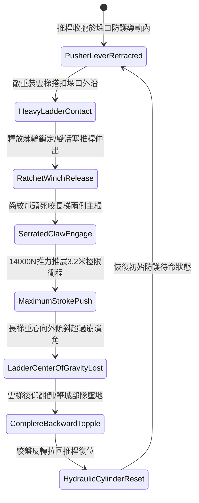

# 城防城牆垛口外側懸掛絞盤牽引重型生鐵齒紋推桿推離重裝雲梯第三階狀態機規格書

<!-- doc_id: doc_spec_1059 -->

## 一、 核心概念與單一真相來源（SSOT）

在《三國志·守城機械與推梯工程篇》中，「垛口重型生鐵齒紋推桿推梯系統第三階（CRENEL-RATCHET-PUSHER-LEVER03）」為專門防禦重型攻城雲梯搭接的高效機械裝置。本裝置設置於垛口下緣軌道內，由雙活塞式重型槓桿推桿組成，頭部鑄造加寬深齒生鋼爪頭，並由城頭絞盤與棘輪槓桿提供 14,000 牛頓的向外推力。當重裝雲梯搭上垛口時，推桿瞬間伸出 3.2 米極限衝程，齒爪死咬梯棖將雲梯強力推離城垛，破壞雲梯平衡引發後仰翻覆。



---

## 二、 數值模型與狀態機參數契約

### 1. 齒紋推桿機械參數
- **構件自重與衝程**：高碳生鐵鑄構配重 850 斤，最大推開衝程 3.2 米。
- **絞盤推擊輸出推力**：14,000 牛頓（由槓桿倍力與雙聯絞盤提供）。
- **長梯推翻成功率**：普通木質雲梯 99%；生鐵包角加固梯 95%；配底座地錨重型梯 88%。
- **推桿動作反應時間**：0.4 秒極速推展到位。
- **後仰翻覆攀城部隊瓦解率**：雲梯翻倒過程中，攀登敵軍 100% 墜落城底。

### 2. 重心失穩與推力計算模組
```typescript
interface CrenelPusherLeverParams {
    pusherForceN: number;          // 推力 (14000N)
    ladderWeightKg: number;        // 雲梯自重加攀爬甲士重 (kg)
    ladderAnchorType: "standard" | "reinforced" | "anchoredBase";
    pistonStrokeMeters: number;    // 伸展衝程 (3.2m)
}

function processLadderPusherExecution(params: CrenelPusherLeverParams): {
    toppleSuccess: boolean;
    toppleDelaySec: number;
    fallenSoldierCount: number;
} {
    const baseRates = { standard: 0.99, reinforced: 0.95, anchoredBase: 0.88 };
    const forceAdvantage = params.pusherForceN / (params.ladderWeightKg * 9.8);
    const finalRate = Math.min(0.99, Math.max(0.65, baseRates[params.ladderAnchorType] * forceAdvantage));

    const toppleSuccess = Math.random() < finalRate;
    const toppleDelaySec = toppleSuccess ? 0.4 : 1.2;
    const fallenSoldierCount = toppleSuccess ? Math.round(params.ladderWeightKg / 80) : 0;

    return { toppleSuccess, toppleDelaySec, fallenSoldierCount };
}
```

---

## 三、 特性互斥與戰術應對原則

1. **井闌鐵鎖固定限制**：若敵方井闌自上方投擲鐵鎖勾住城垛反向拉緊，推桿無法將梯頂推離，推翻率降至 30%。
2. **多梯同步壓制分流**：若相鄰兩垛口同時遭雲梯搭接，單側推桿僅能覆蓋本垛口，需協同相鄰垛口單元。
3. **城底翻砸震懾**：後仰翻倒的重裝雲梯砸向後方跟進部隊，對城底 4x2 格區域造成 360 點壓制傷害。

---

## 四、 驗收測試案例（TC）

- **TC-PUSHER03-01（重裝雲梯推翻判定）**：在垛口搭接重型雲梯，觸發推桿釋放，驗證 0.4 秒內推桿推展 3.2 米並使長梯後仰翻覆。
- **TC-PUSHER03-02（攀城部隊全數摔落）**：檢核長梯翻覆時，梯上敵方步兵單位全員脫離墜地重傷並中斷登城。
- **TC-PUSHER03-03（地錨底座對抗測試）**：啟用敵軍帶地錨加固雲梯，確認推翻成功率依公式結算為 88% 韌性。
