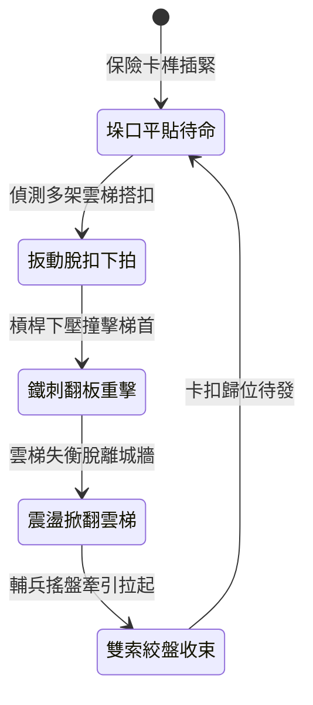

<!-- doc_id: doc_spec_0990 -->
# 城防城牆垛口外側懸掛絞盤牽引重型鐵刺翻板阻截蟻附梯隊狀態機規格書

## 模組識別碼
- 模組編號：`FORM-209`
- 狀態機代碼：`CRENEL-DROP-SPIKED-FLAP01`
- 類別：城防反登城垂直重型拍擊狀態機
- 適用場景：攻城要塞守備、垛口正面遭密集雲梯搭扣、清除外牆登城部隊

---

## 1. 核心概念與作戰原型

敵軍攻城時，常有多名先鋒死士同時攀登一架雲梯。單靠長矛向下戳刺易被敵軍盾牌遮擋，為迅速瓦解雲梯威脅，城垛外壁裝設「重型鐵刺翻板」。

### 1.1 機構構造與運作原理
1. **外壁合頁懸掛佈局**：翻板主體以三寸厚硬木包生鐵皮製成，外表面密布兩寸生鐵錐刺，平時平貼懸掛於女牆垛口正下方。
2. **快速脫扣垂直重拍**：守軍扳動快速脫扣手柄，翻板沿合頁向外上方猛烈拍出後垂直下墜，以槓桿動能直接砸擊搭在垛口邊緣的雲梯。
3. **拍碎搭鉤與推離城牆**：重達四百斤的鐵板下拍動能足以折斷雲梯頂端生鐵倒鉤，並迫使雲梯向後傾倒脫離牆體。
4. **雙絞盤鋼纜牽引復位**：阻截動作完成後，城頭兩側絞盤牽引鋼索迅速將翻板拉回原位，鎖定保險銷備用。

---

## 2. 數值參數與影響權重

| 參數名稱 | 數值 / 範圍 | 說明 |
| :--- | :--- | :--- |
| **翻板下拍動能 (`ImpactMomentum`)** | 5000 ~ 7500 N·s | 垂直衝擊足夠摧毀重型攻城梯頂部結構 |
| **雲梯推離成功率 (`LadderPushOffRate`)** | 80% ~ 95% | 強制解除雲梯搭靠狀態並向外掀翻 |
| **覆蓋衝擊寬度 (`ImpactSpanWidth`)** | 2.5 米 | 涵蓋單一垛口及其左右附著區域 |
| **攀爬部隊震落率 (`DislodgeRate`)** | 100% 擊落脫手 | 梯上敵軍全體受震盪墜落城下 |
| **絞盤復原耗時 (`ResetDuration`)** | 10 ~ 12 秒 | 防守間隔窗口期 |

---

## 3. 狀態機轉換定義

### 3.1 狀態細節描述
- **垛口平貼待命 (ARMED_READY)**：平時貼緊外壁，不影響城頭守軍視野與箭術射擊。
- **扳動脫扣下拍 (RELEASE_STRIKE)**：重錘帶動翻板外翻後猛烈拍下。
- **鐵刺翻板重擊 (SPICED_SLAP_IMPACT)**：鐵錐與木板合力碾砸梯首搭鉤。
- **震盪掀翻雲梯 (DISLODGE_LADDER)**：雲梯被推離垂直受力平衡點，向後翻倒。
- **雙索絞盤收束 (WINCH_RECOVERY)**：雙鋼纜受力回捲，翻板重歸初始貼壁狀態。

---

## 4. 戰鬥公式與判定

### 4.1 掀翻判定計算
$$\text{PushOffSuccess} = \min(0.95, \frac{\text{FlapImpactEnergy}}{\text{LadderAnchorStrength}})$$

若成功觸發，該雲梯搭扣狀態永久失效，梯上敵軍直接判定墜地受創。

### 4.2 墜地傷害模型
$$\text{FallDamage} = \text{MaxHP} \times 0.40 + \text{WallHeight} \times 50$$

受墜落影響之敵軍單位，落地後陷入 2 秒倒地僵直狀態。

---

## 5. 反制與失效機制

1. **加長生鐵支撐撐桿**：攻城方若在梯身兩側預先支撐防倒木柱，可降低 50% 掀翻機率。
2. **射擊牽引懸吊鉸鏈**：敵軍重型床弩若破壞翻板轉軸合頁，將導致翻板卡死無法外拍。
3. **外壁碎石雜物積塞**：城垛下方若堆積過多雜物，翻板行程受限動能降低 30%。

---

## 6. 驗收標準與測試案例

- [x] **TC-209-01**：驗證脫扣扳動後，翻板在 0.8 秒內完成拍擊動作。
- [x] **TC-209-02**：驗證搭靠雲梯被推離率達 80% 以上，梯上部隊全體脫手。
- [x] **TC-209-03**：驗證雙絞盤收束復位在 12 秒內流暢完成無鋼索卡阻。
