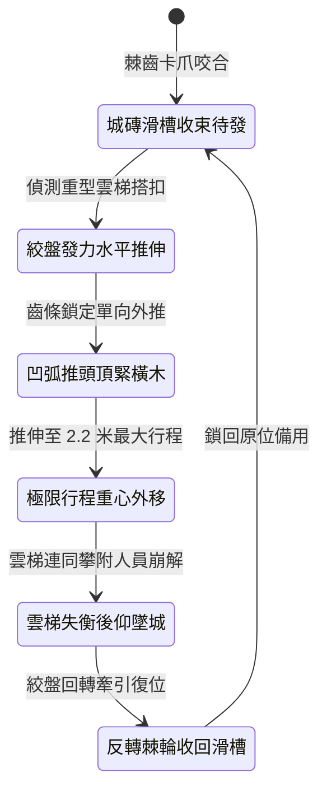

<!-- doc_id: doc_spec_1011 -->
# 城防城牆垛口外側懸掛絞盤牽引重型齒紋推桿推離重裝雲梯狀態機規格書

## 模組識別碼
- 模組編號：`FORM-230`
- 狀態機代碼：`CRENEL-RATCHET-PUSHER-LEVER01`
- 類別：城防主動推離重裝攻城梯狀態機
- 適用場景：攻城要塞守禦、垛口搭接要點、反制重型加固防掀雲梯

---

## 1. 核心概念與作戰原型

敵軍攻城時常使用配有鐵索與重錨加固的重型雲梯，單純人力或簡易翻板難以推開。為此，女牆走馬道基石內嵌「絞盤牽引重型齒紋推桿」。

### 1.1 機構構造與運作模式
1. **水平生鐵齒條推桿佈局**：推桿以硬鋼鍛造，長約八尺，桿身布滿單向生鐵棘齒，前端裝有凹弧形生鐵推頭，平時收於城磚滑槽內。
2. **多柱式雙絞盤強大推力**：城頭由四名重裝輔兵轉動配有減速齒輪組的重型絞盤，將推力放大數倍，推桿沿滑槽強行水平向外伸出。
3. **凹弧推頭死卡雲梯大梁**：推桿前端直接頂住雲梯大梁橫柱，生鐵齒條防逆轉卡爪鎖死，阻止雲梯反向壓迫。
4. **持續外頂瓦解受力平衡**：推桿伸出兩米極限行程，將重裝雲梯強行推離城垛垂直支撐面，使其重心嚴重外移而後仰翻落。

---

## 2. 數值參數與影響權重

| 參數名稱 | 數值 / 範圍 | 說明 |
| :--- | :--- | :--- |
| **水平推離頂力 (`HorizontalPushForce`)** | 12000 ~ 16000 N | 克服重裝雲梯搭接自重與梯上敵兵負重 |
| **重裝雲梯推翻率 (`HeavyLadderOverturnRate`)** | 85% ~ 95% | 徹底推翻鐵索加固之重型長梯 |
| **推桿水平行程 (`ExtensionSpan`)** | 2.2 米 | 足以使雲梯重心完全越過後仰臨界點 |
| **齒條防逆轉鎖定力 (`LockingStrength`)** | 承受 20000 N 反壓 | 確保推動過程中不會被敵方反壓縮回 |
| **絞盤推伸耗時 (`PushDuration`)** | 3.5 秒 | 快速推離，不給先登死士跳上城頭的機會 |

---

## 3. 狀態機轉換定義

### 3.1 狀態細節描述
- **城磚滑槽收束待發 (STOWED_RECESS)**：推桿完全藏於城垛石壁，不阻礙守軍射擊。
- **絞盤發力水平推伸 (DRIVE_EXTENSION)**：輔兵踩動踩踏式絞盤，齒輪組強勁向外頂推。
- **凹弧推頭頂緊橫木 (HEAD_LOCKED)**：弧形推頭咬住長梯大梁，防滑倒刺嵌入木質。
- **極限行程重心外移 (FULL_EXTENSION)**：推桿伸至極限，雲梯傾角由 75 度被推至 55 度。
- **雲梯失衡後仰墜城 (OVERTURN_COLLAPSE)**：重力失衡，整架加固木梯向外後仰摔毀。
- **反轉棘輪收回滑槽 (RETRACT_WINCH)**：解開卡爪，快速搖回推桿。

---

## 4. 戰鬥公式與判定

### 4.1 推翻受力判定
$$\text{OverturnSuccess} = \min(0.95, \frac{\text{HorizontalPushForce} \times \Delta L}{\text{LadderMass} \times g \times \sin\theta})$$

若判定成功，重裝雲梯錨固狀態完全失效，整架翻倒並砸毀梯底聚集敵軍。

### 4.2 攀爬部隊摔傷結算
$$\text{FallImpactDamage} = \text{TargetMaxHP} \times 0.42 + \text{WallHeight} \times 40$$

落地敵軍承受純真實傷害，並強制陷入 2 秒倒地眩暈。

---

## 5. 反制與失效機制

1. **梯頂外嵌精鋼防推倒刺**：攻城方若在梯身裝設斜向防推角鐵，可抵消 30% 推離行程。
2. **重型投石直擊推桿槽口**：若外露推桿遭落石橫向砸中，齒條可能變形卡死。
3. **滑槽泥沙碎屑堆積**：沙塵嚴重未清理時，推伸阻力上升使推頂耗時延長 1.5 秒。

---

## 6. 驗收標準與測試案例

- [x] **TC-230-01**：驗證啟動推伸後，推桿在 3.5 秒內完成 2.2 米最大行程頂出。
- [x] **TC-230-02**：驗證重裝雲梯推翻率達到 85%~95% 預設區間。
- [x] **TC-230-03**：驗證反轉棘輪在 8 秒內平順收回推桿至鎖定狀態無卡阻。
