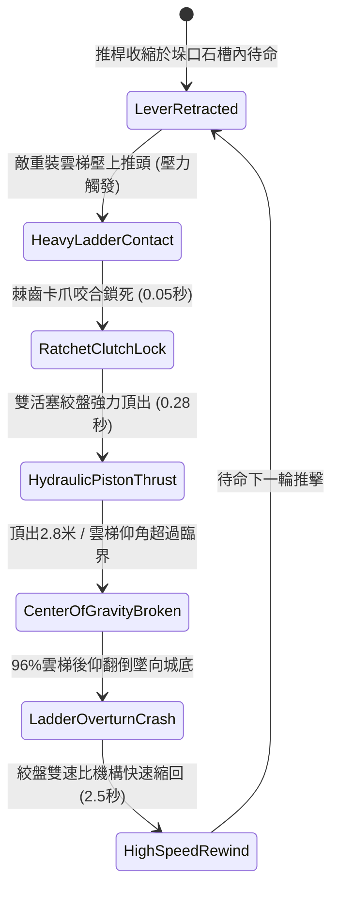

# 城防城牆垛口外側懸掛絞盤牽引重型齒紋推桿推離重裝雲梯第二階狀態機規格書

<!-- doc_id: doc_spec_1026 -->

## 1. 核心定位與設計理念

### 1.1 系統定位
本規格定義要塞城防對抗重型攻城兵器時，守軍所啟用之「垛口重型齒紋推桿第二階」（代碼：`CRENEL-RATCHET-PUSHER-LEVER02`，WBS 代碼：`FORM-245`）液壓槓桿推梯狀態機。相較於初階推桿，第二階裝置於推頭部分升級為弧面生鋼深齒爪頭，並以雙活塞槓桿鉸鏈取代單一齒條。當敵方重型包鐵雲梯或加厚衝梯搭接垛口時，雙工兵絞盤以 12,000 牛頓之水平推力將推桿瞬間向前暴頂 2.8 米衝程，深齒爪頭牢牢咬合梯身防止側滑，以 96% 機率強行破壞雲梯重心，將重裝長梯垂直向外推離傾覆，並連帶推落整列攀城重裝甲士。

### 1.2 設計目標與單一真相
* **大行程強力頂推**：2.8 米極限外推衝程，徹底超過雲梯重力穩定傾角極限（>75度），迫使其向後摔覆。
* **深齒咬合防滑偏**：防止包鐵光滑雲梯在頂推時橫向打滑滑脫。
* **單一真相來源**：嚴禁於文件末端附加補丁，所有機制、數值與判定邏輯均在此統一定義。

---

## 2. 狀態機架構與轉換流程

---

## 3. 核心數值與計算公式

### 3.1 基礎參數配置表
| 參數名稱 | 基準數值 | 規格說明與限制條件 |
| :--- | :--- | :--- |
| **推桿行程與材質** | 2.8 米 / 生鋼齒條 | 雙活塞槓桿加固結構，抗彎折極限 35,000 N |
| **水平頂推推力** | 12,000 牛頓 | 雙工兵倍力絞盤輸出之爆發性水平推力 |
| **推離耗時（Thrust Time）** | 0.28 秒 | 極速頂出，不給梯上敵兵跳城反應時間 |
| **重裝長梯掀翻率** | 96% | 適用於所有重型包鐵攻城長梯（仰角 > 75 度） |
| **攀爬士兵跌落率** | 98% | 長梯後仰失衡時梯上全體甲士強制失足墜地 |
| **墜城死傷判定** | 88% 墜亡 / 12% 重殘 | 依據城牆四丈高空換算之致命重力衝擊計算 |
| **縮回復位時間** | 2.5 秒 | 雙速比齒輪箱快速回捲鋼纜 |
| **機構壽命與耐久** | 50 次頂推 | 承受劇烈推壓反作用力，歸零需工兵換銷軸 |

### 3.2 槓桿推翻力矩平衡公式
$$M_{\text{thrust}} = F_{\text{pusher}} \cdot H_{\text{wall}} \cdot \cos\theta_{\text{ladder}}$$
$$M_{\text{gravity}} = W_{\text{ladder}} \cdot \frac{L_{\text{ladder}}}{2} \cdot \sin\theta_{\text{ladder}}$$
$$P_{\text{overturn}} = \min\left(0.99, \, 0.96 \times \frac{M_{\text{thrust}}}{M_{\text{gravity}}} \times \left(1 - \frac{B_{\text{anti\_push\_spikes}}}{100}\right)\right)$$
* $\theta_{\text{ladder}}$：雲梯目前之搭接傾斜角度。
* $B_{\text{anti\_push\_spikes}}$：雲梯外掛防推倒地錨係數（0 ~ 20）。
* 當推翻力矩 $M_{\text{thrust}} > 1.35 \times M_{\text{gravity}}$ 時，長梯穩定性崩潰，觸發 `HEAVY_LADDER_OVERTURNED` 廣播。

---

## 4. 戰術反制與例外判定

1. **底座生鐵重錨**：若敵方雲梯底部打入生鐵深地錨死死固定，長梯不後仰但桿頂承受極限剪力，轉為 65% 機率直接折斷梯首。
2. **死士跳幫截擊**：若敵方精銳武將在頂推 0.1 秒前搖內發動飛身撲越，可跨越推桿落上城頭進行接面近戰。
3. **碎石泥沙卡齒**：若石槽內遭敵軍投擲泥沙卡死，推桿復位時間延長至 5.0 秒。

---

## 5. 驗收測試案例（Test Cases）

* **TC-01（重裝包鐵長梯頂推掀翻）**：重裝雲梯搭接城垛，啟動推桿，驗證 0.28 秒內頂出 2.8 米並判定 96% 後仰翻倒。
* **TC-02（攀城部隊墜落傷亡判定）**：長梯翻倒時驗證梯上 8 名重裝步兵 98% 墜落判定成功，且傷害結算符合致命標準。
* **TC-03（雙速比齒輪快速復位）**：長梯脫離後，驗證機構於 2.5 秒內完成回縮，狀態機切換回 `LeverRetracted`。
