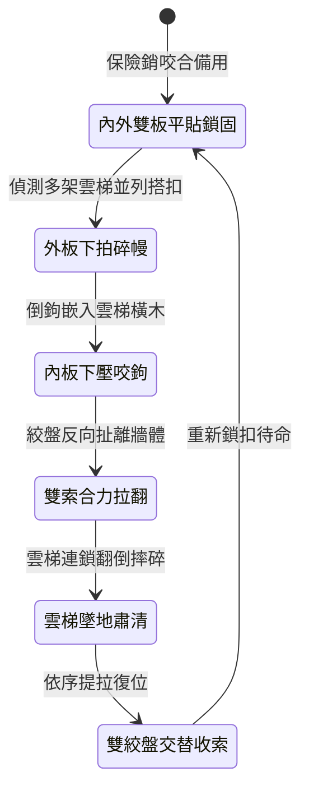

<!-- doc_id: doc_spec_0999 -->
# 城防城牆垛口外側懸掛絞盤牽引雙層重型生鐵倒鉤翻板清掃雲梯隊列狀態機規格書

## 模組識別碼
- 模組編號：`FORM-218`
- 狀態機代碼：`CRENEL-DOUBLE-LAYER-HOOK-FLAP01`
- 類別：城防反登城雙動態清除攻城梯狀態機
- 適用場景：要塞城防、垛口正面遭遇密集梯隊、清除搭靠雲梯與防護木幔

---

## 1. 核心概念與作戰原型

攻城戰鬥中，攻方先登常利用多架木梯並列搭靠，甚至外掛木幔遮擋城頭滾木。為實現立體化清理，要塞垛口下緣設置「雙層重型生鐵倒鉤翻板」。

### 1.1 機構構造與動作特色
1. **內外雙層複合鉸鏈**：外層為帶有粗大下向生鐵倒鉤的重型拍板，內層為厚實生鐵平板，分別由兩組獨立鉸鏈連接於垛口下石槽。
2. **第一動外翻拍擊**：外層翻板在配重重錘下墜牽引下向外猛拍，以巨大動能砸碎搭在垛口的木幔與雲梯頂端生鐵搭鉤。
3. **第二動下壓倒鉤勾扯**：內層板緊隨其後垂直重壓，兩側生鐵倒鉤死死咬住雲梯大梁橫木，配合絞盤反向發力猛扯。
4. **雲梯向外徹底拉翻**：在下拍與外扯的雙重合力作用下，雲梯支點徹底瓦解，整架梯隊後仰跌落城根。

---

## 2. 數值參數與影響權重

| 參數名稱 | 數值 / 範圍 | 說明 |
| :--- | :--- | :--- |
| **雙層衝擊力矩 (`DualImpactTorque`)** | 9000 ~ 12500 N·m | 雙重動能完全壓制攻城梯隊搭靠支撐 |
| **雲梯連鎖推翻率 (`ChainOverturnRate`)** | 88% ~ 96% | 徹底瓦解並排搭靠的兩架以上雲梯 |
| **木幔外罩破壞率 (`ManteletDestruction`)** | 90% | 砸爛防護外殼使攀爬敵軍暴露 |
| **梯上先鋒擊落率 (`ClimberDislodgeRate`)** | 100% | 梯身劇烈震盪導致人員全部脫手墜地 |
| **雙絞盤同步收索耗時 (`RecoveryDuration`)** | 11 ~ 13 秒 | 分步收回內外雙層翻板 |

---

## 3. 狀態機轉換定義

### 3.1 狀態細節描述
- **內外雙板平貼鎖固 (DUAL_STOWED)**：兩層板緊貼外壁，不影響常規射箭孔。
- **外板下拍碎幔 (OUTER_SLAP_IMPACT)**：重力釋放，外板以弧線猛砸破壞木幔。
- **內板下壓咬鉤 (INNER_HOOK_ENGAGE)**：內層生鐵板下壓，倒鉤死死卡住梯橫木。
- **雙索合力拉翻 (CABLE_PULL_DETACH)**：內外絞盤同時反扯，將雲梯生生扯離城牆。
- **雲梯墜地肅清 (COLLAPSE_CLEARED)**：多架長梯失去支撐連環墜毀。
- **雙絞盤交替收索 (SEQUENTIAL_RETRACT)**：先收內板再鎖外板，平順復原。

---

## 4. 戰鬥公式與判定

### 4.1 雙層推翻判定
$$\text{OverturnChance} = \min(0.96, \frac{\text{DualImpactTorque}}{\text{TotalLadderMomentum}})$$

若判定成功，相鄰 2 格內的所有雲梯搭靠狀態全部解除，並砸毀梯底聚集敵軍。

### 4.2 墜落摔傷結算
$$\text{CrushDamage} = \text{TargetMaxHP} \times 0.45 + \text{WallHeight} \times 40$$

落地敵軍承受極限真實摔傷，附加 2 秒倒地眩暈。

---

## 5. 反制與失效機制

1. **梯頂外嵌精鋼角鐵**：敵方若預先在梯頭包裹加厚精鋼護角，可降低 30% 倒鉤咬合率。
2. **長程床弩射中外鉸鏈**：敵軍重弩直擊翻轉軸承可能導致單層翻板卡死。
3. **低溫冰凍導致鉸鏈延遲**：冬季極寒環境若未及時除冰，雙板下拍動作延長 0.5 秒。

---

## 6. 驗收標準與測試案例

- [x] **TC-218-01**：驗證脫扣後外板下拍與內板咬合在 0.8 秒內連貫完成。
- [x] **TC-218-02**：驗證雙層推翻動作對並列雲梯的瓦解率達 88% 以上。
- [x] **TC-218-03**：驗證交替收索絞盤在 13 秒內平穩完成兩板復位鎖固。
