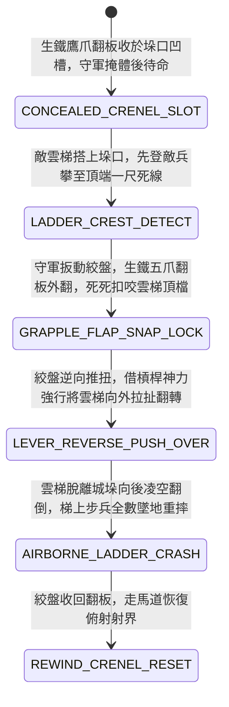

<!-- doc_id: doc_spec_0975 -->
# 城防城牆女牆內側暗置絞盤牽引生鐵排爪翻板抓翻敵軍攻城梯隊狀態機規格書

> **文件編號**：`doc_spec_0975`
> **模組代碼**：`CRENEL-CONCEALED-GRAPPLE-FLAP-OVERTURN01`
> **對應 WBS**：`FORM-194`（M7 戰場進階機關、城防排爪翻板與精銳步兵鉤鐮長矛）
> **單一真相來源（SSOT）**：本文件直接定義城牆女牆生鐵排爪翻板抓翻攻城梯隊之完整物理與戰鬥狀態機，嚴禁於檔尾附加補丁。

---

## 一、 戰術定位與歷史工程原型

在攻城戰中，傳統推竿僅能被動將雲梯頂端推離城垛，若敵軍雲梯裝有抓牆鐵鉤或下端深釘地錨，單純推離極難奏效。**城牆女牆內側暗置絞盤牽引生鐵排爪翻板（Crenel Concealed Grapple-Flap Overturner）** 採取「主動反扣雲梯頂檔、絞盤強行向外掀翻」的主動傾覆機制：
1. **垛口內置旋轉軸與生鐵五指鷹爪板**：於城牆垛口底檻預埋粗大鍛鐵旋軸，外接一塊厚生鐵板，板端向下彎折出五只長達八寸的淬火鷹爪倒鉤；平時隱匿於走馬道凹槽中。
2. **咬扣雲梯第一橫木檔**：當敵軍雲梯架上女牆垛口、先登死士即將翻越時，守軍在女牆掩體後扳動絞盤，生鐵翻板瞬間向上翻出垛口，五指生鐵鷹爪「咔噠」一聲精準咬死雲梯頂端第一根橫木。
3. **絞盤反扭掀翻整個梯隊**：鷹爪咬死後，守軍兩側絞盤反向高速鎖死並發力猛推，利用槓桿原理強行將雲梯頂端向外猛拽，連同梯上正在攀爬的數名先登步兵一併向後掀翻，整架雲梯凌空翻轉砸向城底。

---

## 二、 觸發條件與城防建造參數

| 參數項目 | 規格數值與限制條件 | 備註說明 |
| :--- | :--- | :--- |
| **部署位置限制** | 城牆全線「女牆垛口格（每處垛口可配置 1 組排爪板）」 | 守軍全程在女牆掩體後操作，免疫城下弓弩狙擊 |
| **建造資源消耗** | 生鐵鷹爪板 95、鍛鐵旋軸 50、棘輪絞盤 45、城防工事點 30 | 掀翻雲梯後，絞盤拉回即可在次回合重置待命 |
| **作用對象** | 正對垛口架設之「普通竹木雲梯 / 帶鉤重型雲梯 / 攀爬死士」 | 對無梯直接登城之飛爪死士亦有拍擊砸落效果 |
| **機關耐久（HP）** | `1,250` 點（生鐵鍛造，免疫普通箭雨與刀劍揮砍） | 每次觸發可摧毀正對垛口的 1 架雲梯 |

---

## 三、 核心狀態機（State Machine）

---

## 四、 數值結算與戰鬥公式

### 1. 鷹爪反扣與雲梯強拆（Grapple-Snap & Ladder Overturn）
當雲梯搭上垛口觸發 `GRAPPLE_FLAP_SNAP_LOCK` 時：
- **100% 破解帶鉤雲梯**：即使雲梯裝有抓牆鐵鉤，生鐵五爪直接扣碎鐵鉤固定木榫，以 `100%` 成功率強行將雲梯向外掀翻（普通木梯結構當場粉碎 `100%` 報廢）。
- **梯上人員致死墜落傷**：
  $$\text{Damage}_{\text{fall}} = \text{BaseATK}_{\text{garrison}} \times 2.20 + \text{WallHeightMeters} \times 32$$
  梯上所有敵兵承受高空墜落鈍擊傷害，並附加重度骨折眩暈 `1 回合`。

### 2. 砸擊城根後排部隊（Wall-Foot Secondary Collision）
翻倒的整架沉重雲梯砸向城牆腳下，對正下方 `1 格` 地面敵軍造成 `90% ATK` 的連帶砸擊傷害。

---

## 五、 反制手段與戰術克制

1. **井闌射手預先壓制女牆凹槽**：若攻城方高空井闌射出火箭引燃垛口木槽，翻板轉軸可能受熱變形卡死。
2. **攻城塔搭板直接壓頂**：五層攻城塔（`doc_spec_0843`）頂部重吊橋重達數千斤，砸在垛口上會將排爪板直接壓碎。

---

## 六、 驗收測試案例（Acceptance Tests）

| 測試案例 ID | 測試情境與輸入條件 | 預期狀態轉移與數值輸出 |
| :--- | :--- | :--- |
| **TC-GRAPPLE-01** | 敵方先登死士攀爬至雲梯頂端，排爪翻板觸發外翻扣咬 | 五爪咬死橫檔，100% 掀翻雲梯，梯上敵兵承受高額墜落傷墜亡 |
| **TC-GRAPPLE-02** | 雲梯向後翻倒砸中城牆根部正在排隊的敵方長矛隊 | 梯子砸地粉碎，城根敵軍承受 90% 連帶鈍擊傷並暫時後撤 |
| **TC-GRAPPLE-03** | 敵方推來重型攻城塔，重吊橋砸落覆蓋垛口 | 排爪板被數千斤吊橋壓死無法外翻，機關暫時失效 |
