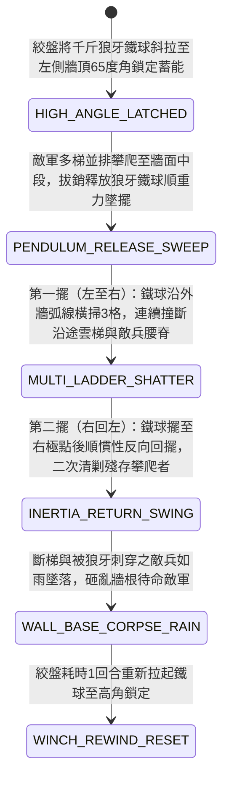

<!-- doc_id: doc_spec_0960 -->
# 城防城牆女牆外懸絞盤牽引生鐵狼牙擺錘橫掃貼牆雲梯隊列狀態機規格書

> **文件編號**：`doc_spec_0960`
> **模組代碼**：`WALL-PENDULUM-SPIKED-BALL-SWEEP01`
> **對應 WBS**：`FORM-179`（M7 戰場進階機關、城防狼牙擺錘與精銳步兵雙鐵戟）
> **單一真相來源（SSOT）**：本文件直接定義城牆女牆外懸絞盤牽引生鐵狼牙擺錘橫掃貼牆雲梯隊列之完整物理與戰鬥狀態機，嚴禁於檔尾附加補丁。

---

## 一、 戰術定位與歷史工程原型

在守城戰中，傳統「生鐵撞鐘錘（`doc_spec_0939`）」採垂直牆面由內向外撞擊，一次僅能撞退正對垛口的單架雲梯；若敵軍採取「密集多梯並排蟻附」，單點撞錘便捉襟見肘。**城牆女牆外懸絞盤牽引生鐵狼牙擺錘（Wall-Suspended Pendulum Spiked-Ball Sweeper）** 利用「平行於城牆外牆面的大型鐘擺位能運動」，實現一次橫掃整段牆面多架雲梯的毀滅性清場：
1. **城頭探出支架與千斤狼牙鐵球**：於城牆馬面或角樓高處探出一根包鐵硬木懸臂樑，懸掛一條長三丈的熟鐵粗鏈，鏈底栓有一顆重達一千二百斤、周身密布四寸生鐵狼牙長刺的實心大鐵球。
2. **高處斜拉蓄能（High-Angle Winch Tension）**：平時由一側城頭的絞盤將狼牙鐵球斜拉至左上方女牆頂端（呈 $65^\circ$ 斜角高懸鎖定），蓄滿龐大的重力位能。
3. **貼牆圓弧鐘擺橫掃（Wall-Hugging Pendulum Sweep）**：當敵軍在該段城牆並排架起三至四架雲梯、數十名敵兵攀爬至牆面中段時，守軍拔開絞盤摯銷；千斤狼牙鐵球順著重力沿外牆面劃出一道跨越 `3 格` 寬度的巨大貼牆圓弧軌跡，猶如死神鐮刀般將沿途所有竹木雲梯連同梯上敵兵一併橫掃撞碎。

---

## 二、 觸發條件與城防建造參數

| 參數項目 | 規格數值與限制條件 | 備註說明 |
| :--- | :--- | :--- |
| **部署位置限制** | 城牆「高段主牆 / 馬面側壁（需連續 `3 格` 直線外牆面）」 | 懸臂支點設於中央格，鐘擺弧線覆蓋左、中、右共 `3 格` 外牆 |
| **建造資源消耗** | 生鐵 140、熟鐵長鏈 70、巨型硬木懸臂 60、城防工事點 40 | 釋放橫掃後，需絞盤耗時 `1 回合` 重新斜拉蓄能 |
| **作用對象** | 貼附於該 `3 格` 外牆面之所有「雲梯 / 飛爪繩索 / 攀爬中部隊」 | 由於擺錘高懸於牆面中上部，對地面敵軍無傷（僅砸落屍骸波及） |
| **擺錘耐久（HP）** | `1,500` 點（實心生鐵球體免疫一切攻擊，僅頂部木懸臂可被投石破壞） | 每次釋放可完成「左至右 + 右回擺至左」雙向二連掃 |

---

## 三、 核心狀態機（State Machine）

---

## 四、 數值結算與戰鬥公式

### 1. 貼牆鐘擺雙向橫掃（Bidirectional Pendulum Sweep）
當狼牙擺錘釋放時，對外牆面橫向連續 `3 格` 的所有攀爬單位與攻城梯具執行「去程橫掃 + 回程反擺」兩段打擊：
- **第一擺（重力極速橫掃）**：千斤鐵球在弧底達到最高擺速，對 3 格內所有攀爬敵軍造成毀滅性鈍擊與狼牙穿刺傷害：
  $$\text{Damage}_{\text{swing1}} = \text{BaseATK}_{\text{garrison}} \times 2.45 \times \left(1 - \text{TargetDEF} \times 0.55\right)$$
  同時對沿途所有「竹木雲梯」造成 `350%` 結構粉碎傷害（普通木梯 `100%` 當場橫向折斷解體）。
- **第二擺（慣性回擺補刀）**：若仍有重甲死士緊抓飛爪或鐵梯未墜落，鐵球反向回擺立即追加第二次打擊，造成 `140% ATK` 傷害並強制將其撞脫墜地。

### 2. 牆根碎梯屍雨波及（Wall-Base Debris & Corpse Rain）
上方 3 格牆面被橫掃折斷的雲梯木塊與墜落敵兵，會垂直砸向城牆根部正下方的 `3 格` 地面敵軍：
- 對牆根地面敵軍造成 `95% ATK` 的砸擊傷害，並附加 `FALLING_DEBRIS_STAGGER`（移動力下降 `40%`，且本回合無法再次架設雲梯）。

---

## 五、 反制手段與戰術克制

1. **重型投石機狙擊頂部木懸臂**：實心鐵球雖無法摧毀，但若攻城方以重型投石機精準砸斷城頭探出的「硬木懸臂樑」，狼牙鐵球將直接墜落地面成為廢鐵。
2. **雙層牛皮衝車直接攻門**：擺錘僅能橫掃外牆面的攀爬部隊，對在地面推進、有厚重屋脊保護的攻城衝車（`doc_spec_0869`）無直接阻擋作用。

---

## 六、 驗收測試案例（Acceptance Tests）

| 測試案例 ID | 測試情境與輸入條件 | 預期狀態轉移與數值輸出 |
| :--- | :--- | :--- |
| **TC-PENDULUM-01** | 敵軍在該段 3 格城牆並排架設 3 座普通木雲梯並爬至半途 | 釋放擺錘橫掃 3 格，3 座木梯 100% 折斷粉碎，攀爬敵軍承受 245% 破甲重創墜落 |
| **TC-PENDULUM-02** | 某隊先登重甲死士靠飛虎爪在第一擺後殘血掛於牆面 | 立即觸發 `INERTIA_RETURN_SWING` 回擺二次打擊（140% 傷害），強制將其撞落城底 |
| **TC-PENDULUM-03** | 牆根正下方 3 格停駐著準備下一波登城的敵方後備步兵 | 受上方斷梯與墜落同袍砸擊，承受 95% 傷害並附加 `FALLING_DEBRIS_STAGGER` 禁止架梯 |
