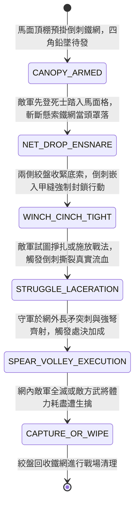

<!-- doc_id: doc_spec_0948 -->
# 城防城牆馬面暗置絞盤牽引生鐵倒刺鐵網罩困敵軍先登死士狀態機規格書

> **文件編號**：`doc_spec_0948`
> **模組代碼**：`BASTION-BARBED-IRON-NET-TRAP01`
> **對應 WBS**：`FORM-167`（M7 戰場進階機關、城防網罩與精銳步兵重鈍器破甲）
> **單一真相來源（SSOT）**：本文件直接定義城牆馬面生鐵倒刺鐵網罩困先登死士之完整物理與戰鬥狀態機，嚴禁於檔尾附加補丁。

---

## 一、 戰術定位與歷史工程原型

攻城戰中，一旦敵軍「先登死士（帶著重甲與大刀的精銳敢死隊）」成功翻越女牆踏上城頭走馬道，往往會憑藉高武力與霸體在城頭撕開防線缺口。**城牆馬面暗置絞盤牽引生鐵倒刺鐵網（Bastion Barbed Iron-Net Trap）** 為守城方針對高威脅單點突破的「軟性活捉與絞殺機關」：
1. **頂棚預掛鉛墜生鐵絲網**：於城牆馬面（凸臺）與角樓交界的走馬道上方木棚，暗藏一張丈五見方、由手指粗熟鐵鏈與柔韌浸油麻繩混編而成的巨網；網眼密布三棱生鐵倒刺，四角栓有百斤生鐵鉛墜。
2. **天羅落網與絞盤收口**：當敵軍先登死士聚集於馬面城頭試圖擴大戰果時，守軍砍斷懸索，四角鉛墜帶著倒刺鐵網瞬間當頭罩下；隨後兩側暗堡守軍轉動棘輪絞盤猛拉收口底索，將網內敵軍緊緊捆成一團。
3. **愈掙扎刺愈深與亂箭攢射**：鐵網內側的倒刺會死死勾住敵軍甲片縫隙與皮肉，敵兵越是揮刀掙扎，鐵鏈纏繞越緊並觸發真實割裂傷；同時守軍長矛手與弩手從網外無傷攢射，將被困死士全數殲滅或生擒。

---

## 二、 觸發條件與城防建造參數

| 參數項目 | 規格數值與限制條件 | 備註說明 |
| :--- | :--- | :--- |
| **部署位置限制** | 僅限城牆「馬面城頭格 / 城門樓頂格 / 甕城轉角格」 | 每處馬面預設可配置 1 組倒刺鐵網 |
| **建造資源消耗** | 精鐵 120、浸油麻繩 60、生鐵鉛墜 50、城防工事點 35 | 可於戰前整備或戰鬥中消耗 1 回合重新掛網 |
| **覆蓋範圍與容量** | 城頭 `1 格`（可同時罩困該格內所有登城敵軍與敵方武將） | 對地面雲梯下方的敵軍無效（僅限已登城者） |
| **鐵網耐久（HP）** | `950` 點（熟鐵鏈混編，免疫鈍器砸擊，劈砍減傷 `70%`） | 僅能由網外友軍使用長柄大斧耗時劈開 |

---

## 三、 核心狀態機（State Machine）

---

## 四、 數值結算與戰鬥公式

### 1. 落網捆縛與霸體破除（Iron-Net Ensnare & Super-Armor Break）
當敵方先登部隊或武將踏入設有鐵網的城頭格時，立即觸發 `NET_DROP_ENSNARE`：
- **無視霸體定身**：四角百斤鉛墜產生的柔性包覆力直接無視敵方「先登霸體（Unstoppable）」狀態，`100%` 強制附加 `BARBED_NET_TRAPPED`（倒刺鐵網束縛，持續 2 回合）。
- **攻防與閃避歸零**：被罩在網內的敵軍移動力（MOV）歸零、閃避率（EVA）歸零，普通攻擊與主動戰法遭到強制封禁（無法揮動長兵器），且防禦力（DEF）下降 `45%`。

### 2. 掙扎倒刺撕裂與網外攢射加成（Struggle Laceration & Execution）
- **掙扎反噬傷害**：被困敵軍每回合試圖掙脫時，鐵網倒刺會切入甲縫，造成基於目標自身武力（STR）的反噬流血真傷：
  $$\text{Damage}_{\text{struggle}} = \text{TargetMaxHP} \times 0.08 + \text{TargetSTR} \times 2.5$$
- **網外無傷處決**：守軍對處於 `BARBED_NET_TRAPPED` 狀態的敵軍發動近戰刺擊或弩箭射擊時，不會受到任何反擊（反擊傷害 = 0），且暴擊率提升 `50%`、最終傷害提升 `65%`。
- **武將生擒判定（Live Capture）**：若網內敵方武將兵力降至 `10%` 以下且仍處於鐵網束縛中，守方可直接執行「絞盤收網生擒」，生擒成功率提升至 `85%`（不受名將逃脫馬匹加成影響，因已在城頭落網）。

---

## 五、 反制手段與戰術克制

1. **火矢先行焚燒頂棚**：攻城方若以井闌高處瞭望識破馬面頂棚機關，可先以火箭集火焚毀頂棚木架，使鐵網提前墜落失效。
2. **雙手持重斧友軍破網**：若後續登城的敵方「長柄大斧兵」抵達相鄰格，可消耗整回合行動對鐵網施展「劈鏈破網」，直接清除鐵網束縛。

---

## 六、 驗收測試案例（Acceptance Tests）

| 測試案例 ID | 測試情境與輸入條件 | 預期狀態轉移與數值輸出 |
| :--- | :--- | :--- |
| **TC-NET-01** | 敵方具「先登霸體」之精銳死士翻越女牆踏入馬面格 | 無視霸體 100% 觸發 `BARBED_NET_TRAPPED`，敵移動與閃避歸零、封禁普攻與戰法、防禦 -45% |
| **TC-NET-02** | 網內敵將（STR=95）嘗試掙扎，且守軍長矛隊從網外突刺 | 敵將先受掙扎真傷，守軍突刺享 +50% 暴擊率與 +65% 傷害加成，且守軍承受反擊傷害為 0 |
| **TC-NET-03** | 網內敵方先登武將兵力被打至 8%（`<10%`） | 觸發 `CAPTURE_OR_WIPE` 生擒判定，無視敵將坐騎逃脫加成，以 85% 機率直接生擒入獄 |
