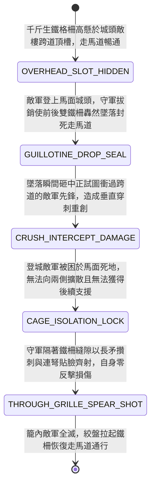

<!-- doc_id: doc_spec_0966 -->
# 城防城牆馬面暗置絞盤牽引生鐵千斤墜落鐵柵欄隔絕登城敵軍狀態機規格書

> **文件編號**：`doc_spec_0966`
> **模組代碼**：`BASTION-DROP-IRON-GRILLE-ISOLATION01`
> **對應 WBS**：`FORM-185`（M7 戰場進階機關、城防千斤鐵柵與精銳步兵喪門釘耙）
> **單一真相來源（SSOT）**：本文件直接定義城牆馬面暗置絞盤牽引生鐵千斤墜落鐵柵欄隔絕登城敵軍之完整物理與戰鬥狀態機，嚴禁於檔尾附加補丁。

---

## 一、 戰術定位與歷史工程原型

在攻城戰白熱化階段，若敵軍精銳步兵已透過多架雲梯或攻城塔登上城牆馬面，並試圖沿走馬道向兩側擴散包抄守軍弓弩手時，守軍急需能在城頭瞬間切斷走馬道、將登城敵軍「關門打狗」的隔絕工事。**城牆馬面暗置絞盤牽引生鐵千斤墜落鐵柵欄（Bastion Drop Iron-Grille Isolation Gate）** 為設於城頭敵樓與馬面交界處的「城上分段封鎖閘門」：
1. **敵樓過道頂部預懸生鐵格柵**：於城牆每隔三十步的敵樓（城頭跨道箭樓）或馬面入口拱門頂部，暗藏兩道由手腕粗熟鐵柱縱橫鍛接而成的「千斤生鐵透空鐵柵欄」，底部鍛有鋒利楔形鐵尖。
2. **斷索瞬落與分段切斷走馬道**：一旦某段馬面失守、敵軍湧上城頭準備向兩側走馬道衝殺時，敵樓二層守軍立即扳動掣銷，前後兩道千斤生鐵柵欄順著石槽轟然垂直墜落，瞬間將該段城頭走馬道徹底封死，把登城敵軍死死困在僅數丈寬的露天馬面「鐵籠區」內。
3. **透空柵欄隔欄刺射（Through-Grille Safe Volley）**：由於鐵柵欄採每格五寸寬的「透空直櫺設計」，被困在內的敵軍無法揮刀劈過鐵柱，但鐵柵欄外側的守軍長矛手與強弩手卻能將槍尖與弩箭從鐵柵縫隙中從容伸入，對籠中困獸實施零戰損的單向屠殺。

---

## 二、 觸發條件與城防建造參數

| 參數項目 | 規格數值與限制條件 | 備註說明 |
| :--- | :--- | :--- |
| **部署位置限制** | 僅限城牆「馬面入口格 / 城頭敵樓跨道格」 | 用於切斷城頭走馬道橫向通行，形成封閉困敵區 |
| **建造資源消耗** | 生鐵與熟鐵柱 155、石槽絞盤 65、城防工事點 40 | 絞盤升起需 `1 回合`，墜落封鎖為 **0 秒瞬發** |
| **隔絕與射界特性** | 敵軍 **100% 無法通行與近戰跨格攻擊**；守軍長矛/弓弩可 `100%` 穿透鐵柵縫隙攻擊 | 實現物理阻斷但單向保留守方射界之戰術優勢 |
| **鐵柵耐久（HP）** | `2,200` 點（純鐵實心格柵，免疫火燒與弓箭，刀劍劈砍減傷 `85%`） | 僅能由雙手重錘（如甕金錘）或開山大鉞緩慢砸毀 |

---

## 三、 核心狀態機（State Machine）

---

## 四、 數值結算與戰鬥公式

### 1. 斷頭墜落砸擊與走馬道封死（Guillotine Drop & Path Seal）
當敵方登城部隊試圖從馬面踏入走馬道跨道格時，立即觸發 `GUILLOTINE_DROP_SEAL`：
- **墜落砸擊傷害**：正處於閘門下方的敵軍承受千斤鐵柵底部楔形鐵尖的垂直砸擊：
  $$\text{Damage}_{\text{grille}} = \text{BaseATK}_{\text{garrison}} \times 2.30 \times \left(1 - \text{TargetDEF} \times 0.45\right)$$
  並 `100%` 被強制推回馬面困敵格內，附加 `IRON_CAGE_ISOLATED`（鐵籠孤立態：無法移動離開該格，且因退路與前路皆斷，閃避率下降 `50%`）。

### 2. 隔欄單向攢射與零反擊保護（Through-Grille One-Way Execution）
當鐵柵欄處於落下封鎖狀態時：
- **守軍單向穿透**：位於鐵柵欄外側的守軍「長槍兵 / 蛇矛兵 / 弓弩手」對鐵柵內的 `IRON_CAGE_ISOLATED` 敵軍發動攻擊時，武器可穿過五寸柵欄縫隙，命中率提升 `30%`、傷害提升 `25%`。
- **100% 阻絕敵方反擊**：被困在鐵柵內的敵方近戰部隊（除非同樣持有 2 格刺擊長矛），其刀、斧、錘等揮砍兵器皆會被粗大鐵柱擋死，無法對柵欄外的守軍造成任何近戰傷害或反擊傷害（守軍承受反擊 = `0`）。

---

## 五、 反制手段與戰術克制

1. **擂鼓甕金錘 / 長柄鐵骨朵硬砸鐵柵**：若登城敵軍為配備「擂鼓甕金錘（`doc_spec_0964`）」的金錘力士，可對鐵柵欄造成 `250%` 工事破壞傷害，強行砸彎鐵柱破籠而出。
2. **飛虎爪翻越敵樓外牆**：輕裝死士可放棄走馬道，改由城牆外側使用飛虎爪繞過鐵柵欄所在的敵樓。

---

## 六、 驗收測試案例（Acceptance Tests）

| 測試案例 ID | 測試情境與輸入條件 | 預期狀態轉移與數值輸出 |
| :--- | :--- | :--- |
| **TC-GRILLE-01** | 敵方登城大刀兵衝入敵樓跨道格瞬間，守軍放落千斤鐵柵 | 承受 230% 破甲砸擊，100% 被推回馬面格並附加 `IRON_CAGE_ISOLATED`（禁移動、閃避 -50%） |
| **TC-GRILLE-02** | 守軍長矛兵隔著鐵柵欄對籠內敵方大刀兵發動突刺 | 守軍享 +30% 命中與 +25% 傷害加成，且敵方大刀被鐵柵擋住，守軍承受反擊傷害為 0 |
| **TC-GRILLE-03** | 被困於柵欄內的敵方「金錘力士」對千斤鐵柵發動重錘攻擊 | 觸發重鈍器對鐵柵特攻（250% 結構傷害），可逐步砸毀鐵柵突圍 |
