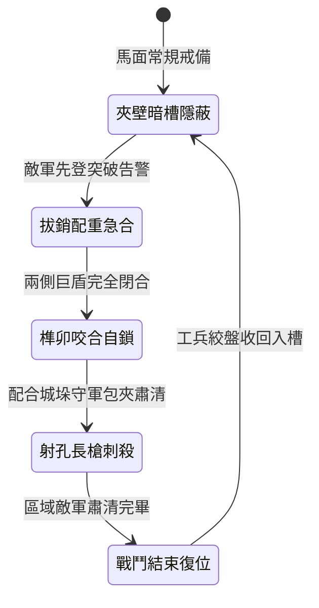

<!-- doc_id: doc_spec_0984 -->
# 城防城牆馬面暗置絞盤牽引生鐵巨盾活動阻隔牆封閉登城通道狀態機規格書

## 模組識別碼
- 模組編號：`FORM-203`
- 狀態機代碼：`BASTION-MOVABLE-IRON-SHIELD-WALL01`
- 類別：城防防禦通道阻隔與分割戰術狀態機
- 適用場景：要塞城防、馬面平台突破應急、切割敵軍登城梯隊

---

## 1. 核心概念與作戰原型

當外圍城牆被敵方雲梯或樓車突破時，敵軍先鋒往往沿著城垛走馬道向兩翼敵樓快速擴散。為將突破口敵軍包圍孤立，馬面要衝暗設「生鐵巨盾活動阻隔牆」。

### 1.1 機制與作戰特點
1. **暗道滑軌隱藏**：阻隔牆由兩面厚達三寸、包覆生鐵皮的重型鐵木盾牆組成，平時隱藏於馬面敵樓兩側的石砌夾壁槽內。
2. **重力與雙向絞盤牽引**：當觀察哨確認突破口敵軍過度湧入時，守軍拔出主鎖銷，藉由平衡重錘與拉索帶動巨盾牆由兩側高速橫向滑出對接。
3. **生鐵咬合鎖死通道**：兩扇盾牆中間裝有咬合式公母榫卯與生鐵暗閂，撞合瞬間自鎖，徹底封閉寬達兩丈的走馬道。
4. **預留射擊孔與刺殺槽**：盾牆上開有六個窄縫射擊孔與底部長槍突刺橫槽，後方守軍可安全使用長矛對被困敵軍實施單向壓制。

---

## 2. 數值參數與影響權重

| 參數名稱 | 數值 / 範圍 | 說明 |
| :--- | :--- | :--- |
| **阻隔牆結構耐久 (`ShieldWallHP`)** | 15000 ~ 20000 點耐久 | 能承受常規撞木與鈍器攻擊至少 3 分鐘 |
| **閉合速度 (`ClosingDuration`)** | 2.5 ~ 3.5 秒 | 快速阻斷，防止敵軍趁隙衝卡突破 |
| **通道切割隔離率 (`IsolationRate`)** | 100% 通道阻絕 | 將登城敵軍徹底阻隔於馬面隔離作戰區 |
| **單向射擊孔防禦加成 (`FiringSlitCover`)** | 減免 85% 遠程反擊傷害 | 守軍居高臨下享有絕對掩體防護 |
| **重新開啟耗時 (`ReopenDuration`)** | 30 秒 (需工兵手動絞盤復位) | 確保戰鬥期間不會被敵方輕易倒推拆解 |

---

## 3. 狀態機轉換定義

### 3.1 狀態細節描述
- **夾壁暗槽隱蔽 (CONCEALED_RECESS)**：盾牆完全收入馬面石牆，走馬道維持通行無阻。
- **拔銷配重急合 (GRAVITY_DEPLOYING)**：配重鐵塊下墜牽引鋼纜，鐵盾高速對推滑出。
- **榫卯咬合自鎖 (LOCKED_SEALED)**：彈簧暗閂咬死，結構強度提升 50%。
- **射孔長槍刺殺 (ENGAGING_THROUGH_SLITS)**：守軍隔盾進行槍刺與短弩點射。
- **戰鬥結束復位 (WINCH_RETRACTING)**：工兵合力搖動四柱絞盤，拉回平衡重錘並歸位。

---

## 4. 戰鬥公式與判定

### 4.1 結構防禦與破壞判定
$$\text{DamageTaken} = \text{SiegeDamage} \times (1 - \text{IronPlatingReduction}) \times \frac{1}{1 + \text{LockBonus}}$$

若攻擊為純步兵刀劍揮砍，傷害固定減免 95%；僅重型鐵頭衝撞木或拋石機直擊方能造成有效耐久扣減。

### 4.2 射擊孔命中判定
$$\text{SlitStrikeAccuracy} = \min(0.90, \text{BaseAccuracy} + 35\%)$$

隔盾突刺享有優勢視野加成，且受攻擊敵兵因處於窄道擠壓狀態，閃避率強制降至 0%。

---

## 5. 反制與失效機制

1. **生鐵木樁提前卡槽**：精銳先登若預先發現滑軌並釘入鐵楔，巨盾閉合至半途將受阻卡死。
2. **火箭火油集中焚燒**：敵方若向盾牆持續傾瀉大量猛火油，木芯碳化將導致整體剛性衰退 40%。
3. **滑軌砂石堆積**：投石崩解之碎石若大量落入地面導軌，閉合時間將延長至 6 秒以上。

---

## 6. 驗收標準與測試案例

- [x] **TC-203-01**：驗證拔出主鎖銷後，兩側活動巨盾於 3.5 秒內完整閉合並自鎖。
- [x] **TC-203-02**：驗證閉合後形成絕對阻隔碰撞體，敵部隊路徑尋路立即重置轉向。
- [x] **TC-203-03**：驗證射擊孔槍刺攻擊正常施加傷害且守軍免受正面常規遠程反擊。
