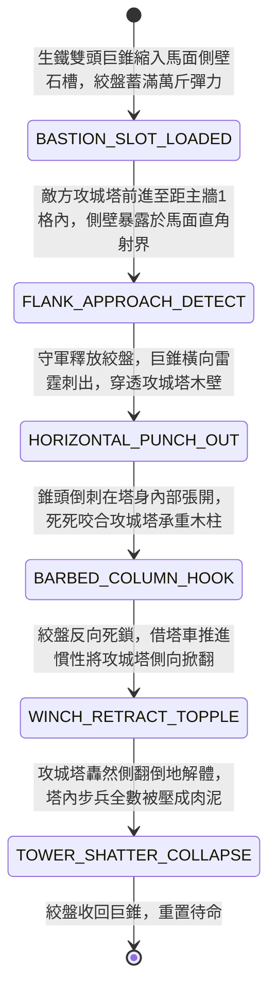

<!-- doc_id: doc_spec_0972 -->
# 城防城牆馬面暗置絞盤牽引生鐵雙頭巨錐穿刺敵軍攻城塔側壁狀態機規格書

> **文件編號**：`doc_spec_0972`
> **模組代碼**：`BASTION-TWIN-SPIKE-SIEGE-TOWER-PIERCE01`
> **對應 WBS**：`FORM-191`（M7 戰場進階機關、城防穿刺攻城塔與精銳步兵點鋼槍）
> **單一真相來源（SSOT）**：本文件直接定義城牆馬面生鐵雙頭巨錐穿刺攻城塔側壁之完整物理與戰鬥狀態機，嚴禁於檔尾附加補丁。

---

## 一、 戰術定位與歷史工程原型

在攻城戰中，敵軍推動高大的「臨衝呂公車（攻城塔，`doc_spec_0843`）」抵近城牆時，若讓其搭板搭上女牆，大批先登部隊將直接湧上城頭。傳統弓箭與輕投石難以摧毀攻城塔的厚重包皮木側壁。**城牆馬面暗置絞盤牽引生鐵雙頭巨錐（Bastion Twin-Spike Siege-Tower Piercer）** 為設於馬面側壁的「近距側向破壞重錐」：
1. **馬面暗室橫向滑軌**：於城牆凸出的馬面側壁內部開鑿一丈長的水平石槽，槽內安裝由重型棘輪絞盤牽引的生鐵雙頭破城巨錐（每錐長丈二、重八百斤，兩端鑄有三棱破甲尖）。
2. **側向直刺貫穿攻城塔木壁**：當敵軍攻城塔企圖貼近相鄰的主城牆女牆時，必定會將其脆弱的側壁暴露在馬面的側向射界內。守軍在暗室內釋放蓄滿配重與彈力的雙頭巨錐，巨錐橫向破孔而出，直接從側壁刺入攻城塔內部。
3. **破壁卡死與側向掀翻**：巨錐刺入攻城塔內部後，雙頭倒刺張開死死勾住攻城塔的主承重立柱；守軍透過後拉絞盤反向發力，連同攻城塔前進的慣性，直接將數萬斤的攻城塔在城下拉扯側翻傾覆。

---

## 二、 觸發條件與城防建造參數

| 參數項目 | 規格數值與限制條件 | 備註說明 |
| :--- | :--- | :--- |
| **部署位置限制** | 僅限城牆「馬面凸臺側壁（覆蓋相鄰主牆外側 `1 ~ 2 格`）」 | 專精側向伏擊貼近城牆之超大型木構器械 |
| **建造資源消耗** | 生鐵雙頭巨錐 140、重型配重絞盤 75、石槽滑軌 60、城防工事點 45 | 刺出後可絞盤收回重複使用（冷卻 `1 回合`） |
| **作用對象** | 「臨衝高樓 / 攻城塔 / 井闌 / 雙層衝車」 | 對單兵無效（純器械破壞巨錐） |
| **機關耐久（HP）** | `1,600` 點（藏於馬面厚石壁內，免疫地面常規攻擊） | 釋放瞬間無視攻城塔正面蒙皮防禦 |

---

## 三、 核心狀態機（State Machine）

---

## 四、 數值結算與戰鬥公式

### 1. 側向穿透與立柱破壞（Flank Penetration & Structural Shatter）
當攻城塔進入馬面側向攻擊格時，巨錐橫向直刺：
$$\text{Damage}_{\text{pierce}} = \text{BaseATK}_{\text{garrison}} \times 3.20 \times \left(1 - \text{TowerArmor} \times 0.20\right)$$
- **無視外層裝甲（Flank Bypass）**：由於攻擊的是攻城塔毫無蒙皮保護的側面，無視攻城塔正面 `80%` 的防禦減免。

### 2. 慣性側翻與內部步兵全滅（Inertial Topple & Crew Wipe）
- **強制側翻判定**：命中後以 `85%` 機率觸發 `SIEGE_TOWER_TOPPLED`，攻城塔永久倒地解體毀損。
- **內部部隊殲滅**：攻城塔內裝載的敵方先登突擊隊（最多 2 隊）隨塔倒塌，全體承受最大兵力 `80%` 的致死砸傷，剩餘兵力陷入重度眩暈。

---

## 五、 反制手段與戰術克制

1. **提前以重型投石轟塌馬面轉角**：若攻城方先以投石機轟塌馬面石壁，滑軌卡死將無法刺出。
2. **在攻城塔側面加掛生牛皮簾**：若攻城塔兩側預掛厚毛氈（`doc_spec_0945`），可吸收部分穿刺動能，側翻機率降至 `35%`。

---

## 六、 驗收測試案例（Acceptance Tests）

| 測試案例 ID | 測試情境與輸入條件 | 預期狀態轉移與數值輸出 |
| :--- | :--- | :--- |
| **TC-PIERCE-01** | 敵方滿載步兵之五層臨衝攻城塔抵近主牆，側面暴露於馬面側壁 | 雙頭巨錐刺出造成 3.2 倍破甲傷，85% 機率將攻城塔側向掀翻解體 |
| **TC-PIERCE-02** | 攻城塔側翻倒地，塔內 2 隊敵方先登步兵結算傷害 | 2 隊先登步兵各自承受 80% 最大兵力砸傷並附加眩暈 2 回合 |
| **TC-PIERCE-03** | 馬面石壁先遭敵軍投石機直接轟塌 | 巨錐卡死於瓦礫中，無法觸發 `HORIZONTAL_PUNCH_OUT` |
