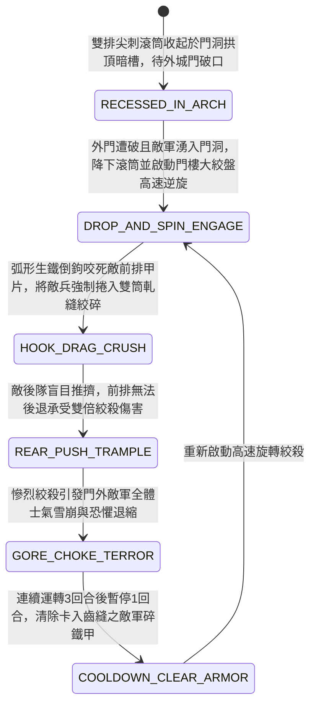

<!-- doc_id: doc_spec_0954 -->
# 城防城門內側絞盤牽引生鐵尖刺轉輪滾筒絞碎敵軍蟻附先鋒狀態機規格書

> **文件編號**：`doc_spec_0954`
> **模組代碼**：`GATE-SPIKED-ROTARY-DRUM-CRUSHER01`
> **對應 WBS**：`FORM-173`（M7 戰場進階機關、城防滾筒絞殺與精銳步兵拖刀迴旋斬）
> **單一真相來源（SSOT）**：本文件直接定義城門內側絞盤牽引生鐵尖刺轉輪滾筒絞碎敵軍先鋒之完整物理與戰鬥狀態機，嚴禁於檔尾附加補丁。

---

## 一、 戰術定位與歷史工程原型

在慘烈的城門爭奪戰中，當外層木製城門遭衝車撞破、大批敵軍先鋒步兵如潮水般湧入狹窄的「城門洞（Gate Tunnel）」時，傳統塞門刀車（`doc_spec_0909`）雖能被動堵路，卻無法主動持續絞殺湧入的敵軍。**城門內側絞盤牽引生鐵尖刺轉輪滾筒（Gate-Tunnel Spiked Rotary Drum Crusher）** 為守城方設於門洞中段的「主動機械絞肉機」：
1. **上下雙排生鐵狼牙巨滾筒**：於城門洞中段兩側石壁預鑿深槽，橫向嵌入上下兩根直徑三尺、長一丈二尺的實心硬木包鐵巨滾筒，滾筒表面交錯鍛接數百枚三寸長弧形生鐵倒鉤尖刺。
2. **門樓蓄水輪或八牛絞盤驅動**：滾筒兩端軸心透過穿牆鐵鏈與城門樓頂部的「八牛大絞盤（或高處蓄水重力水輪）」相連；一旦啟動，上下兩根尖刺滾筒便以相反方向高速對向旋轉（猶如現代碎石軋機）。
3. **捲入絞碎與血肉築牆**：湧入門洞的敵軍前排步兵在後隊盲目推擠下，瞬間被高速旋轉的弧形倒刺勾住衣甲捲入雙滾筒縫隙，連人帶甲被對向旋轉的千斤扭力絞碎；屍骸與碎甲堵塞滾筒下方，徹底截斷後續敵軍的衝鋒路線。

---

## 二、 觸發條件與城防建造參數

| 參數項目 | 規格數值與限制條件 | 備註說明 |
| :--- | :--- | :--- |
| **部署位置限制** | 僅限「城門洞內部格 / 甕城內門通道格」 | 必須預先安裝於門洞石槽，外門破口後自動接戰 |
| **建造資源消耗** | 生鐵 150、巨型硬木 90、熟鐵傳動鏈 65、城防工事點 45 | 每座城門洞限裝設 1 組雙排轉輪滾筒 |
| **運轉持續時間** | 啟動後可連續高速絞殺 `3 回合`（之後需冷卻 `1 回合` 清理卡死碎甲） | 運轉期間該門洞格成為敵軍不可穿越之「絞殺死地」 |
| **滾筒耐久（HP）** | `1,650` 點（實心包鐵結構，免疫弓箭與刀槍劈刺，鈍器減傷 `60%`） | 僅能以攻城衝車撞頭硬撞或火油長時間炙烤破壞 |

---

## 三、 核心狀態機（State Machine）

---

## 四、 數值結算與戰鬥公式

### 1. 對向逆旋捲入絞殺（Counter-Rotating Crush）
當敵方步兵或騎兵踏入裝有生鐵尖刺轉輪滾筒的城門洞格，或在門洞口與滾筒接戰時：
- **強制牽引鎖死**：滾筒表面的弧形倒鉤以 `100%` 機率咬住敵軍前排，附加 `ROTARY_DRUM_GRIPPED`（無法移動、無法撤退、閃避率歸零）。
- **無視護甲絞殺傷害**：雙筒對向軋壓直接粉碎甲葉，每回合造成極高機械撕裂與鈍擊複合傷害：
  $$\text{Damage}_{\text{drum}} = \text{BaseATK}_{\text{garrison}} \times 2.65 \times \left(1 + 0.25 \times \text{RearPushStacks}\right)$$
  （此傷害直接無視目標 `65%` 的物理防禦力 DEF）。

### 2. 後隊推擠加乘與恐懼震懾（Rear-Push Amplification & Terror）
- **後隊推擠效應（Rear-Push Stacks）**：若被捲入滾筒的敵軍身後緊貼著其他敵方部隊（每有 1 隊後續排隊敵軍，$\text{RearPushStacks} + 1$，上限 2 層），後隊的推擠力道會使前排敵兵更深地壓入尖刺滾筒，承受傷害額外提升 `25% ~ 50%`。
- **血霧恐懼（Gore Terror）**：每當有敵方部隊在滾筒格損兵超過 `30%`，門洞外 `2 格` 內的所有敵軍立即承受 `18` 點士氣打擊，並有 `45%` 機率附加 `TERRIFIED_HESITATION`（畏縮不前，下一回合無法執行前進指令）。

---

## 五、 反制手段與戰術克制

1. **塞入巨木或鐵塊卡死齒輪**：若攻城方派「重裝工兵」或推「撞錘衝車」將堅硬青岡巨木強行塞入雙滾筒縫隙，可使滾筒提前強制進入 `COOLDOWN_CLEAR_ARMOR`（卡死停機 1 回合）。
2. **攻佔城門樓切斷絞盤**：若敵軍先登死士從兩側城牆殺入城門樓頂層，砍斷絞盤傳動鐵鏈，滾筒將失去旋轉動力，僅保留普通塞門路障功能。

---

## 六、 驗收測試案例（Acceptance Tests）

| 測試案例 ID | 測試情境與輸入條件 | 預期狀態轉移與數值輸出 |
| :--- | :--- | :--- |
| **TC-DRUM-01** | 敵方精銳重甲步兵衝破外門踏入門洞格，身後緊跟 2 隊友軍推擠 | 觸發 `HOOK_DRAG_CRUSH`，無視 65% 防禦造成 $2.65 \times 1.50 = 397.5\%$ 絞殺傷害，且無法撤退 |
| **TC-DRUM-02** | 門洞內敵軍單回合損兵達 35%（`>30%`） | 觸發 `GORE_CHOKE_TERROR`，門外 2 格敵軍士氣 -18，並以 45% 機率陷入畏縮無法前進 |
| **TC-DRUM-03** | 敵方工兵消耗 1 回合將巨型柞木塞入轉輪滾筒縫隙 | 滾筒被硬木卡死，立即強制轉入 `COOLDOWN_CLEAR_ARMOR` 停機 1 回合 |
