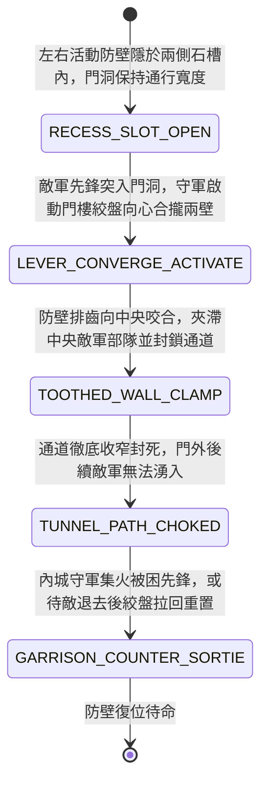

<!-- doc_id: doc_spec_0978 -->
# 城防城門內側絞盤牽引生鐵排齒活動防壁合攏阻滯突入門洞敵軍狀態機規格書

> **文件編號**：`doc_spec_0978`
> **模組代碼**：`GATE-CONVERGING-TOOTHED-WALL-BLOCK01`
> **對應 WBS**：`FORM-197`（M7 戰場進階機關、城防活動防壁合攏與精銳步兵雙頭槍）
> **單一真相來源（SSOT）**：本文件直接定義城門內側絞盤牽引活動防壁合攏阻滯門洞敵軍之完整物理與戰鬥狀態機，嚴禁於檔尾附加補丁。

---

## 一、 戰術定位與歷史工程原型

在城門防衛作戰中，一旦外層主城門失守，敵軍先鋒常企圖迅速穿過幽暗狹長的門洞進入內城。若僅靠直向落下的千斤閘，容易被敵軍以粗木或衝車硬撐。**城門內側絞盤牽引生鐵排齒活動防壁（Gate-Tunnel Converging Toothed-Wall Barrier）** 為設於門洞中段兩側石壁內部的「水平向心式機械合攏防壁」：
1. **兩側石壁暗藏滑軌活動厚鐵壁**：門洞左右兩側花崗岩牆體內預鑿深槽，各內嵌一扇長一丈、高丈二的厚重包鐵生鐵壁，壁面交錯凸出三寸厚的生鐵方牙排齒。
2. **門樓雙向絞盤水平推動合攏**：守軍在城門樓操作雙軸絞盤，兩扇防壁在鐵鏈牽引下沿地面水平滑軌同時向中央向心合攏，將門洞寬度由原先的一丈二尺迅速壓縮收攏至不足兩尺。
3. **機械夾擊阻滯與陣型封閉**：合攏過程直接攔截並夾滯處於兩壁之間的敵軍先鋒部隊，兩側排齒咬合封死通道，徹底切斷門洞內外敵軍的聯繫。

---

## 二、 觸發條件與城防建造參數

| 參數項目 | 規格數值與限制條件 | 備註說明 |
| :--- | :--- | :--- |
| **部署位置限制** | 僅限城門洞「中段石壁通道格（連續 `2 格` 縱深）」 | 兩側石壁需結構完好無塌陷 |
| **建造資源消耗** | 厚生鐵壁板 160、水平滑軌與齒條 80、城防工事點 45 | 合攏啟動需 `1 回合`，可手動拉開重置 |
| **通道壓縮幅度** | 門洞寬度由 `100%` 壓縮至 `15%`（寬度縮至 0.5 米） | 大部隊與衝車完全無法通行 |
| **機關耐久（HP）** | `2,400` 點（厚重純鐵結構，極度耐撞抗衝擊） | 免疫常規刀劍與火攻 |

---

## 三、 核心狀態機（State Machine）

---

## 四、 數值結算與戰鬥公式

### 1. 向心合攏夾滯與結構傷害（Converging Wall Clamp Damage）
當兩側防壁向中央合攏時，對處於門洞中央格的敵方部隊造成水平擠壓傷害：
$$\text{Damage}_{\text{clamp}} = \text{BaseATK}_{\text{garrison}} \times 2.40 \times \left(1 - \text{TargetDEF} \times 0.35\right)$$
- **100% 強制夾滯（Immobilized）**：被夾在兩壁間的敵軍單位附加 `TOOTHED_WALL_PINNED`，移動力歸零，無法發動普攻與戰法，持續 `2 回合`。

### 2. 門洞通道完全封阻（Chokepoint Absolute Denial）
- 防壁合攏後，該城門洞格化為「不可跨越之鐵壁障礙格（`IMPENETRABLE_IRON_BARRIER`）」，阻斷門外一切攻城步騎與器械的通行。

---

## 五、 反制手段與戰術克制

1. **塞入巨型實心石料阻礙合攏**：若攻城方先推入載滿巨石之重車卡在滑軌中，防壁無法完全閉合。
2. **攻城衝車撞頭正面頂住**：若衝車撞頭正對兩壁咬合處，粗大鐵撞頭可延緩防壁合攏速度。

---

## 六、 驗收測試案例（Acceptance Tests）

| 測試案例 ID | 測試情境與輸入條件 | 預期狀態轉移與數值輸出 |
| :--- | :--- | :--- |
| **TC-WALL-01** | 敵方突擊隊衝入門洞，守軍啟動防壁向心合攏 | 兩壁咬合，造成 2.4 倍結構傷害，100% 附加 `TOOTHED_WALL_PINNED` 定身 |
| **TC-WALL-02** | 防壁閉合後，門外後續敵方騎兵部隊試圖湧入 | 通道被封死為不可跨越障礙，後續敵軍無法穿過該格 |
| **TC-WALL-03** | 門洞內預先卡有巨石車輛阻礙滑軌 | 防壁受阻無法完全閉合，夾滯效果減半 |
