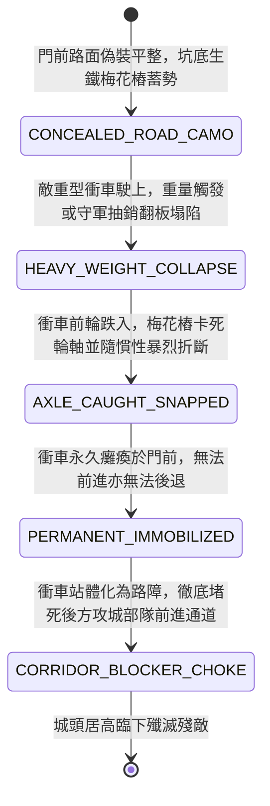

<!-- doc_id: doc_spec_0969 -->
# 城防城門外側深掘暗置絞盤翻板生鐵梅花樁陷阱折斷敵軍衝車輪軸狀態機規格書

> **文件編號**：`doc_spec_0969`
> **模組代碼**：`MOAT-GATE-TRAPDOOR-AXLE-SNAP01`
> **對應 WBS**：`FORM-188`（M7 戰場進階機關、城防斷軸陷阱與精銳步兵棗陽槊）
> **單一真相來源（SSOT）**：本文件直接定義城門外生鐵梅花樁陷阱折斷衝車輪軸之完整物理與戰鬥狀態機，嚴禁於檔尾附加補丁。

---

## 一、 戰術定位與歷史工程原型

在城池攻防中，敵軍推動重達數千斤的「雙層牛皮撞錘衝車（`doc_spec_0869`）」直撲城門時，若僅靠城頭拋石，常被衝車的弧形厚重木屋脊彈開。**城門外側深掘暗置絞盤翻板生鐵梅花樁陷阱（Moat-Gate Trapdoor & Plum-Spike Axle-Snap Pit）** 為針對超重型攻城車輛的「地基式斷軸絕殺陣」：
1. **城門前沿深坑與翻板偽裝**：於護城河吊橋內側至城門正前方一丈範圍內，向下深挖丈二深坑，上方鋪設以熟鐵橫軸支撐的翻板，板面覆蓋夯實黃土與碎石，偽裝與普通路面無異。
2. **坑底生鐵梅花樁陣列**：坑底澆築二十四根兩尺高、頂端呈凹字形卡齒的生鐵梅花短樁，專為卡扣車輪與輪軸而設計。
3. **重車壓陷與輪軸折斷癱瘓**：普通步兵走過時翻板受彈簧銷鎖定不翻；但當萬斤衝車碾上時，重力超過臨界值或由守軍抽開鎖銷，翻板瞬間塌陷，衝車前輪猛然跌入坑中，梅花樁直接頂碎衝車硬木輪輻並卡死生鐵輪軸，使其永久動彈不得，反化為阻擋後續敵軍的天然塞門障礙。

---

## 二、 觸發條件與城防建造參數

| 參數項目 | 規格數值與限制條件 | 備註說明 |
| :--- | :--- | :--- |
| **部署位置限制** | 僅限城門正前方「外側 `1 ~ 2 格` 通道格」 | 需在戰前防禦整備階段耗時深挖完成 |
| **建造資源消耗** | 生鐵梅花樁 120、巨木與轉軸 80、夯土石板 50、城防工事點 40 | 一旦觸發塌陷，該格化為「永久斷軸坑」 |
| **作用對象** | 「攻城衝車 / 井闌 / 盾車 / 裝甲重車 / 投石車」 | 對輕步兵可手動選擇是否放行或抽銷 |
| **機關耐久（HP）** | `1,800` 點（深坑土木結構，免疫一切常規攻擊） | 車輛卡死後，可由城頭持續傾瀉金汁與火矢 |

---

## 三、 核心狀態機（State Machine）

---

## 四、 數值結算與戰鬥公式

### 1. 輪軸折斷與永久定身（Axle Snapping & Permanent Immobilization）
當敵方攻城車輛（衝車、攻城塔等）移動至陷阱格時，觸發 `HEAVY_WEIGHT_COLLAPSE`：
- **毀滅性斷軸傷害**：巨大慣性撞擊生鐵梅花樁，對衝車造成極限結構剪切傷害：
  $$\text{Damage}_{\text{axle}} = \text{TargetMaxHP} \times 0.65 + \text{BaseATK}_{\text{garrison}} \times 2.0$$
- **100% 永久癱瘓**：敵方車輛直接附加 `AXLE_PERMANENTLY_SNAPPED`，移動力永久清零，且撞錘無法再觸及城門，攻城功能徹底報廢。

### 2. 塞門路障效應（Gate Chokepoint Blocker）
- 癱瘓在坑中的衝車殘骸具有實體碰撞體積，直接阻斷該格通路，敵軍後續的步騎部隊無法穿過該格，必須繞道或花費整整 `2 回合` 行動力拆除殘骸。

---

## 五、 反制手段與戰術克制

1. **工兵預先鋪設長木排跨越**：若攻城方先派工兵鋪設「加固防陷木排道（`doc_spec_0883`）」，可將重力分散至坑道兩側石沿，安全駛過陷阱。
2. **輕步兵肉身排雷**：攻城方若先驅使敢死輕步兵踏勘觸發抽銷，使陷阱提前暴露，後續車輛可及時避開。

---

## 六、 驗收測試案例（Acceptance Tests）

| 測試案例 ID | 測試情境與輸入條件 | 預期狀態轉移與數值輸出 |
| :--- | :--- | :--- |
| **TC-AXLE-01** | 敵方滿血撞錘衝車駛入城門前第 1 格偽裝陷阱 | 翻板塌陷，梅花樁 100% 扣除 65% 最大耐久，附加永久斷軸癱瘓 |
| **TC-AXLE-02** | 衝車斷軸卡在門前，身後敵方長槍隊試圖前進攻門 | 受癱瘓衝車阻擋，通道被堵死，後續敵軍無法穿過該格 |
| **TC-AXLE-03** | 敵方工兵提前在陷阱上方鋪設「雙軌加固木排道」 | 衝車重量被木排分散，平穩駛過未觸發塌陷斷軸 |
